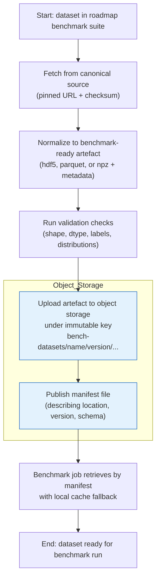

# Benchmark dataset retrieval assessment

## 1. Scope

This document assesses each dataset listed in the roadmap benchmark suite[^1]
and estimates:

- effort to automate download and preparation for benchmark use
- cached/prepared dataset size
- approximate retrieval cost from object storage (AWS S3, Scaleway Object
  Storage, and DigitalOcean Spaces)

Pricing and source checks were refreshed on 2026-03-02. Upstream HTTP range
support was probed on 2026-08-16 (§3.2.1).

## 2. Process

For each dataset, use this repeatable pipeline:

1. Fetch from canonical source using a pinned URL and checksum validation.
2. Normalize to one benchmark-ready artefact format (Hierarchical Data Format
   version 5 (HDF5; `.hdf5`), `.parquet`, or `.npz`) with metadata (`dataset`,
   version, schema, preprocessing hash).
3. Run validation checks (shape, dtype, label or ground-truth integrity, and
   basic distribution sanity checks).
4. Upload to object storage under an immutable key
   (`bench-datasets/<name>/<version>/...`) and publish a manifest file.
5. Retrieve by manifest in benchmark jobs, with local cache fallback.

For screen readers: The following flowchart shows the benchmark dataset
retrieval pipeline from canonical fetch through prepared artefact upload,
manifest publication, and benchmark-side retrieval with cache fallback.

_Figure 1: Benchmark dataset retrieval pipeline from source fetch to benchmark
consumption._

## 3. Shared implementation and infrastructure tasks

### 3.1. Shared retrieval crate and contracts

- Create a shared dataset retrieval crate (`chutoro-bench-datasets`) with a
  `DatasetRecipe` abstraction (`fetch`, `validate`, `prepare`, `publish`). See
  `docs/adrs/adr-0004-bench-dataset-recipe-trait.md` for the typed handoff and
  port-boundary decision.
- Standardize integrity checks (SHA-256 checksums, optional signatures, and
  explicit source URL pinning).
- Normalize all prepared datasets to a canonical schema:
  `features`, optional `labels`, optional `ground_truth`, and an immutable
  `manifest.json`.
- Version preprocessing so model-dependent transforms (for example CIFAR
  embeddings) are hash-addressed and reproducible.

Only a pinned SHA-256 digest of the transferred bytes establishes integrity.
Validators such as `ETag` and `Last-Modified` answer a different question:
whether the representation is the one the client started reading. Neither is a
digest of content, and neither is an integrity pin (see
[RFC 9110 §13.1.5](https://www.rfc-editor.org/rfc/rfc9110.html#section-13.1.5)).

Pins live with the recipe, not with the manifest. `SourceSpec` now carries an
optional parsed `Checksum`, so a recipe can record the digest its source should
match before any manifest exists. Roadmap item 10.1.3 later serializes those
same pins into the canonical `manifest.json`; the manifest records the pin
rather than being its authority.

Checksum parsing exists; pin verification does not. `Checksum` pairs a
`DigestAlgorithm::Sha256` tag with a 32-byte digest, and `Checksum::parse`
accepts canonical `sha256:<hex>` text and returns a `Checksum`, or a typed
`RecipeError::Integrity` failure for a malformed value. Parsing validates only
the textual form; it does not hash or verify downloaded bytes, and fetch-time
verification remains part of roadmap item 10.1.2.

ETags are validators, not integrity pins. The ANN-Benchmarks hosts return S3
multipart ETags such as `"2bf1ef4c0c3e17031bd64980774eea09-63"` and
`"c4aecb89b5369bc649bacb0b3ec3be4b-115"` (see
[§3.2.1](#321-upstream-range-support-evidence-2026-08-16)). The value is a
digest of per-part digests with the part count appended after a hyphen. Such an
ETag is syntactically strong because it has no `W/` prefix, so RFC 9110 §13.1.5
permits it in `If-Range` and it is valid for resume validation. It still says
nothing verifiable about the bytes: two byte-identical objects uploaded with
different part sizes receive different ETags. The MNIST mirror's single-part,
MD5-like ETag `"f68b3c2dcbeaaa9fbdd348bbdeb94873"` is no better. It is opaque
server metadata rather than a published commitment, and an MD5 digest would not
satisfy the SHA-256 requirement. Integrity comes only from the pinned SHA-256
value.

### 3.2. Transport, cache, and object storage

- Add resumable transfer support with retry and backoff plus partial-download
  cleanup logic, following the resume-safety requirements in
  [§3.2.2](#322-resume-safety-requirements).
- Implement object-store adapters via Rust `object_store`[^2] to support AWS S3
  and S3-compatible endpoints (Scaleway and DigitalOcean) with the same code
  path, including endpoint override support from `AmazonS3Builder`.[^3]
- Add local cache index and lockfile controls to prevent duplicate preparation
  work across concurrent matrix jobs.
- Keep manifest serialization and lock acquisition in pure helpers with
  canonical field ordering, stable hash inputs, and explicit lock states, so
  property tests can verify manifest canonicalization, duplicate-preparation
  suppression, and lock release after failure.
- Treat archive extraction as `.gz`, `.bz2`, `.xz`, and `.tar`, with
  `ArchiveFormat::None` adopting bare downloads in place; `.zip` is out of
  scope for 10.1.2 and 10.3.10 (see
  [ADR 008](adrs/adr-0008-glove-source-and-zip-scope.md)).

#### Staging lock semantics

Concurrent matrix jobs that prepare the same dataset must exclude each other
while a partial download is appended, committed, or discarded. The
`chutoro-bench-datasets` `http` feature therefore provides an advisory staging
lock. The governing decision is
[`ADR-009`](adrs/adr-0009-staging-lock-via-rustix-flock.md).

- The lock file is a stable, relative `.lock` file inside the cache root. It is
  created if missing, opened without truncation, and never removed or renamed.
- Acquisition uses a non-blocking exclusive `flock` in a bounded loop. A hard
  timeout and a single warning on first contention stop a dead holder from
  wedging every other job.
- `flock` is advisory and per open file description. On NFS and overlay mounts
  the filesystem may not honour it, so the cache root must be a local
  filesystem. In-process double acquisition is caught by a process-wide
  registry rather than by `flock`.
- The staging lock is not the roadmap 10.1.5 cache index or lockfile. It
  excludes writers to one staging artefact only; it does not deduplicate recipe
  preparation, index cache entries, or coordinate object-store publication.

#### 3.2.1. Upstream range-support evidence (2026-08-16)

On 2026-08-16 the upstreams this project downloads from, or has committed to
downloading, were probed with one `Range: bytes=100-199` request. All three
returned `206 Partial Content`.

| Source                                                                  | `Content-Range`           | `Accept-Ranges` | `ETag`                                   | `Content-Encoding` |
| ----------------------------------------------------------------------- | ------------------------- | --------------- | ---------------------------------------- | ------------------ |
| `ann-benchmarks.com/sift-128-euclidean.hdf5`                            | `bytes 100-199/525128288` | `bytes`         | `"2bf1ef4c0c3e17031bd64980774eea09-63"`  | absent             |
| `ann-benchmarks.com/glove-200-angular.hdf5`                             | `bytes 100-199/962819488` | `bytes`         | `"c4aecb89b5369bc649bacb0b3ec3be4b-115"` | absent             |
| `storage.googleapis.com/cvdf-datasets/mnist/train-images-idx3-ubyte.gz` | `bytes 100-199/9912422`   | `bytes`         | `"f68b3c2dcbeaaa9fbdd348bbdeb94873"`     | absent             |

_Table 1: Responses to `Range: bytes=100-199` on 2026-08-16._

The third row is the mirror already selected by
`chutoro-benches/src/source/mnist/mod.rs`: the default `MnistConfig::base_url`
is `https://storage.googleapis.com/cvdf-datasets/mnist`, and the helper appends
`train-images-idx3-ubyte.gz`.

The evidence is point-in-time and bounded:

- The sibling test file `t10k-images-idx3-ubyte.gz` was not probed.
- SIFT and GloVe ingestion is planned, but this checkout has no downloader for
  either, so the two ANN-Benchmarks rows describe hosts a future recipe will
  use rather than a code path that exists today.
- One request per host does not prove that a host keeps the same validator
  across an hours-long transfer, nor that an intermediary never adds a content
  coding.
- The probe exercised `Range`, not `If-Range`. It does not demonstrate
  end-to-end resume, so the re-probe must also cover matching and mismatching
  validators.

The evidence must be re-probed before roadmap item 10.1.2 relies on it.

The impact is that resumable transfer has a working primary path on real
sources, not merely a fallback that no live host exercises. A ranged request
can be validated against a strong `ETag` with `If-Range` and appended at the
durable offset. If a host later lacks range support, or presents only a weak
validator, the implementation must fall back to a full-representation download
and rewrite the file (see [§3.2.2](#322-resume-safety-requirements)). The
integrity consequence of these validators is recorded in
[§3.1](#31-shared-retrieval-crate-and-contracts).

#### 3.2.2. Resume-safety requirements

The following rules are requirements for roadmap item 10.1.2. They describe
behaviour to implement, not behaviour present in this checkout.

- Use `If-Range` only with a strong validator, and use an HTTP-date only when
  the client has no entity tag for the representation. RFC 9110
  [§13.1.5](https://www.rfc-editor.org/rfc/rfc9110.html#section-13.1.5) forbids
  a weak entity tag in `If-Range`, and permits an HTTP-date only when the
  client has no entity tag and the date is a strong validator. A client holding
  a weak `ETag` and a strong `Last-Modified` date must use neither; it starts
  fresh.
- Treat `Accept-Ranges` as advisory (RFC 9110
  [§14.3](https://www.rfc-editor.org/rfc/rfc9110.html#section-14.3)). Never
  gate a range request on it, and always handle a full-representation response.
- Validate `Content-Range` against the durable offset and the expected
  representation length before appending anything (RFC 9110
  [§14.4](https://www.rfc-editor.org/rfc/rfc9110.html#section-14.4)). The
  appended range must start at the next byte required, and the complete length
  must agree with the pinned expectation.
- Never recombine a malformed range. A `Content-Range` whose `last-pos` is less
  than its `first-pos`, or whose complete length is less than or equal to
  `last-pos`, is invalid under RFC 9110 §14.4, and the received content must be
  discarded.
- Truncate to zero and rewrite when a ranged request receives a full
  representation (RFC 9110
  [§14.2](https://www.rfc-editor.org/rfc/rfc9110.html#section-14.2) and
  §13.1.5). The server either ignored the range or the representation changed;
  this is the normal fallback, not an error.
- Disable resume for any URL whose response carries `Content-Encoding`. RFC
  9110 [§14.1.2](https://www.rfc-editor.org/rfc/rfc9110.html#section-14.1.2)
  calculates byte offsets against the encoded octet stream, and on-the-fly
  compression is not byte-stable across requests, so offsets learned from one
  response cannot address another.
- Disable automatic decompression in the HTTP adapter. If the adapter decodes
  the body, the client's offsets no longer refer to the octet stream that the
  server ranged over.

HTTP content coding is not a file format. A `.gz` file served with an identity
content coding is an octet stream whose byte offsets are stable, so it remains
resumable; decompressing it is a separate extraction step performed after the
transfer completes. The rule above disables resume only when the HTTP response
itself is encoded, for example with `Content-Encoding: gzip`, which is not the
same as serving a gzip file.

The detailed resume state machine, including its full-representation,
unsatisfiable-range, and no-progress branches, is specified in the
[10.1.2 shared download primitives ExecPlan](https://github.com/leynos/chutoro/blob/10-1-2-shared-download-primitives/docs/execplans/10-1-2-shared-download-primitives.md)
(draft, on branch `10-1-2-shared-download-primitives`, PR #199). The ExecPlan
is not present on this branch.

### 3.3. Governance and telemetry

- Enforce provenance and licence metadata gates; fail fast when an upstream
  dataset requires interactive or legal steps.
- Emit preparation telemetry (download seconds, transform seconds, compressed
  and expanded bytes, and checksum outcomes).

## 4. Matrix benchmark framework and result publication

### 4.1. Execution mechanism

Recommended implementation mechanism:

- Keep `criterion`[^4] for benchmark timing, confidence intervals, and baseline
  comparisons.
- Add a dedicated Rust orchestration binary (for example
  `chutoro-bench-matrix`) that:
  - reads a declarative matrix spec (`benchmarks/matrix.toml`) across
    dataset/version, chutoro backend, metric, and profile (`smoke`, `cpu`, and
    `scale`),
  - resolves prepared dataset artefacts required by the manifest,
  - executes benchmark tuples with deterministic seeds,
  - records tuple-level run metadata.
- Use `cargo-criterion --message-format=json`[^5] for machine-consumable
  benchmark events.
- Keep matrix expansion, tuple-id derivation, and profile filtering as pure
  functions over the parsed spec, so property tests can assert deterministic
  expansion across reordered TOML tables and repeated runs.

### 4.2. Publishable result schema

Convert benchmark outputs into:

- `results.jsonl` (per-tuple raw records)
- `summary.parquet` (analytics-friendly summary)
- `report.md` (human-readable publishable report)

Tuple identifiers and object keys should be canonicalized from
dataset/version/backend/metric/profile/git SHA, so publication helpers can
reject duplicate or non-canonical keys before upload. This should remain a
property-tested pure helper rather than ad hoc string concatenation at the
upload boundary.

### 4.3. Object-store persistence model

Persist run artefacts and baseline references in object storage:

- `bench-results/<run-id>/...`
- `bench-results/baselines/<dataset>/<backend>/<metric>/latest.json`

This design keeps benchmark logic in Rust and avoids shell-only orchestration
while preserving reproducibility and publishability.

## 5. Cost model

Retrieval cost is modelled as:

`cost ~= egress_cost + request_cost`

Assumptions:

- These are retrieval-only estimates (not storage-at-rest).
- Sizes are presented in gibibytes (GiB, `2^30` bytes).
- Provider egress list prices are quoted in decimal gigabytes (GB, `10^9`
  bytes). For rough planning estimates, this document treats `1 GiB ~= 1 GB`.
- Numbers below are marginal egress costs (assume included transfer quotas are
  already exhausted).
- AWS request charge for `GET` is included as a note; it is negligible for the
  object counts expected here.

Provider pricing inputs used:

- AWS S3 Standard (US East): data transfer out to internet `$0.09/GB`
  (first 10 TB), `GET` `$0.0004` per 1,000 requests.[^6]
- Scaleway Object Storage: requests included; egress `75 GB` free every month,
  then `EUR0.01/GB`.[^7]
- DigitalOcean Spaces: `1,024 GiB` outbound included per subscription; outbound
  overage `$0.01/GiB`; no separate standard per-request retrieval fee listed on
  Spaces pricing docs.[^8]

Included-transfer notes:

- AWS lists a `100 GB` per month free transfer allowance to internet on the S3
  pricing page.[^6]
- Scaleway includes `75 GB` per month egress.[^7]
- DigitalOcean Spaces includes `1,024 GiB` per month outbound transfer.[^8]

For matrix jobs, retrieval cost scales approximately with:

`dataset_size_gib * number_of_tuples_that_pull_dataset * provider_egress_rate`

In practice, local worker cache hits reduce this significantly when tuple
ordering groups by dataset.

## 6. Dataset assessments

Effort scale:

- `XS`: fully scriptable, <0.5 day
- `S`: scriptable, ~1 day
- `M`: scriptable with non-trivial preprocessing, 1-3 days
- `L`: partially gated and/or heavier pipeline, 3-5 days
- `XL`: very large-scale operational pipeline, ~1-2 weeks+

| Dataset                                            | Automatability and prep effort                                                                                               | Cached/prepared size (gibibytes, GiB)                   | AWS S3 retrieval (USD) | Scaleway retrieval (EUR) | DigitalOcean retrieval (USD) |
| -------------------------------------------------- | ---------------------------------------------------------------------------------------------------------------------------- | ------------------------------------------------------: | ---------------------: | -----------------------: | ---------------------------: |
| `make_blobs`                                       | Fully automatable synthetic generation. No external download. `XS`.                                                          | 0.000                                                   | 0.000                  | 0.000                    | 0.000                        |
| MNIST digits                                       | Fully automatable (prefer approximate nearest neighbour (ANN) HDF5 packaging). `S`.                                          | 0.212                                                   | 0.019                  | 0.002                    | 0.002                        |
| Fashion-MNIST                                      | Fully automatable with direct IDX links and checksums. `S`.                                                                  | 0.212                                                   | 0.019                  | 0.002                    | 0.002                        |
| CIFAR-10 / CIFAR-100                               | Fully automatable downloads; medium prep to produce fixed embeddings. `M`.                                                   | 0.228 (both)                                            | 0.021                  | 0.002                    | 0.002                        |
| 20 Newsgroups                                      | Fully automatable via `fetch_20newsgroups`; medium prep for text vectorization. `M`.                                         | 0.027 (384d embeddings)                                 | 0.002                  | 0.000                    | 0.000                        |
| RCV1-v2                                            | Fully automatable via `fetch_rcv1`; larger sparse-to-dense prep. `M-L`.                                                      | 1.151 (384d embeddings)                                 | 0.104                  | 0.012                    | 0.012                        |
| SNAP com-Amazon                                    | Fully automatable download; medium graph-to-vector prep. `M`.                                                                | 0.160 (128d embeddings)                                 | 0.014                  | 0.002                    | 0.002                        |
| SNAP com-DBLP                                      | Fully automatable download; medium graph-to-vector prep. `M`.                                                                | 0.151 (128d embeddings)                                 | 0.014                  | 0.002                    | 0.002                        |
| Peripheral blood mononuclear cell (PBMC) 68k (10x) | Source page is lead-form gated; pipeline is only partly automatable end-to-end. `L`.                                         | 0.013 (50d principal component analysis (PCA) + labels) | 0.001                  | 0.000                    | 0.000                        |
| GloVe word vectors                                 | Fully automatable via ANN-Benchmarks HDF5; no extraction or projection. `S`.                                                 | 0.896 (GloVe-200 HDF5)                                  | 0.081                  | 0.009                    | 0.009                        |
| SIFT1M                                             | Fully automatable via ANN-Benchmarks HDF5. `S`.                                                                              | 0.489                                                   | 0.044                  | 0.005                    | 0.005                        |
| GIST1M                                             | Fully automatable via ANN-Benchmarks HDF5. `S-M`.                                                                            | 3.600                                                   | 0.324                  | 0.036                    | 0.036                        |
| DEEP1B / BigANN                                    | Automatable but operationally heavy (multi-hundred-GB artefacts, resumable download, sharded upload, long validation). `XL`. | 89.4-476.8 (1B vectors, uint8 to float32)               | 8.046-42.912           | 0.894-4.768              | 0.894-4.768                  |

_Table 2: Dataset preparation effort, cache size, and approximate one-time
retrieval cost by provider._

## 7. Dataset-specific implementation tasks for suite and matrix readiness

### 7.1. `make_blobs`

- Implement deterministic recipe presets (seed, centres, anisotropy,
  imbalance, and noise).
- Export generated features and labels into canonical artefact format and
  manifest it like external datasets.
- Register tuples in `smoke` profile for quick backend parity checks.

### 7.2. MNIST digits

- Add pinned IDX downloader and checksum verifier.
- Convert to canonical dense array artefact with labels and benchmark metadata.
- Register `smoke` and `cpu` tuples with ARI, NMI, and recall outputs.

### 7.3. Fashion-MNIST

- Reuse MNIST ingestion flow with separate source URLs and checksums.
- Validate class-label mapping consistency with manifest metadata.
- Register as a harder small-scale profile tuple alongside MNIST.

### 7.4. CIFAR-10 / CIFAR-100

- Add deterministic image embedding pipeline (frozen model revision and
  config).
- Store prepared embeddings and labels with preprocessing hash in the manifest.
- Register separate tuples for CIFAR-10 and CIFAR-100 class granularity.

### 7.5. 20 Newsgroups

- Add deterministic text cleaning, tokenization, and embedding recipe.
- Cache vectors and topic labels in canonical schema; persist recipe version.
- Add `cpu` profile tuples with topic recovery metrics.

### 7.6. RCV1-v2

- Add fetch and normalization for multilabel targets.
- Implement sparse-to-dense projection recipe with fixed dimensionality and a
  checksum of transform configuration.
- Register long-running tuples in `cpu` profile with multilabel-aware scoring.

### 7.7. SNAP com-Amazon

- Add graph ingestion with deterministic node ordering and parsing validation.
- Build and cache node embeddings with pinned hyperparameters.
- Add tuples that evaluate community recovery and graph-quality metrics.

### 7.8. SNAP com-DBLP

- Mirror SNAP ingestion and embedding flow for DBLP graph files.
- Preserve overlapping-community label structures in prepared artefacts.
- Register graph profile tuples parallel to com-Amazon for regression diffs.

### 7.9. PBMC 68k (10x Genomics)

- Define internal mirrored-source ingestion because the upstream path is
  interactive and lead-form gated.
- Add a fixed preprocessing chain (normalization, highly variable gene
  selection, and PCA) with explicit version hash.
- Gate matrix execution on provenance confirmation metadata.

### 7.10. GloVe vectors

- Fetch the four ANN-Benchmarks HDF5 files `glove-{25,50,100,200}-angular.hdf5`
  from <https://ann-benchmarks.com/>. They carry the Stanford Twitter 27B
  vectors (2B tweets, 27B tokens, 1.2M vocabulary) and are adopted in place with
  `ArchiveFormat::None`; no archive extraction is required.
- Pin a first-party SHA-256 digest for each file in the repository checksum
  manifest and verify it on every fetch. Do not use the MD5 values published
  with the Zenodo reproducibility artefact.
- Validate 1,183,514 train rows and 10,000 test rows, `train`/`test` widths
  equal to the dimension in the filename, finite coordinates, non-zero row
  magnitude, and `neighbors`/`distances` shapes of `(10000, 100)`. The
  published files carry only the `distance=angular` attribute, so derive the
  dimension from the dataset shapes and check dtypes from the datasets instead
  of requiring `type`, `dimension`, or `point_type`. The files carry no tokens,
  so no tokenizer or projection step applies.
- Adopt in place only at `fetch`: map `train` to `features` and the
  `neighbors`/`distances` pair to `ground_truth` during `prepare`, then emit
  the immutable manifest at `publish`. A cached download alone is not a
  prepared artefact.
- Retain sampled subsets for smoke runs and register angular-distance tuples
  for `cpu` and `scale` profiles.
- Licence: `PDDL-1.0`. The `glove.6B.zip` Wikipedia/Gigaword bundle is not
  used because it is a different corpus, has a 400K vocabulary, and omits the
  25-dimensional vectors. See
  [ADR 008](adrs/adr-0008-glove-source-and-zip-scope.md).

### 7.11. SIFT1M

- Integrate ANN-Benchmarks HDF5 ingestion with ground-truth validation.
- Convert or expose data in benchmark suite schema while preserving exact
  neighbours.
- Register recall-focused tuples across backends in `cpu` and `scale`
  profiles.

### 7.12. GIST1M

- Integrate ANN-Benchmarks ingestion for high-dimensional vectors.
- Add preparation-time and run-time memory guards to avoid host overcommit.
- Register `scale` tuples on runners meeting documented memory thresholds.

### 7.13. DEEP1B / BigANN

- Implement sharded ingestion pipeline for 1M, 10M, 100M, and 1B subsets.
- Use multipart and resumable object-store uploads plus per-shard checksum
  manifests.
- Partition matrix runs by scale profile and dedicated runner class to keep
  jobs bounded and reproducible.

## 8. Notes on size estimates

- MNIST, Fashion-MNIST, SIFT1M, GIST1M, and GloVe-200 use published
  ANN-Benchmarks HDF5 sizes.[^9]
- `make_blobs` sizing is based on generated arrays from the canonical
  scikit-learn API.[^10]
- CIFAR assumes a one-time fixed image embedding step and caching both
  CIFAR-10 and CIFAR-100 in 512d float32 vectors.[^11]
- 20 Newsgroups and RCV1 assume caching dense 384d float32 embeddings for
  repeatable ANN or clustering runs.[^12][^13]
- SNAP datasets assume caching 128d float32 node embeddings plus labels.[^14]
- PBMC assumes caching 50d PCA embeddings plus cell-type labels.[^15]
- DEEP1B or BigANN range is computed from datatype and dimensionality in
  Big-ANN specifications: `1B * dims * bytes-per-dim`.[^16]

## 9. Key risks and recommendations

- PBMC 68k is the least automation-friendly source because the 10x dataset page
  is form-gated; keep a mirrored internal artefact and treat it as controlled
  input.
- DEEP1B or BigANN should use chunked transfers and manifest-level checksums,
  then sharded object keys to avoid very large single-object retries.
- For recurring benchmark jobs, retrieval cost is dominated by egress. Request
  charges are usually negligible compared with transfer.

## 10. References

[^1]: Roadmap dataset list and benchmark tiers: repository-local
  `docs/roadmap.md` section "Benchmark dataset suite".
[^2]: Rust `object_store` crate:
  <https://docs.rs/object_store/latest/object_store/>.
[^3]: `AmazonS3Builder` endpoint configuration:
  <https://docs.rs/object_store/latest/object_store/aws/struct.AmazonS3Builder.html>.
[^4]: Criterion command-line options:
  <https://bheisler.github.io/criterion.rs/book/user_guide/command_line_options.html>.
[^5]: `cargo-criterion` JSON message output:
  <https://bheisler.github.io/criterion.rs/book/cargo_criterion/external_tools.html>.
[^6]: AWS S3 pricing: <https://aws.amazon.com/s3/pricing/>.
[^7]: Scaleway storage pricing:
  <https://www.scaleway.com/en/pricing/storage/>.
[^8]: DigitalOcean Spaces pricing:
  <https://docs.digitalocean.com/products/spaces/details/pricing/>.
[^9]: ANN-Benchmarks dataset table:
  <https://github.com/erikbern/ann-benchmarks>.
[^10]: scikit-learn `make_blobs`:
  <https://scikit-learn.org/stable/modules/generated/sklearn.datasets.make_blobs.html>.
[^11]: CIFAR-10 and CIFAR-100 dataset page:
  <https://www.cs.toronto.edu/~kriz/cifar.html>.
[^12]: scikit-learn `fetch_20newsgroups`:
  <https://scikit-learn.org/stable/modules/generated/sklearn.datasets.fetch_20newsgroups.html>.
[^13]: scikit-learn `fetch_rcv1`:
  <https://scikit-learn.org/stable/modules/generated/sklearn.datasets.fetch_rcv1.html>.
[^14]: SNAP dataset pages:
  <https://snap.stanford.edu/data/com-Amazon.html> and
  <https://snap.stanford.edu/data/com-DBLP.html>.
[^15]: PBMC 68k dataset landing page (lead-form gate):
  <https://www.10xgenomics.com/datasets/fresh-68-k-pbm-cs-donor-a-1-standard-1-1-0>.
[^16]: Big-ANN benchmark dataset specifications:
  <https://big-ann-benchmarks.com/neurips21.html>.
