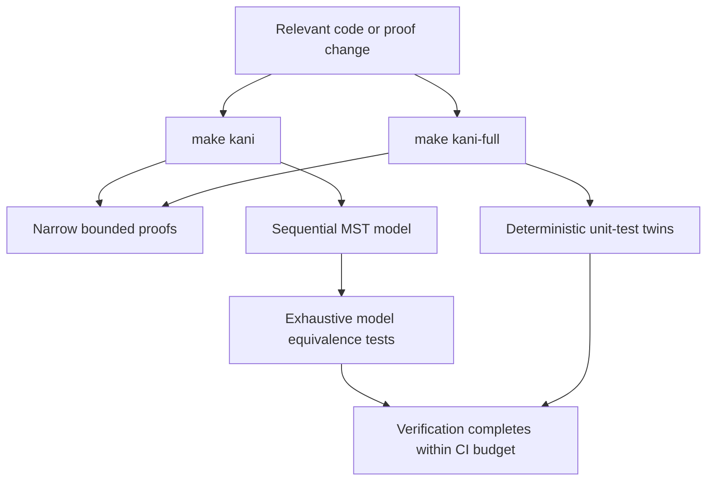

# Developers guide

This guide collects day-to-day practices for contributors working on the
Chutoro codebase. It complements the more specialized documents in `docs/` and
keeps operational guidance in one place.

## Rust toolchain and build routing

The workspace pins stable Rust 1.99.1 in `rust-toolchain.toml` and declares
Rust 1.89 as its minimum supported Rust version (MSRV). Every standard Cargo
gate runs on that stable pin and reads `.cargo/config.toml`, which supplies the
documentation-warning flags and, on Linux, the `mold` linker.
[The build standard](#the-build-standard) describes those recipes and the
contract tests that hold them.

Kani and Verus sit outside that statement: each verifier runs on the toolchain
its own release requires. Provisioning is delegated to the pinned
`rust-prover-tools` package rather than a repository script, so
`make install-kani` and `make install-verus` provision from it,
`make kani-check` reads the installed version through it, and `make verus` runs
the proofs through it. `make kani` does not delegate: it invokes
`$(CARGO) kani` directly, since `cargo-kani` is the verifier's own front-end.
Whitaker is the third exception to the pinned stable toolchain: it runs under
the toolchain its own installer manages. None of the three is selected through
the development fragment, so this does not weaken the Cranelift boundary below.

Cranelift is an opt-in development-speed route, not the default build. It
requires a nightly toolchain, so it stays behind the explicit `dev-build` and
`dev-test` targets and never reaches a merge gate. The route selects the
fragment in `tools/dev-fast/config.toml`, pinned to the dated nightly in
`tools/dev-fast/TOOLCHAIN`. On Linux the fragment selects GCC as the linker
driver and `mold` 2.41.0 as the linker. It lives outside Cargo's automatic
configuration paths and is reachable only through the `--config` argument in
the Makefile's `DEV_CARGO`, so installing the nightly components alone does not
activate it.

`make install-dev-fast` installs `rustfmt`, Clippy, `rust-analyzer`, and the
Cranelift backend component, then the checksum-verified `mold` 2.41.0 archive
on Linux x86_64 and aarch64 hosts. Provide GCC 12.1 or later on Linux, because
earlier releases reject `-fuse-ld=mold`. It does not install `cargo-nextest`,
which `dev-test` and `test` both need: run `scripts/install-nextest.sh`, the
checksum-verified installer listed under [tool installers](#tool-installers),
before either route.

A matching digest proves only that the download is the file the pin names, not
that the file is fit to install. `scripts/install-mold.sh` therefore checks
every member the linker route needs, and probes both binaries' reported
version, in its staging directory before copying into the prefix. Validating
after the copy would leave a truncated or stale tree installed, and the next
run would reuse it because the warm-install check probes the same paths. The
script shares `scripts/lib/pinned-download.sh` with the CI installers, so its
version and digest are read through the same fail-closed helper rather than by
a private copy of that logic.

[ADR-005](adrs/adr-0005-cranelift-opt-in-development-route.md) records why the
route is opt-in rather than the development-profile default, and what keeps it
out of every merge gate. Each development target validates the host probe
before using it. The probe is captured once with its exit status, because a
`?=` default over `$(shell uname -s)` is recursively expanded and would re-run
the command on every reference; a recipe could then pass one answer to its
check and select its flags from another. An empty value reads as "not Linux"
everywhere it is tested, and a probe that answers but exits non-zero is refused
too, so neither case can silently drop the linker selection. `DEV_FAST_HOST_OS`
remains overridable for a host whose `uname` cannot run.

The exit status is appended by the probe's own shell rather than read back from
`.SHELLSTATUS`. That variable reports whichever `$(shell)` call ran last, so a
read back is correct only while no other call intervenes between the probe and
the read — an ordering this file satisfies today only because `BUILD_HOST_OS`'s
call comes further down. Appending the status inside the probe binds it to its
own answer, so adding a shell call above or below cannot silently retarget the
check.

Reading the pin is fallible in the same silent way. `$(file <…)` yields nothing
for a missing file and strips to nothing for an empty one, and `cargo +` with
nothing after it falls back to the default toolchain;
`rustup toolchain install` with an empty name does the same. Each development
recipe therefore starts with `$(DEV_FAST_CHECK)`, which refuses an empty read
through `$(error …)` before any command runs. The check is per recipe rather
than a file-wide `$(error)` for the same reason the host probe's is: the
standard gates parse `DEV_FAST_TOOLCHAIN` too, and a broken development pin
must not fail them.

`dev-build` compiles the binary and `dev-test` runs `cargo-nextest`, both
through `DEV_CARGO`. Nextest starts a separate Cargo invocation to compile
tests and does not inherit the outer Cargo configuration, so `dev-test` passes
the fragment before `nextest` and again to `nextest run`. Both routes assign
`RUSTFLAGS`, appending their flags to any inherited value with
`$${RUSTFLAGS:+$$RUSTFLAGS }` rather than replacing it. The assignment is what
makes them repeat the fragment's own rustflags: assigning `RUSTFLAGS` makes
Cargo ignore every `rustflags` table, including the fragment's, so the
documentation denials and the Linux linker flag are restated on the route;
`dev-test` adds `-D warnings` for its test run. The other standard Make
targets—`build`, `test`, `typecheck`, `lint-clippy`, `release`, formatting,
coverage, Kani, Verus, benchmarks, and Whitaker—do not select the fragment and
need neither the nightly toolchain nor Cranelift, so CI provisions nothing
extra for them. `mold` is not one of those development-only prerequisites: the
Linux `rustflags` table in `.cargo/config.toml` links with it, and the standard
`build`, `test`, `typecheck`, and `lint-clippy` recipes restate that flag in
`STANDARD_LINKER_FLAGS`, so a Linux host needs `mold` for the standard targets
as well. Outside Linux the fragment leaves the platform linker selected.

The backend cannot unwind a panic taken while a write guard is alive. Ordinary
unwinding still works: a plain `catch_unwind(|| panic!())` unwinds normally. A
test that wants to observe lock poisoning must panic while the guard is held
and catch that unwind, and under Cranelift the attempt aborts the process with
`fatal runtime error: failed to initiate panic, error 5` instead of unwinding.
`dev-test` therefore excludes exactly one case, the poisoned-lock regression in
`hnsw::cpu::test_helpers::tests`, through `DEV_TEST_FILTER`. The standard
`test` gate is on the stable pin and keeps no such exclusion, so the regression
runs at the merge gate; the development route only gives up its own accelerated
copy.

nextest treats an exclusion that matches nothing as an empty match rather than
an error, so the filter string must name a case that really exists at that path.
`rust_declaration_reading.declared_in_module` reads
`chutoro-core/src/hnsw/cpu/test_helpers.rs` to check that it does, and it
accepts only a declaration *directly* inside a top-level `mod tests`. A case
moved into a nested module has a longer path than the filter names, so that
move is a missing exclusion too. The reading blanks comments and literals
through `rust_source_reading`, this suite's single Rust lexer, before counting
braces; a brace inside a string or character literal would otherwise end the
module span early and hide the declaration.

`rust_declaration_reading` owns one question — is this name declared at this
module's own level — and no other. Its only call-site is
`dev_fast_routing_test.py`, and nothing outside `tests/workflow_contracts` may
import it. It reads source text rather than the Makefile, so it does not
duplicate the dry-run reading. The lexer itself stays in `rust_source_reading`:
a second Rust scanner here would eventually disagree with the first about where
a raw string or a nested block comment ends.

`tests/workflow_contracts/dev_test_filter_selection_test.py` executes Nextest's
own filter evaluation over the workspace and compares it with an unfiltered
baseline. A filtered listing reports every case with a `filter-match` status,
so the contract checks that the poisoned-lock case is rejected, that no
benchmark case is selected, and that every other runnable case still is.
Listing runs no test, and the filter is evaluated over the compiled names on
the stable pin, so the Cranelift route stays out of the merge gate.

Those three development targets declare themselves `.PHONY` beside their
recipes rather than in the file-wide list at the top of the `Makefile`. The
file-wide list is a single long line that other work also edits, so appending
to it invites a merge conflict with any concurrent change to the same targets.
Keeping the opt-in feature's declarations next to its recipes means this
feature and its declarations move together.

### End-to-end contracts for the development route

The contracts in `tests/workflow_contracts/dev_fast_*_test.py` read a
`make --dry-run` transcript. That pins what the Makefile *says* and cannot
distinguish a correct exclusion from one whose string misspells the test name.
The two are not equivalent. nextest treats a `test(=...)` clause that matches
no registered test as an empty match, so the misspelt form excludes nothing,
still selects the poisoned-lock regression, and aborts under Cranelift; only
the correctly named exclusion leaves that case unrun.
`dev_fast_end_to_end_test.py` closes the gap by comparing live nextest
selections and by running the real recipes.

It is opt-in, because building the workspace twice costs far more than a
contract suite should spend by default:

```sh
CHUTORO_DEV_FAST_E2E=1 make test-workflow-contracts
```

The selection comparison is the one opt-in check. It compares the development
selection with the standard one and requires an exact difference of the
poisoned-lock regression; a typo, a rename, or a dropped clause fails it.

The selection comparison runs both `list` invocations on the *stable* pin, not
the Cranelift fragment: test names come from the source, so they do not depend
on the codegen backend, and enumerating under the nightly would pay a Cranelift
build for evidence the probe contracts already buy. What it covers is the
filter's membership.

It asks for `-T oneline` and reads each line as a binary id and a test name,
exactly two whitespace fields. The shape matters: only the *binary* id is
guaranteed to carry a `::` separator. An integration test appears as
`pkg::suite case` and a root-level unit test as `pkg case`, so a parse keyed on
`::` would drop the second kind from both selections and let the comparison
pass over the omission it exists to find.

The two probe contracts that run the real recipes are *not* behind the switch.
They build a synthetic crate rather than this workspace, so they cost seconds
rather than the workspace build the switch exists to avoid. `dev-build` reads
the compiler line Cargo printed for the probe's own `rustc` invocation, and
`dev-test` reads it for the probe's *test harness*, selected by Cargo's
`--test` marker; both require `codegen-backend=cranelift` on every matching
line. The dry-run contracts prove only that the recipe passes `--config` — not
that Cargo honoured it, and only a verbose build prints the arguments at all. A
fragment that stopped selecting the backend would leave every text-level
assertion passing while the build quietly reverted to stable Rust.

`dev-test` runs against a probe-shaped filter, not the production one: the
production expression scopes its exclusion with `package(chutoro-core)`, and
nextest rejects a `package(...)` that names nothing in the tree.

## GitHub Actions runner profiles

Every job on the developer feedback path runs on a paid Ubicloud runner, at
`ubicloud-standard-2` except the two that build the whole workspace, which run
at `ubicloud-standard-4` (see "Disk on the build lanes" below): `verus-proofs`
in `ci.yml`, `kani` in `kani-pr.yml`, `property-tests-pr`, and the two
pull-request benchmark lanes are at two cores, and `build-test` in `ci.yml` and
`coverage-upload` in `coverage-main.yml` are at four. What the paid queue buys
is admission: GitHub's own queue can stretch to hours during busy periods, and
every one of these jobs stands between a contributor and a merge. The core
count is a separate question, and was answered by measurement rather than by
the jobs' names.

`coverage-upload` runs on `push` to `main` rather than on a pull request, and
moved with the others because it is the sole writer of the compiler-cache key
`build-test` reads. That key carries `runner.environment`, so a writer left on
GitHub's runners would fill a store its readers cannot see. See "Compiler cache
ownership" below.

No paid lane names its label outright, because a pull request from a fork
cannot obtain an Ubicloud runner at all. Without a fallback such a job is not
slow, it is unassignable: it sits forever and the pull request never reports.
So every paid lane tests for the fork and falls back to GitHub's pool for that
case. It falls back for a pull request Dependabot opened too: hosted minutes
cost nothing on a public repository, and Dependabot opens many pull requests,
which therefore build cold on the hosted pool. The test reads the pull
request's author, not `github.actor`, because the actor is whoever triggered
the run, so a person pushing to a Dependabot branch would flip the runner:

```yaml
runs-on: >-
  ${{ (github.event.pull_request.head.repo.fork
  || github.event.pull_request.user.login == 'dependabot[bot]')
  && 'ubuntu-latest' || 'ubicloud-standard-2' }}
```

Two of the paid jobs also serve a weekly cron, and neither pays for it, so they
carry both conditions at once. Written positively, the paid label is the one
taken when the lane is a pull request, its head is not a fork and its author is
not Dependabot:

```yaml
runs-on: >-
  ${{ github.event_name == 'pull_request'
  && !github.event.pull_request.head.repo.fork
  && github.event.pull_request.user.login != 'dependabot[bot]'
  && 'ubicloud-standard-2' || 'ubuntu-latest' }}
```

Keep every continuation at the same indent as the first line. A more-indented
line inside a folded scalar is not folded: YAML keeps the break, and the
expression arrives with a newline inside it. GitHub evaluates it regardless and
the lane runs, so a green run is no evidence that the declaration is well
formed. Both examples above were indented deeper until 2026-09-16, and the
contract that reads them could not tell: its pattern separates tokens with a
whitespace class, and a newline is whitespace, so a broken declaration parsed
as a correct one with the right labels and the right guard.
`conditional_runner` now refuses a value carrying a break, and
`test_no_runs_on_declaration_carries_a_line_break` names the job.

`benchmark-policy` gates the pull-request benchmark lanes, so a contributor
waits behind it; on the schedule it gates `benchmark-baseline-compare`, which
nobody waits for. `benchmark-smoke` is the same story. The placement contract
reads both arms of that expression and fails if the non-pull-request arm ever
names a paid label, so the shape cannot quietly become unconditional.

`conditional_runner` in `tests/workflow_contracts/workflow_support.py` is what
reads both shapes, and its boundary is deliberately narrow. It belongs to the
contract package; its only callers are the placement contracts, which have to
judge each arm and each condition separately. A contract asking merely whether
a job is paid keeps using `runner_labels`.

It does not return a boolean. It returns the paid label, the fallback label and
the set of guards the condition actually supplies, so a contract can require a
guard rather than infer one from the shape of the expression. The condition is
matched against exact strings, never patterns: a looser match would accept a
test on a sibling field and report it as the guard it is not.

That narrowness is contracted rather than asserted. The mutations run against
it swap `head.repo.fork` for `head.repo.private` in an otherwise identical
expression, drop the fork guard from a lane that keeps the event guard, and
drop the Dependabot author test or swap it for `github.actor`. Both are
rejected. A future selector on some other condition gets its own entry in the
guard table rather than a looser pattern here.

It ran on `ubicloud-standard-8` until the shape was measured. On eight cores
the whole "Run property suite" step, compilation and 250 cases together, took
21 to 24 seconds across the four suites (run 33852441511), inside jobs of 51 to
57 seconds. That is roughly a fifteen-second compile, four ways in parallel,
far off the critical path that `build-test`'s coverage step defines. Eight
cores bought nothing worth paying for, so the job runs on two. Wall times are
in "Property suite runner shape" below.
`tests/workflow_contracts/runner_placement_test.py` and
`chutoro-core/tests/nextest_config.rs` both assert the label by value, because
a paid runner is the one setting here that costs more when somebody quietly
reaches for a bigger one.

### Property suite runner shape

Table: The four pull-request property suites before and after the move from
eight cores to two, measured on run 33852441511 and on the run of the pull
request that made the change.

| Suite        | Step, 8 cores | Step, 2 cores | Job, 8 cores | Job, 2 cores |
| ------------ | ------------- | ------------- | ------------ | ------------ |
| hnsw         | 24 s          | 53 s          | 57 s         | 79 s         |
| dense_simd   | 23 s          | 52 s          | 54 s         | 82 s         |
| edge_harvest | 21 s          | 55 s          | 53 s         | 87 s         |
| mst          | 21 s          | 52 s          | 51 s         | 81 s         |

The step is compilation and 250 cases together, so it roughly doubles, and the
whole job grows by about half. Nothing approaches the `timeout-minutes: 20`
budget, and the four suites still run in parallel, so the pull request waits
about thirty seconds longer on a path already defined by `build-test` at over
700 seconds. Two cores at a quarter of the per-minute rate for around 1.55
times the minutes is roughly a 60 % saving on this job.

The `ci` nextest profile still asks for four test threads, so two cores
oversubscribe. That is the deliberate part of the trade, and the doubled step
time above is what it costs. Raising the shape again needs a wall-time
measurement in the pull request that raises it, not an argument from the
suites' names.

Everything else is GitHub-hosted on `ubuntu-latest`, and the placement rule
that keeps it that way is deliberate rather than incidental:

> Weekly, nightly, mutation, scheduled, and application-programming-interface
> (API) bound jobs never run on a paid runner.

Those jobs are off the feedback path, so a shorter queue buys them nothing,
their long runtimes would dominate the bill, and GitHub's Linux minutes are
free on a public repository. `property-tests-weekly` runs 25,000 forked cases
per suite and `nightly-kani` can run for two hours; neither blocks a pull
request. Externally owned reusable workflows (`mutation-testing.yml`,
`dependabot-automerge.yml`) keep their callee's runner selection.

A `push` or `workflow_dispatch` trigger does not put a job on the wrong side of
that rule. A dispatch is a manual re-run of a lane that already runs paid, and
the only `push` lane here is the cache writer described above.
`OFF_PATH_EVENTS` in the placement contract is therefore `schedule` alone.

`.github/actionlint.yaml` registers every label outside GitHub's hosted pool.
Every label the workflows use must be covered by an entry, and every entry must
cover at least one label in use: an unregistered label fails actionlint, and an
entry that covers nothing hides a runner assignment that has already been
retired. An entry is an exact label or ends in `*`, as the estate's
`ubicloud-*` does; a wildcard stays in use while any label matches it.

### Lane wall times before and after the move

Table: each moved lane, its GitHub-hosted median on four cores and its first
`ubicloud-standard-2` run, from pull request #263 (runs 34962285685,
34962285766 and 34962285803, 2026-09-15).

| Lane                              | GitHub-hosted, 4 cores | Ubicloud, 2 cores, cold |
| --------------------------------- | ---------------------- | ----------------------- |
| `build-test`                      | 438 s                  | 796 s                   |
| `verus-proofs`                    | 24 s                   | 31 s                    |
| `kani`                            | 630 s                  | 641 s                   |
| `benchmark-policy`                | 33 s                   | 46 s                    |
| `benchmark-smoke`, median of five | 154 s                  | 177 s                   |

`build-test` is the one that grew, and the cold compiler cache is most of it.
The key carries `runner.environment`, which is `self-hosted` on Ubicloud, so
the first run there read an empty store: 3,309 compile requests, 108 hits, a
0.00 % hit rate on Rust, and 1.1 GB written. Zero read errors and zero write
errors, with `Cache location` reading the workspace directory, so the
local-disk arm works unchanged on Ubicloud. The warm number arrives once
`coverage-upload` writes that key from the first merge to `main`.

`kani` sits on two cores on measurement, not on the estate default alone.
Halving the cores against GitHub's hosted four cost eleven seconds, and
doubling them again bought sixty-six:

Table: the Kani practical suite on each shape, from runs 34962285803 and
34975622704.

| Shape                                   | Wall time | Disk free after the Kani install |
| --------------------------------------- | --------- | -------------------------------- |
| `ubuntu-latest`, 4 cores, hosted median | 630 s     | not measured                     |
| `ubicloud-standard-2`                   | 641 s     | 31 GB of 72 GB                   |
| `ubicloud-standard-4`                   | 575 s     | 82 GB of 145 GB                  |

The proof work is effectively serial, so the sixty-six seconds cost a doubled
per-minute rate for ninety per cent of the minutes. They also reach nobody:
this job finishes some 230 seconds before `build-test`, which is what defines
the critical path, so the pull request waits exactly as long either way. Disk
is not the constraint on either shape; the Kani bundle and its pinned nightly
toolchain together cost about 1 GB. Raising this shape needs a measurement that
moves the critical path, not one that moves this lane.

Queue time is the other half of the trade, and it is what the paid runner buys.
Every job above was admitted within 22 to 76 seconds of the run being created;
`kani` alone had waited 47 seconds on GitHub's queue on a quiet day, and that
queue reaches hours when the account is busy.

### Disk on the build lanes

`build-test` and `coverage-upload` build the lint tree, the dense-SIMD gate,
the instrumented coverage tree and the trybuild graph into one `target`, and
that outgrew the 72 GB disk of `ubicloud-standard-2`. Pull request #307 (run
36956577474, 2026-10-02) died with `No space left on device` writing
`libregex_automata.rlib` in the trybuild graph, at test 1030 of 1272, on a cold
compiler cache; the trunk coverage job had already run out once while building
its cache archive (run 36647822422). Deleting the tree before the save, which
`coverage-main.yml` does, helps the writer but not a cold pull-request build.

The shape table above measured both sizes: 72 GB of disk on
`ubicloud-standard-2` against 145 GB on `ubicloud-standard-4` (82 GB free after
the Kani install). Disk, not cores, is the reason for the move, so the other
lanes stay at two cores; the larger shape is also faster on a build that
parallelizes, which this one does. `build-test` writes `df -h` and the size of
`target` to its job summary from a step that runs after a failed build too, and
a contract holds that; `coverage-upload` writes the same figures on either side
of the success-gated reclaim before its cache save, so a run that fails earlier
shows no figure there.

### Job inventory

Table: Every workflow job, the runner it uses, and what it does.

| Workflow                    | Job                          | Runner                                                                                      | Purpose                                       |
| --------------------------- | ---------------------------- | ------------------------------------------------------------------------------------------- | --------------------------------------------- |
| `benchmark-regressions.yml` | `benchmark-policy`           | `ubicloud-standard-2` on a non-fork, non-Dependabot pull request, `ubuntu-latest` otherwise | Resolve the benchmark mode and matrix         |
| `benchmark-regressions.yml` | `benchmark-smoke`            | `ubicloud-standard-2` on a non-fork, non-Dependabot pull request, `ubuntu-latest` otherwise | Criterion discovery smoke check               |
| `benchmark-regressions.yml` | `benchmark-baseline-compare` | `ubuntu-latest`                                                                             | Compare against the previous commit           |
| `ci.yml`                    | `build-test`                 | `ubicloud-standard-4`, `ubuntu-latest` for a fork or Dependabot                             | Format, lint, spelling, contracts, coverage   |
| `ci.yml`                    | `verus-proofs`               | `ubicloud-standard-2`, `ubuntu-latest` for a fork or Dependabot                             | Verus edge-harvest proofs                     |
| `coverage-main.yml`         | `coverage-upload`            | `ubicloud-standard-4`                                                                       | Upload trunk coverage and advance the ratchet |
| `dependabot-automerge.yml`  | `automerge`                  | callee-selected                                                                             | Reusable workflow, API-bound                  |
| `kani-pr.yml`               | `kani`                       | `ubicloud-standard-2`, `ubuntu-latest` for a fork or Dependabot                             | Kani practical harnesses                      |
| `mutation-testing.yml`      | `mutation`                   | callee-selected                                                                             | Reusable workflow, scheduled                  |
| `nightly-kani.yml`          | `kani-full`                  | `ubuntu-latest`                                                                             | Full Kani harness suite                       |
| `nightly-portable-simd.yml` | `nightly-portable-simd`      | `ubuntu-latest`                                                                             | Nightly portable-SIMD backend                 |
| `property-tests.yml`        | `property-tests-pr`          | `ubicloud-standard-2`, `ubuntu-latest` for a fork or Dependabot                             | Pull-request property suites                  |
| `property-tests.yml`        | `property-tests-weekly`      | `ubuntu-latest`                                                                             | Weekly deep property suites                   |

### Tool installers

Continuous integration (CI) never builds a tool from source. A source build
turns a cache miss into minutes of paid compilation, so every tool arrives as a
pinned, checksum-verified prebuilt archive:

Table: Each tool CI installs, the installer that fetches it, and where its
version and digest are pinned.

| Tool          | Installer                                                  | Pin                                                                                       |
| ------------- | ---------------------------------------------------------- | ----------------------------------------------------------------------------------------- |
| Whitaker      | `leynos/shared-actions/.github/actions/install-whitaker`   | Action input, default 0.2.12, at action commit `a0519a1476ab769ca7b8badfa794f3751213f1ea` |
| `mold`        | `leynos/shared-actions/.github/actions/setup-rust`         | Action input, currently 2.41.0                                                            |
| mdtablefix    | `leynos/shared-actions/.github/actions/install-mdtablefix` | Action input, currently 0.6.1                                                             |
| cargo-nextest | `scripts/install-nextest.sh`                               | `tools/nextest/VERSION` and `SHA256SUMS`                                                  |
| sccache       | `scripts/install-sccache.sh`                               | `tools/sccache/VERSION` and `SHA256SUMS`                                                  |
| Kani          | `make install-kani`                                        | `tools/kani/VERSION`                                                                      |
| Verus         | `make install-verus`                                       | `tools/verus/VERSION` and `SHA256SUMS`                                                    |

The two remaining repository scripts share `scripts/lib/pinned-download.sh`,
which reads the pinned version, looks the archive's SHA-256 up in the sibling
manifest, and fails closed when either is missing or does not match. That
helper is for repository installer scripts only; it is not a general download
utility and must not be sourced from application code. Each script also probes
for its own executable first, so a warm cache repeats no download.

### The shared prover tool

Kani and Verus are installed and run by
[`rust-prover-tools`](https://github.com/leynos/rust-prover-tools), not by
repository shell scripts. `Makefile` defines `PROVER_TOOLS_SOURCE` as
`git+https://…@<commit>` and `PROVER_TOOLS` as
`uv tool run --from $(PROVER_TOOLS_SOURCE) prover-tools`, so every prover
command resolves through one reviewed commit and no project virtual environment
is needed. `make install-kani`, `make install-verus`, `make kani-check`, and
`make verus` are thin delegations;
`tests/workflow_contracts/tool_install_test.py` holds each one to its single
`prover-tools` subcommand and to the commit pin, and fails if a bespoke
downloader reappears under `scripts/`.

The package owns the download policy: it accepts only `https`, follows a capped
number of re-validated redirects, rejects an oversized `Content-Length` before
reading, counts streamed bytes against a per-asset ceiling, and applies one
monotonic deadline. It connects directly and does not read proxy environment
variables such as `HTTPS_PROXY`, which differs from the `curl` the removed
scripts used. Archives land under `.cache/kani` (or `--cache-dir`) and reach
their final path only after the pinned digest matches.

Kani is a two-part tool. The `cargo-kani` front-end comes from a Cargo
QuickInstall binary archive and the CBMC-backed verifier bundle from the Kani
release; extracting only the bundle leaves `cargo kani` unavailable, and
installing only the front-end leaves the verifier missing. Both digests live in
the package's `binary_assets` module rather than in `tools/kani/SHA256SUMS`, so
bumping Kani means moving the `rust-prover-tools` pin as well as
`tools/kani/VERSION`; the prebuilt route refuses a version it has no pinned
manifest for and points at `--compile`. `kani setup --use-local-bundle`
consumes the verified download instead of fetching its own.

`nightly-kani` passes an empty `rustflags` to `setup-rust`. The default is
`-D warnings`, and under `cfg(kani)` the proof-harness helpers in
`chutoro-core` are only partly used, so `dead_code` fires and denial turns it
into a compilation error unrelated to verification. Warning denial stays where
it belongs, on `ci.yml`'s lint and build steps.

### Cache owners

Every cached path has exactly one owner per job. Two owners means two keys
racing to describe the same directory, so one of them always restores work the
other has invalidated. `tests/workflow_contracts/cache_ownership_test.py`
enforces this, including the paths the shared actions own implicitly. The
caches that were measured and rejected outright are pinned separately, in
`rejected_caches_test.py`, which matches declared paths through the
`@actions/glob` translation in `cache_path_globs.py` rather than as strings.

Table: Each cached path, its single owner, and the input its key is derived
from.

| Path                                                         | Owner                                          | Key input                                     |
| ------------------------------------------------------------ | ---------------------------------------------- | --------------------------------------------- |
| `~/.cargo/registry`, `~/.cargo/git`                          | `setup-rust`                                   | Toolchain file and `Cargo.lock`               |
| `~/.cache/uv`                                                | `setup-rust`'s `setup-uv` invocation           | `pyproject.toml`, `uv.lock`, helper scripts   |
| `~/.cargo/bin/whitaker-installer`, `~/.local/share/whitaker` | `install-whitaker`                             | Installer version and `dylint.toml`           |
| `.verus`                                                     | `ci.yml`'s Cache Verus step                    | Pinned Verus version and digest               |
| `.sccache`                                                   | `coverage-main.yml`'s Save compiler cache step | Toolchain file, `Cargo.lock` and a date stamp |

Three consequences follow, and each is asserted by a contract test:

- `generate-coverage` takes `cache-provider: external` wherever `setup-rust`
  already owns the Cargo home, and the explicit `setup-uv` step in `ci.yml`
  takes `enable-cache: false` for the same reason.
- No cache step archives a `target` tree. sccache owns compiler output;
  archiving `target` beside it duplicates that ownership and risks restoring
  one build shape's objects under another shape's flags.
- cargo-nextest and Kani are deliberately uncached, because measurement said
  so rather than because caching them was hard.

The two rejections are worth keeping, because a cache that costs more than it
saves is easy to add and hard to notice.

Table: What a cache would save against what it would move, for the two tools
whose caches were measured and rejected.

| Tool          | Work a cache would avoid                         | Archive it would move |
| ------------- | ------------------------------------------------ | --------------------- |
| cargo-nextest | An 11 MB release archive                         | About 11 MB           |
| Kani          | A 16 s cold install, measured on run 33819842254 | About 1.8 GB          |

Kani is the sharper case. It is a multi-part tool, so a cache has to cover the
front-end, the verifier bundle under `KANI_HOME`, and the pinned nightly
toolchain together or the toolchain symlink dangles; that is 483 MB plus 1.3
GB. Moving 1.8 GB to save sixteen seconds fails the payoff rule outright and
would consume most of the repository's cache quota for a nightly job that
blocks nobody. Both tools still install from pinned, checksum-verified archives
with executable probes; only the archive is gone.

### The compiler cache

sccache is the sole owner of compiler output, which is why no cache step
archives a `target` tree. Owning it is not the same as storing it, and this
repository has now failed at that twice. Both failures reported success. Every
part below is asserted by the contracts in `tests/workflow_contracts/`:
`sccache_wiring_test.py` for whether the cache is switched on and pointed
somewhere real, and `sccache_cache_entry_test.py` for who reads it, who writes
it, and in what order.

The arrangement that works has five parts:

1. `RUSTC_WRAPPER: sccache` at job level, so every compiling step routes
   through the cache, including the ones inside shared actions. `setup-rust`
   never names the wrapper itself, so before this every compilation bypassed
   the cache while the logs reported a healthy server with zero compile
   requests.
2. `use-sccache: 'false'` on every `setup-rust` step, and the binary
   installed by `scripts/install-sccache.sh` from a `run:` step instead. The
   shared action runs `mozilla-actions/sccache-action`, whose last act is to
   write `ACTIONS_CACHE_SERVICE_V2=on` and GitHub's results URL and token to
   `GITHUB_ENV`. That clobbers any earlier cache-endpoint export for every
   later step in the job, which is how the Ubicloud lane's writes ended up at
   GitHub rather than at the local proxy. Keeping the step out is what makes
   the local backend's indifference to those variables count.
3. `SCCACHE_DIR` pointing at `.sccache` under the workspace, with
   `SCCACHE_CACHE_SIZE: 2G`. The default is `~/.cache/sccache`, outside the
   workspace, where no cache step can reach it; the bound keeps the compiler
   cache from evicting its neighbours out of the repository's 10 GB quota.
4. An `actions/cache/restore` of that directory before the server starts.
   Unpacking the archive underneath a running server leaves the run compiling
   from scratch while the statistics report a full cache.
5. `sccache --zero-stats` before the build and `--show-stats` afterwards,
   teed into both the log and the job summary, alongside the restored key. Job
   summaries are not exposed through the REST API, so a summary-only report
   cannot be checked by anything except a human with a browser, and a restore
   that silently missed produces exactly the numbers a cold run produces.

#### Who reads and who writes

`ci.yml`'s `build-test` restores the key and never saves. `coverage-main.yml`'s
`coverage-upload` restores it, compiles on `push` to `main`, and is the only
job that saves. One owner means no race on merge and no run discarding
another's work. The save is guarded on `github.event_name == 'push'`, so a
dispatch restores and never saves and a manual re-upload cannot overwrite the
entry a real merge produced.

One owner has a consequence that is easy to miss and expensive to leave alone:
a shape the writer never builds is a shape no pull request can ever hit.
`build-test` compiles three of them, the dense-SIMD gate with its own feature
set, `make lint`'s rustdoc and Clippy pass, and the instrumented coverage run.
When `coverage-upload` built only the third, the warm hit rate stalled at 47.94
% with byte-identical counters across two dispatches, 1375 hits and 1493 misses
each time. Identical numbers across runs are the tell. A flaky cache varies; a
structurally incomplete archive does not.

The fix is not a second writer, because one key may have only one owner. It is
for that owner to build what its reader builds, so `coverage-upload` now runs
the dense-SIMD gate and `make lint` before its coverage step, purely to fill
the cache. The two jobs live in different files, so YAML anchors cannot hold
them together; `tests/workflow_contracts/sccache_cache_entry_test.py` asserts
that the writer's compile commands are a superset of the reader's, comparing
whole command lines rather than subcommands. A change to the dense-SIMD feature
list in one file fails the contract until the other matches.

The key carries `runner.os`, `runner.arch`, `runner.environment`, the hash of
`rust-toolchain.toml` and `Cargo.lock`, and a UTC date stamp. The date stamp is
not decoration: `actions/cache` refuses to overwrite an existing key, so
without a component that moves, the entry would freeze at the first push that
used a given lockfile and never take another day's work. Readers carry two
`restore-keys` prefixes, one dropping the date and one dropping the lockfile
too, so a dependency bump starts from the newest older entry rather than from
nothing. The stamp is computed once per job, so a job running across midnight
cannot restore under one date and save under another.

Before the save, `coverage-upload` stops the server, deletes the whole `target`
tree, and writes `df -h` on both sides to the log and the job summary. Nothing
after the coverage report reads `target`, and the archive holds `.sccache`
alone. The lint, dense-SIMD and instrumented builds all fill it, and
`ubicloud-standard-2` has a 72 GB disk: deleting only `target/llvm-cov-target`
freed 1.2 GB (71 GB used with 674 MB free, then 70 GB used with 1.9 GB free, run
36556821647) and a later push run ran out of space building the archive (run
36647822422, whose log was lost with the runner). The summary is what survives
a run that dies of a full disk, and the `df -h` pair is how the next reader
knows how much headroom the save actually had.

#### Why the GitHub Actions backend is gone

sccache's `ghac` backend was tried and reverted on measurement, not taste.

Table: `build-test` across four states, showing what each sccache configuration
cost.

| Step                      | Before the pin bump | No wrapper   | Wrapper, local disk | Wrapper plus `ghac` |
| ------------------------- | ------------------- | ------------ | ------------------- | ------------------- |
| Dense stable SIMD gating  | 50 s                | 103 s        | 104 s               | 154 s               |
| Lint                      | 93 s                | 155 s        | 139 s               | 279 s               |
| Test and Measure Coverage | 331 s               | 444 s        | 494 s               | 607 s, killed       |
| Whole job                 | 494 s median        | 749 to 814 s | 813 s               | red                 |

With `ghac` selected the job exceeded the 600-second nextest global timeout and
failed. The statistics say why: 273 rejected writes, and a cache read hit
averaging 0.280 s against 0.420 s to simply compile the unit. A backend whose
reads cost nearly as much as compiling cannot pay even at a perfect hit rate,
so it fails the same rule that rejected the Kani and cargo-nextest caches. The
Ubicloud lane failed differently, with 164 rejected writes, and the cause is
worth stating precisely because the obvious explanation is wrong. `run:` steps
do see the credentials export. What defeats it is that
`mozilla-actions/sccache-action`, which `setup-rust` invokes, writes
`ACTIONS_CACHE_SERVICE_V2=on` and GitHub's results URL and token to
`GITHUB_ENV` as its last act, clobbering the export for every later step in the
job. The server then wrote to GitHub rather than to the local proxy.

Nothing sets `SCCACHE_GHA_ENABLED` now, and a contract test sweeps every job,
every step and every script to keep it that way. The
`export-ubicloud-cache-credentials` shared action is gone with it: it exists to
let a `run:`-started server reach the proxy's v1 cache service, which only that
backend spoke. `actions/cache` is an action step, so the runner hands it those
variables directly, and the local disk backend ignores them entirely.

`Cache location` in the reported statistics names the backend. It must read the
workspace `.sccache` directory. `Local disk: ~/.cache/sccache` means the job is
compiling into a directory nothing moves, which is the failure that reads as
success.

#### Which jobs carry a cache, and which do not

Two jobs name the wrapper: `build-test` and `coverage-upload`, the reader and
the writer of the one key. Every other job passes `use-sccache: 'false'` and
carries no compiler cache at all, which is a deliberate choice rather than an
oversight:

- The property suites would need their own writer. Their readers sit on
  Ubicloud, so only an Ubicloud writer lands in the store they read, which
  means a paid job on every merge. The whole "Run property suite" step,
  compilation and 250 cases together, measures 21 to 24 seconds on run
  33852441511, and the four suites run in parallel far off the critical path
  that the 495-second coverage step defines. A writer would buy about ten
  seconds.
- The benchmark jobs and `nightly-kani` have no writer on `main` either.
  `nightly-kani` additionally compiles through `kani-compiler`, which sccache
  does not support.
- `verus-proofs` and `nightly-portable-simd` do not use `setup-rust`, so
  there was never an sccache to name.

Installing sccache in any of those would be worse than leaving it out: the
server starts, the statistics look plausible, and the directory dies with the
runner.

This matters more than it looks. When `setup-rust` stopped archiving
`target/${BUILD_PROFILE}`, correctly, the coverage gate grew from a 494-second
median to over 800 seconds, because the mechanism meant to replace that archive
had never been switched on.

Compiled-tool keys include `runner.environment` alongside `runner.os` and
`runner.arch`. That value is `github-hosted` on GitHub's runners and
`self-hosted` on Ubicloud, which is exactly the isolation needed to stop a
binary built against one image being restored onto another.

All cache steps use `actions/cache` (or its `restore` and `save` halves) pinned
to v6.1.0. Ubicloud's transparent cache proxy intercepts that version's
traffic, so the deprecated `ubicloud/cache` fork is unnecessary and would
otherwise diverge from the GitHub-hosted lanes.

## CPU HNSW public APIs

`chutoro-core` exposes `CpuHnsw` as the public CPU-resident Hierarchical
Navigable Small World (HNSW) index. The primary insertion and query entry
points are:

```rust
pub fn build<D: DataSource + Sync>(source: &D, params: HnswParams)
    -> Result<CpuHnsw, HnswError>;
pub fn build_with_edges<D: DataSource + Sync>(source: &D, params: HnswParams)
    -> Result<(CpuHnsw, EdgeHarvest), HnswError>;
pub fn with_capacity(params: HnswParams, capacity: usize)
    -> Result<CpuHnsw, HnswError>;
pub fn insert<D: DataSource + Sync>(&self, node: usize, source: &D)
    -> Result<(), HnswError>;
pub fn insert_harvesting<D: DataSource + Sync>(&self, node: usize, source: &D)
    -> Result<Vec<CandidateEdge>, HnswError>;
pub fn search<D: DataSource + Sync>(
    &self,
    source: &D,
    query: usize,
    ef: NonZeroUsize,
) -> Result<Vec<Neighbour>, HnswError>;
```

`build` and `build_with_edges` seed the entry point from node `0`
single-threaded, then dispatch the remaining insertions across Rayon workers.
Each insertion is serialized by the index's insert mutex, so Rayon provides
worker dispatch rather than concurrent graph mutation. That mutex is a
scheduling boundary as well as a mutual-exclusion one; see
[the lock and scheduling contract](#hnsw-lock-and-scheduling-contract).
`build_with_edges` is the preferred path when the caller needs the
`EdgeHarvest` used by the MST stage. Harvested edges are sorted into a stable
order, but worker scheduling can change the insertion order, so the harvested
edge set itself can vary between builds. `with_capacity` is the entry point for
manual or incremental index population.

`insert` mutates the graph without allocating harvested edge storage.
`insert_harvesting` performs the same planning and commit sequence, but also
returns the candidate edges identified during the read-phase search. The first
insertion into an empty index returns an empty vector, while later insertions
return edges ordered by insertion sequence. `DuplicateNode` indicates a repeat
insertion, and other `HnswError` variants cover invalid parameters, poisoned
locks, non-finite distances, graph invariant failures, and wrapped
`DataSourceError` values.

`search` is the observable way to compare graph state after different insertion
paths. The HNSW edge-harvesting tests treat equivalent `search` results as the
behavioural contract between `insert` and `insert_harvesting`.

Design rationale and deeper implementation notes live in
[the design document](./chutoro-design.md), the completed
[edge-harvesting ExecPlan](./execplans/11-1-1-make-edge-harvesting-hnsw-insertion-path-public.md),
and the completed
[incremental core-distance ExecPlan](./execplans/11-1-4-incremental-core-distance-computation.md).

## Edge harvest and the MST boundary

`EdgeHarvest` owns the harvested `Vec<CandidateEdge>` and guarantees a
deterministic ordering: `EdgeHarvest::new`, `EdgeHarvest::from_unsorted`, and
the `From<Vec<CandidateEdge>>` conversion all sort by
`(sequence, natural Ord)`. Keep that invariant when adding constructors.

`EdgeHarvest::as_slice` returns `&[CandidateEdge]` and is the accessor to reach
for when the consumer can work with a contiguous slice. It avoids the
intermediate collection that `iter` forces on callers such as Rayon kernels.

The two Kruskal entry points differ in what they accept:

- `parallel_kruskal(node_count, &EdgeHarvest)` is the public signature and the
  only path external callers should use. It delegates through `as_slice`.
- `parallel_kruskal_from_edges(node_count, &[CandidateEdge])` is `pub(crate)`
  and takes a slice. Pipeline code that has already built a
  `Vec<CandidateEdge>` should call this directly.

Prefer the slice-based path inside the crate. Wrapping edges in an
`EdgeHarvest` merely to satisfy the public signature re-sorts by
`(sequence, natural Ord)`, and `prepare_edge_list` then discards that ordering
when it sorts by `(weight, source, target, sequence)` before the union-find
scan. The `cpu_pipeline` mutual-reachability transform therefore hands its
`Vec<CandidateEdge>` straight to `parallel_kruskal_from_edges`.

`prepare_edge_list` validates through a parallel map into an index-ordered
buffer and then scans that buffer sequentially, so the returned error is the
one at the lowest index of the slice it was given (`EdgeHarvest::as_slice`
order through the public entry point). Do not replace that with `try_fold` /
`try_reduce` or with collecting into `Result`: Rayon documents that both
surface an unspecified error when several are present, because a shared abort
flag lets other tasks stop early with a partial result.

Tests that depend on error selection must build explicit
`rayon::ThreadPoolBuilder` pools (for example one and eight threads) and
install the call in them. Never set or read `RAYON_NUM_THREADS` in tests:
repository policy forbids the environment mutation, and CI pins it to `1`,
which hides the race. Assert exact `MstError` values, and cover the rule with a
property test whose oracle computes the first error independently of
`validate_and_canonicalize_edge`.

`EdgeHarvest::from_parallel_inserts` carries the same discarded ordering; only
`prepare_edge_list`'s `(weight, source, target, sequence)` order is observable
downstream. Recovering it means changing the harvest contract.

## Memory estimate model

In CPU builds the memory guard behind `ChutoroBuilder::with_max_bytes` calls
`estimate_peak_bytes_for_hnsw_params` with the builder's `HnswParams`.
`estimate_peak_bytes(point_count, max_connections)` is a public helper for
callers holding no parameter object: it models the documented defaults and has
no caller inside the library. Both build one `EstimateInputs` and share
`estimate_peak_bytes_with_search_width`; only their inputs differ, so do not
substitute one estimate for the other when investigating a
`MemoryLimitExceeded`. The public contract and the term-by-term arithmetic are
in [the design document](./chutoro-design.md), §11.4.

`harvested_edge_count(point_count, harvest_width, layers_eighths)` computes
`n × harvest_width × layers_eighths / 8`. The two entry points supply different
widths. `estimate_peak_bytes_for_hnsw_params` passes the effective construction
search width, `hnsw_params.effective_ef_construction(point_count)`, because a
layer search retains up to `ef` candidates. The two-argument
`estimate_peak_bytes` has no parameter object, so it passes
`LEGACY_EF_PER_CONNECTION × max_connections` — four times the neighbour
fan-out, the documented default `ef_construction` of `4 × M`. The harvest
counts therefore differ whenever a caller configures another `ef_construction`.
The layer term is an integer count in eighths, so the estimator stays in
integer arithmetic and can remain a `const fn`.

The layer count is an expectation, not a worst case. A build can exceed it, so
the estimate is an approximate budget rather than a proof of a peak allocation.
The CPU-gated `estimate_covers_multi_layer_harvests` regression builds a real
index and pins its harvest inside the modelled multi-layer count; it guards the
model's order of magnitude, not an upper bound.

`HnswParams::expected_layers_eighths` derives that expectation from the
configured sampler. `should_stop` stops once `ln(draw) × −multiplier < 1`, so a
node continues with probability `q = exp(−1 / multiplier)` and reaches level
`k` with probability `q^k`. Sampling stops at `max_level`, so the expectation
is the finite sum `(1 − q^L) / (1 − q)` over `L = max_level + 1` layers,
rounded up in eighths and clamped to `[8, 8 × L]`. The finite sum matters when
the cap binds: the infinite series `1 / (1 − q)` overstates the layer count
there. The default multiplier `1 / ln(M)` gives `q = 1 / M` and the geometric
mean `M / (M − 1)`; `M = 1` makes the default multiplier unbounded, so it
reaches the cap. A multiplier large enough to stop no node also reaches the
cap, and one whose continuation probability falls below the sampler's minimum
clamped draw reports a single layer. The result is in eighths (`LAYER_EIGHTHS`)
so no caller handles a fraction.

`estimate_peak_bytes_for_hnsw_params` consumes that value directly. The
two-argument `estimate_peak_bytes` has no parameter object, so it uses
`default_layers_eighths(max_connections)`, the integer form of
`ceil(8 × M / (M − 1))` capped at the same level count. Keep the two
consistent. The CPU-gated `default_parameters_match_the_geometric_layer_model`
checks that the default `HnswParams` reproduces the legacy formula, and
`default_max_level_constant_matches_the_hnsw_defaults` keeps
`DEFAULT_HNSW_MAX_LEVEL` equal to `HnswParams::default().max_level()`.

`prepare_edge_list` holds two candidate-sized buffers at peak, and the estimate
includes both: one `Result<Option<MstEdge>, MstError>` slot per harvested edge
while validation runs in parallel, and the prepared `MstEdge` list retained for
sorting and deduplication. The CPU-gated
`buffer_slot_constants_cover_the_real_layouts` checks the per-slot constants
against the real types. The candidate and mutual-reachability terms use the
same harvested count, because the CPU pipeline rewrites and re-sorts the full
candidate set.

## Session public APIs

The public session surface is CPU-only. `build_session` constructs an empty
`ClusteringSession` without seeding HNSW or running the batch bootstrap path.
The architectural rationale for that split lives in
[the design document](./chutoro-design.md).

```rust
// ChutoroBuilder (cpu feature required for session APIs)
pub fn with_hnsw_params(self, params: HnswParams) -> Self;
pub fn hnsw_params(&self) -> &HnswParams;
pub fn with_session_refresh_policy(self, policy: SessionRefreshPolicy) -> Self;
pub fn session_refresh_policy(&self) -> &SessionRefreshPolicy;
pub fn build_session<D: DataSource + Send + Sync>(self, source: Arc<D>)
    -> Result<ClusteringSession<D>>;
```

```rust
// SessionRefreshPolicy
pub fn manual() -> Self;
pub fn with_refresh_every_n(self, refresh_every_n: Option<NonZeroUsize>) -> Self;
pub fn refresh_every_n(&self) -> Option<NonZeroUsize>;

// SessionConfig
pub fn min_cluster_size(&self) -> NonZeroUsize;
pub fn hnsw_params(&self) -> &HnswParams;
pub fn refresh_policy(&self) -> &SessionRefreshPolicy;

// ClusteringSession<D: DataSource + Send + Sync>
pub fn config(&self) -> &SessionConfig;
pub fn append(&mut self, indices: &[usize]) -> Result<()>;
pub fn refresh(&mut self) -> Result<()>;
pub fn labels(&self) -> std::sync::Arc<Vec<usize>>;
pub fn recompute_core_distances(&mut self) -> Result<()>;
pub fn recompute_core_distances_full(&mut self) -> Result<()>;
pub fn core_distance(&self, point: usize) -> Option<f32>;
pub fn point_count(&self) -> usize;
pub fn snapshot_version(&self) -> u64;
```

`build_session` validates `min_cluster_size > 0`, rejects
`ExecutionStrategy::GpuPreferred`, accepts empty and undersized sources, and
returns an inert session whose initial observable state is `point_count() == 0`
and `snapshot_version() == 0`.

The internal `ExecutionConfig` is the single validated source for
`min_cluster_size` and CPU `HnswParams`. `ChutoroBuilder` creates it after
validation and passes it unchanged to batch `Chutoro` or `SessionConfig`.
One-shot runs use these same HNSW settings for both CPU pipeline construction
and memory estimates. It is a composition boundary only: execution and session
code may read it, but must not create or revalidate alternate copies of those
settings.

`append` inserts source indices into the live HNSW index by calling
`CpuHnsw::insert_harvesting` for each index. It must not duplicate HNSW
insertion logic or inspect private HNSW adapter internals. The session stores
all returned `CandidateEdge` values in its internal `pending_edges` buffer for
future refresh work. The method is fail-fast and preserves partial progress:
insertions completed before the first error remain in the index, and their
harvested edges remain pending.

`recompute_core_distances` computes core distances for dirty newly inserted
source indices and for existing points that appear in those new points'
non-self HNSW neighbour lists. `recompute_core_distances_full` searches every
inserted point and applies the same selection rule as the batch CPU
core-distance stage, but it still walks its targets serially because the
session mutates its own state between searches. Parallelizing that path is a
separate change; do not assume the batch stage's pooling or error-ordering
contracts already apply to the session. The `core_distance(i)` accessor returns
`None` for cells that are dirty, unset, or outside the source-indexed storage,
and it also treats non-finite cells as unavailable. Callers that need to
distinguish an out-of-range read from a dirty inserted point should check their
own source index bookkeeping; `point_count()` reports the number of inserted
points, not a maximum source index.

Session construction allocates HNSW capacity from `source.len().max(1)` while
still leaving the index empty. `append` prevalidates each requested index
against `source.len()` before insertion so early bootstrap cases return a
`ChutoroError::DataSource` for out-of-bounds indices even when HNSW would not
need a distance query for the first inserted node.

### Refresh domain boundary

`refresh` is split along a hexagonal seam. The impure adapter step stays in
`session/refresh_impl.rs`: it recomputes dirty core distances through
`CpuHnsw::search`, then times the call. Everything between "raw edge buffers
in" and "labels plus raw MST backbone out" lives in the pure
`session/refresh.rs` function `rebuild_mst_labels`, which has no HNSW, I/O, or
clock dependency. Keep that boundary: new policy logic in the refresh belongs
in the pure function so it stays unit-, property-, and proof-testable, and new
graph or distance I/O belongs in the adapter.

The rebuild reuses the batch pipeline's own primitives rather than forking them:

- `cpu_pipeline::mutual_reachability_edges` is shared with the batch path. It
  takes a `&[CandidateEdge]` slice and applies the private
  `mutual_reachability_weight` scalar, `max(raw, core_u, core_v)`.
- `crate::mst::parallel_kruskal_from_edges` is the direct slice entry point
  that the public `parallel_kruskal` delegates to, and that the batch pipeline
  calls too.
- `crate::extract_labels_from_mst` supplies the label vector.

The session keeps the MST backbone as **raw** `CandidateEdge` values, not as
weighted `MstEdge` values. `MstEdge::weight` is a mutual-reachability weight,
so reweighting a retained `MstEdge` would feed that weight back into `max(...)`
and ratchet it upward whenever a core distance later falls. Raw retention makes
the **weight** a pure function of the raw distance and the current core
distances, so it cannot depend on how many times an edge was reweighted.

That is a narrower claim than whole-refresh history independence, and the
difference matters. The candidate set a refresh sees still depends on earlier
refreshes: non-MST candidates are not retained until roadmap 11.2.5, so a later
refresh can merge a different edge set than a batch run would. Raw retention
removes the weight ratchet; it does not make incremental and batch results
identical. The developers' guide's differential suite measures the remaining
gap on its stated fixture domain, not in general.

The three merged buffers may overlap: an edge selected into the MST can be
re-harvested by a later insertion. No pre-merge filtering is needed.
`mst::prepare_edge_list` canonicalizes the edges and then removes only
**adjacent** duplicates by `(weight, source, target)`, so numerically equal
triples can survive when another edge sorts between them. Duplicate raw edges
reweight identically under the same core distances, so overlap still collapses
in the ordinary case. Backbone recovery matches each accepted key at most once,
so a duplicated raw edge is retained once.

`refresh` requires appended point ids to form the contiguous prefix
`[0, point_count)`. HNSW node ids are the source indices, and both
`core_distances` and `extract_labels_from_mst` are indexed by them. The rebuild
checks `core_distances.len() == node_count` before any reweight work; a
mismatch reports `CpuMstFailure` with code `INVALID_NODE_ID`, naming
`core_distances.len() - 1` as the offending endpoint. Do not replace that guard
with a panic or a new error variant.

Publication is a single commit block after every fallible call succeeds:
labels, backbone, pending-edge clearing, and the version bump are applied
together, so a failed refresh leaves the published snapshot intact.

### HNSW error conversion boundary

`chutoro-core/src/hnsw/error.rs` owns the reusable conversion from `HnswError`
to `ChutoroError`. CPU pipeline construction and core-distance searches, plus
session allocation, insertion, and core-distance searches, pass `Arc<str>`
values derived from `source.name()` to `HnswError::into_chutoro_error`. Callers
must use this helper rather than recreating the conversion or depending on
CPU-pipeline orchestration.

The mapping preserves the error boundary: `HnswError::DataSource(error)` becomes
`ChutoroError::DataSource { data_source, error }`; every other HNSW variant
becomes `ChutoroError::CpuHnswFailure` with the HNSW code and message. The CPU
pipeline continues to own only its one-shot MST and hierarchy error mappings.

The v1 incremental clustering surface has these limitations:

- Ingestion is append-only; deletions and updates are not supported.
- Cluster identity is not stable across snapshots, and cluster IDs may change.
- Refreshes are micro-batched rather than applied per point.
- Existing points may be relabelled after a refresh.

### Session internal architecture

Keep the session responsibility split intact when adding behaviour. Domain
state should stay on `ClusteringSession`; configuration-only changes belong
with session configuration; append construction work belongs with the append
implementation; and core-distance work should stay in the core-distance
subsystem until it grows a clearer sub-boundary.

Core-distance storage is indexed by source index, not by dense insertion
ordinal. `core_distances: Vec<f32>` stores finite values after recompute and
uses `f32::INFINITY` only as an internal unset sentinel.
`dirty_core_distances: Vec<bool>` is authoritative: `true` means the
corresponding cell is stale or never computed, and `false` means a finite cell
may be read through `core_distance(i)`. The dirty state uses `Vec<bool>`
because the workspace does not already depend on `fixedbitset`, and roadmap
item 11.1.4 forbids new production dependencies.

`ClusteringSession::append` emits tracing through `#[tracing::instrument]` and
structured `warn!`/`debug!` events, but it must not install tracing
subscribers. Library code may emit metrics and tracing; application boundaries
remain responsible for recorder and subscriber installation.

Metrics support is entirely feature-gated behind `metrics`. Production builds
without that feature must not allocate the clock field or compile metric
emission code. When `metrics` is enabled, construction describes the append
error counter, per-point latency histogram, and harvested-edge counter. The
append path records:

- `chutoro.session.append.errors_total`, labelled by low-cardinality failure
  reason.
- `chutoro.session.append.point_seconds`, one histogram sample per inserted
  point.
- `chutoro.session.harvested_edges`, counting buffered candidate edges.

Core-distance recompute helpers record:

- `chutoro.session.core_distance.queries_total`, counting HNSW searches used
  for core-distance recompute.
- `chutoro.session.core_distance.recomputed_existing`, counting existing
  points recomputed after incremental neighbour discovery.
- `chutoro.session.core_distance.appends_left_dirty_total`, counting recompute
  calls that began with dirty core distances.
- `chutoro.session.core_distance.touched_existing_per_recompute`, recording
  incremental recompute fan-out.
- `chutoro.session.core_distance.recompute_seconds`, recording recompute
  duration.

Refresh records:

- `chutoro.session.refresh.seconds`, recording whole-call duration.
- `chutoro.session.refresh.errors_total`, labelled by low-cardinality failure
  reason.
- `chutoro.session.refresh.candidate_edges`, recording the merged edge count.
- `chutoro.session.refresh.cluster_count`, recording distinct labels in the
  published snapshot.

The latency histogram reads time through the internal `MonotonicClock` trait.
`StdMonotonicClock` is the production implementation. Tests may replace it via
`with_clock_for_test` with `FixedMonotonicClock`, which is available only under
`#[cfg(all(feature = "metrics", test))]`. Do not expose this seam through the
public constructor or builder API; it exists solely to make metrics assertions
deterministic while preserving the public session contract.

The one-shot CPU pipeline records its expensive stages separately:

- `chutoro.cpu_pipeline.stage_seconds`, a histogram labelled by the bounded
  `stage` names `core_distances`, `mutual_reachability`, and `kruskal`.

The label values come from the private `PipelineStage` enum in `cpu_pipeline`,
so the cardinality is fixed at compile time. Adding a stage means adding an
enum variant and its `as_label` arm; never pass a formatted string or other
runtime value as the label. Call sites go through `record_stage`, which is a
no-op when the `metrics` feature is disabled, so the pipeline code carries no
conditional compilation of its own.

Stage timings are read once on the orchestration thread with `Instant` and
recorded only after the stage returns `Ok`, so a failed stage contributes no
sample and the clock never sits inside a worker.

### Batch core-distance stage

`compute_core_distances` searches HNSW once per source index with an indexed
`rayon` parallel iterator, so it runs on the caller's pool rather than a pool
of its own. Two contracts follow from that:

- Results are returned in source index order. The indexed collect preserves
  order even when the searches finish out of order.
- When several searches fail, the returned error belongs to the lowest source
  index, not whichever worker reported first. The stage collects
  `Vec<Result<T, E>>` and then scans it serially. Do not "simplify" that to
  `collect::<Result<Vec<_>>>()`: the short-circuiting form returns a
  nondeterministic error at thread counts above one.

Unlike the previous serial loop, an early failure does not stop later searches.
Those later results only populate the shared distance cache, which is a lookup
accelerator, so clustering output is unaffected while every index is still
exercised. The parity tests in `cpu_pipeline/tests/core_distances.rs` compare
one- and eight-thread pools against an independent sequential oracle; keep the
oracle separate from the production helper so a shared defect cannot hide.

The selection rule itself lives in
`chutoro_core::core_distance_from_neighbours` and is shared with the session
and benchmark harnesses.

The pipeline is split into `build_index_and_core_distances` and
`build_mutual_reachability_forest` so the mutual-reachability transform and the
Kruskal call can be exercised independently of the HNSW build. Keep new stages
as separate `pub(crate)` helpers with the same shape rather than growing
`run_cpu_pipeline_with_len`; the tests under `cpu_pipeline/tests` depend on
those seams.

## Clustering result construction

`ClusteringResult::try_from_assignments` is the public construction boundary
for assignments supplied outside the CPU pipeline. It validates that cluster
identifiers start at zero and are contiguous, returning the typed
`NonContiguousClusterIds` error for invalid input. Callers should propagate or
match that error rather than rely on a panic.

The CPU pipeline may use `ClusteringResult::from_assignments`, but this helper
is `pub(crate)`, compiled only with the `cpu` feature, and reserved for labels
that the pipeline has produced contiguously from zero. It may panic when that
precondition fails, including when an identifier reaches or exceeds the host
pointer-width limit. See the [design document](./chutoro-design.md) for the
architectural rationale and boundary details.

## Workspace lint and check-cfg policy

The seven workspace crates inherit the root `[workspace.lints]` policy through
`[lints] workspace = true`: `chutoro-core`, `chutoro-cli`,
`chutoro-providers-dense`, `chutoro-providers-text`, `chutoro-test-support`,
`chutoro-benches`, and `chutoro-bench-datasets`. Keep that inheritance rather
than duplicating lint tables in individual manifests. The root policy denies
private-item documentation debt through Clippy's
`missing_docs_in_private_items` lint, in addition to the Rustdoc `missing_docs`
policy.

The workspace also declares the configuration names used by supported builds
and verification tools: `kani`, `coverage`, `nightly`, and `dylint_lib` (with
arbitrary values for the latter). Add a new `cfg` name to the root `check-cfg`
list when introducing a supported build mode so local Rustc diagnostics and the
commit gates agree.

Whitaker filesystem exceptions are boundary-specific entries in `dylint.toml`,
not crate-wide opt-outs. The current exceptions cover the CLI's ambient input
boundary, CLI file-backed test fixtures, the dense provider's parquet-path
adapter, benchmark report writers and Linux `/proc` sampling, MNIST cache
staging, and the separately compiled CI gate binaries. Keep the rest of each
workspace crate under `no_std_fs_operations` enforcement and add an explanatory
comment whenever a new boundary is unavoidable.

A capability root is not a filesystem exception. When `cap-std` lacks an
operation, borrow the descriptor it already owns (`AsFd`) rather than
recovering an ambient `std::fs::File` with `into_std()`. The staging lock's
`rustix::fs::flock` call is the worked example: it needs a lock, declares a
direct optional dependency whose version is already pinned in the lockfile, and
keeps `chutoro-bench-datasets` out of the exclusion list. Reach for
`dylint.toml` only when no capability-preserving route exists.

### Feature unification in package-subset lint runs

`cargo clippy -p <subset> --all-features` enables every feature only for the
selected packages and for the dependencies they forward a feature to. A subset
that omits both `chutoro-core` and `chutoro-benches` therefore leaves
`chutoro-core`'s `metrics` feature off, and Clippy then lints the
`#[cfg(not(feature = "metrics"))]` code that the workspace-wide `make lint`
never compiles. `make lint` runs `cargo clippy --all-targets --all-features`
without `-p`, which enables the feature for every workspace package, including
`chutoro-core`; `chutoro-benches` enables it through its `pipeline-profile`
feature.

The no-op metric hooks that a no-metrics build selects now live in
`chutoro-core/src/hnsw/distance_cache/metric_hooks.rs` and are `const fn`, so
the historical `missing_const_for_fn` finding no longer reproduces. The
feature-unification risk remains for any future `#[cfg(not(feature = "..."))]`
code. Lint with `make lint`, or include `-p chutoro-core` in the selection. To
check the no-metrics configuration deliberately, run:

```sh
cargo clippy -p chutoro-core --all-targets --no-default-features --features cpu -- -D warnings
```

## Injected environment access

Read environment values through `mockable::Env`, not ambient `std::env`
functions. The workspace pins `mockable` 3.0.0 at the root; production code uses
`DefaultEnv` only at the application boundary and passes `&impl Env` into the
configuration logic. Select the accessor that preserves the required value:
`raw` returns `Result<String, VarError>` and distinguishes missing from
non-Unicode values; `string` returns `Option<String>` and discards both;
`os_string` returns `Option<OsString>` and preserves non-Unicode values; and
`path_buf` returns `Option<PathBuf>` for path-valued variables, including
non-Unicode paths.

In tests, use `MockEnv` from `mockable`'s `mock` feature and configure
`mockall` expectations such as `expect_string`, `expect_os_string`, or
`expect_path_buf` for the accessors exercised by the code under test. Do not
call
`std::env::{var, var_os, vars, vars_os, set_var, remove_var, set_current_dir}`
in library or test code. The root Clippy policy denies these methods so that
environment access remains injectable and in-process tests do not mutate
process-global state, including the working directory. Subprocess tests may
configure a child explicitly with `Command::env`, `Command::env_remove` or
`Command::current_dir`; code that needs a directory takes it as an argument
rather than changing the process's own.

## Locating sibling binaries from integration tests

An integration test that runs another binary from the same package must pass
Cargo's compile-time `env!("CARGO_BIN_EXE_<name>")` value directly to
`Command::new`. Cargo defines the variable for every binary target in the
package, and the value names the finished executable for the selected profile
whatever the target and build directories are.

Do not reconstruct a sibling's path from `current_exe()`, and do not scan a
`deps` directory for a matching file name. A compiled artefact's name carries a
metadata hash, and that hash cannot distinguish a finished binary from its
unit-test harness: both are `<name>-<hash>`. Running the harness in place of
the gate exits successfully after printing `running 0 tests`, so the caller
reads an empty result rather than a failure.

Cargo 1.91 stabilized `build.build-dir` and its `CARGO_BUILD_BUILD_DIR`
environment variable. That setting moves intermediate artefacts, test harnesses
included, under the build directory while finished binaries stay in
`<target-dir>/<profile>`. The gate suites therefore take their executable from
`CARGO_BIN_EXE_<name>` rather than from path arithmetic, and
`tests/workflow_contracts/gate_binary_split_build_dir_test.py` runs both suites
with distinct temporary target and build directories. The contract asserts that
each suite really executed and that the finished gates and hashed harnesses
landed in their separate directories.

## Whitaker lint suite

`make lint` first runs `make interrogate`, which requires a docstring on every
module, class and function in the Python files under `scripts` and `tests`. It
runs interrogate 1.7.0 through `uv tool run` with `-vv --fail-under 100`, so it
needs `uv` on the path, and it also fails on any `MISSED` row because the
rounded percentage can hide a single gap. Add a new Python directory to
`INTERROGATE_TARGETS` in the Makefile.
`tests/workflow_contracts/interrogate_gate_test.py` holds the wiring.

Whitaker is a Dylint lint suite that runs as a commit gate alongside Clippy.
`make lint` runs `lint-clippy` (rustdoc plus Clippy) followed by
`lint-whitaker`, which invokes the `whitaker` wrapper with
`RUSTFLAGS="-D warnings"` over `--all-targets --all-features`. That literal
`RUSTFLAGS` is the isolation boundary: Whitaker runs under the toolchain its
installer manages, so it takes none of the development standard (no `mold`
linker flag and no inherited `RUSTFLAGS`), and
`tests/workflow_contracts/whitaker_isolation_test.py` holds the boundary.
Individual lints are referenced elsewhere in this guide where they apply: the
[fallible fixture policy](#fallible-fixture-policy) covers
`no_expect_outside_tests`, and the
[support-module boundaries](#support-module-boundaries) section covers the
400-line `module_max_lines` cap.

Cognitive complexity is not gated by Clippy. Clippy's `cognitive_complexity`
scores code after macro expansion, so it counts branching a macro generated, and
`clippy.toml` does not set `cognitive-complexity-threshold`. Whitaker's
experimental `macro_aware_cognitive_complexity` gates it at
`max_complexity = 9`, CodeScene's ceiling. `dylint.toml` opts in with
`[whitaker] experimental = ["macro_aware_cognitive_complexity"]`. Fix a finding
by extracting named helpers, never by raising the threshold.

### Installing Whitaker locally

Install the `whitaker` wrapper the same way continuous integration (CI) does,
by installing `whitaker-installer` and letting it place the wrapper on your
`PATH`:

```shell
cargo binstall --no-confirm --locked whitaker-installer
whitaker-installer
```

CI does not use this path. It installs Whitaker through the shared
`install-whitaker` action, which resolves a pinned prebuilt release and
verifies its published digest. The former crates.io source-build fallback has
been removed: a fallback that compiles is a policy failure in CI, not a
convenience.

`whitaker-installer` installs the `whitaker` wrapper itself; the Makefile
invokes it by bare name, so it must resolve on `PATH`. Override the `WHITAKER`
make variable with an explicit path if you keep the binary somewhere else:

```shell
make lint WHITAKER=/path/to/whitaker
```

If `whitaker` is unavailable, run `make lint-clippy` for a Clippy-only pass.

**Agents must not install, upgrade, or downgrade Whitaker from this repository,
and must not otherwise modify the user's Whitaker installation.** If the
wrapper is missing, ask the user to install it. See `AGENTS.md` for the full
agent-facing rule.

### CI resolution and configuration

CI installs Whitaker through the shared `install-whitaker` action, pinned to
the reviewed `leynos/shared-actions` commit
`a0519a1476ab769ca7b8badfa794f3751213f1ea`; at that commit the action's input
defaults to `whitaker-installer` 0.2.12. The action resolves the pinned
prebuilt release, verifies the installer and Clippy-snapshot digests against
its own manifest, and runs the installer with `--no-source-fallback`, so a
source build is a failure rather than a slow success. The installer bootstraps
the Dylint driver from a verified, commit-pinned Clippy snapshot; installer
0.2.8 instead asked upstream Clippy for `master`, and a cold driver build
failed once Clippy renamed that branch to `main`.

The lint suite itself is still a rolling release taken from Whitaker's default
branch tip, because prebuilt lint libraries are published only for the tip. A
new suite release can therefore introduce findings on code that has not
otherwise changed; treat such findings as genuine and fix them rather than
pinning around them. Retuning one of a rule's own thresholds in `dylint.toml`
is not pinning: it changes how the rule scores code, so it needs recorded
evidence and a rationale comment beside the setting.

Per-lint configuration, including `no_std_fs_operations` crate exclusions with
rationale comments, lives in the root `dylint.toml`.

### `bumpy_road_function` threshold

The root `dylint.toml` raises `bumpy_road_function`'s threshold from the rule's
default of 2.5 to 4.0. The suite charges compiler desugarings as authored
structure, so the two-arm `ControlFlow` `match` that rustc lowers `?` to is
scored in full: each arm contributes its nesting depth and its control-flow
weight, on the line that carries the `?`. A run of `?` operators a few lines
apart therefore reads as a bumpy road, even though it expresses error
propagation rather than nested logic, and neither `clippy::question_mark` nor
the error-handling policy above leaves a way to remove them. That is what made
suite 0.2.12 report eight such findings on code this change does not touch,
where the same code passed `make lint` under the suite resolve of the day
before.

The higher threshold removes the desugaring that dominates such a report
without blinding the rule to real structure. A desugared `?` charges two arms
on the single line that carries it, so a run of `?` operators falls below 4.0,
while genuine nesting accumulates depth, branch predicates, and per-arm flow
across the whole region it covers and still crosses 4.0.

The threshold is a blunt instrument, not a classifier, and it is worth knowing
where it stops working. A `?` inside a loop scores the same as a handwritten
two-arm `match` inside a loop, because the suite sees the lowered `ControlFlow`
match and cannot tell it from the authored construct. Raising the threshold far
enough to hide the former would hide the latter too. The three findings that
survived 4.0 were exactly that shape, and the answer was the usual one for this
rule: extract the complexity clusters into named helpers.
`batch_distances_for_trim` gave up its cache-probe and miss-application loops to
`fill_cached_trim_distances` and `apply_trim_miss_distances`;
`extract_flat_labels` moved to `single_linkage::labels` alongside the labeller
it drives; and `recompute_core_distances` delegates its searches to
`session::core_updates`.

The hosted `Lint` step prints the bumps that survive against the configured
value, which is the check to read before changing it; record the reason in
`dylint.toml` as well.

## Test fixture conventions

The house policy is that fixtures and helpers are not tests. It governs how
test-support code reports failure, distinct from how `#[test]`, `#[rstest]`, and
`proptest!` bodies consume that failure.

### Tracing-capture tests pin callsite interest

A test that captures spans or events through
`tracing::subscriber::with_default` must hold a
`chutoro_test_support::tracing::CallsiteInterestPin` for the whole capture:
from before the recording subscriber is built until after every snapshot has
been taken. `pin_callsite_interest()` returns the guard, and the guard records
nothing:

```rust
let _pin = pin_callsite_interest();
let layer = RecordingLayer::default();
let subscriber = tracing_subscriber::registry().with(layer.clone());
tracing::subscriber::with_default(subscriber, || run_the_code());
let spans = layer.spans();
```

`cargo test` runs the tests of one binary in a shared process, so a sibling
thread with no scoped subscriber can be the first to touch a callsite.
`tracing-core` 0.1.36 then caches `Interest::never` for that callsite through
its `Rebuilder::JustOne` path, and the recording subscriber never sees the span
even when it was installed before the capture began. The pin registers a
second, inert dispatcher: with two live dispatches `tracing-core` rebuilds
interest across all of them, and the inert `never` combined with the recording
subscriber's `always` yields `sometimes`, so the recording thread answers for
itself. nextest's process-per-test isolation masks the problem but does not fix
it, because a single test can still spawn an unscoped thread.
`chutoro-core/tests/tracing_callsite_pin.rs` is the regression guard, and it
must stay a single-test binary: a second test would observe whatever interest
the first one cached.

The pin narrows the exposure; it does not remove every ordering.
`DefaultCallsite::register` reads the registry's `has_just_one` flag before
computing interest and stores the result unconditionally afterwards, so a
registration that straddles a `Dispatch::new` can still overwrite a corrected
interest with `never`. That window belongs to `tracing-core`, and no downstream
sequence of dispatches closes it. Create the pin immediately before the
recording subscriber so the unprotected interval is limited to dispatch setup.

### Fallible fixture policy

Test helpers, fixtures, and support functions must not panic to report their
own invariants: no `.expect(...)`, `.unwrap()`, `panic!`, or `assert!` for
conditions the helper itself is checking. They return `Result` and propagate
failure with `?`. Panicking and assertion belong at the `#[test]` / `#[rstest]`
/ `proptest!` boundary, where a failure is attributable to the test rather than
to the helper it called. Whitaker's `no_expect_outside_tests` lint enforces the
`.expect(...)` half of this rule; the rest is convention.

### Assertion crates

Three test-only crates back the richer assertions: `pretty_assertions` for
readable vector and edge-list diffs, `googletest` matchers for structural
claims, and `insta` for committed snapshots of deterministic label vectors.
They are `[dev-dependencies]` only and must not appear in a `[dependencies]`
table. Plain `assert!` remains right for a trivial scalar check, and
`prop_assert!` inside `proptest` blocks; reach for the richer crates when a
failure would otherwise print two long vectors or when a claim is structural
rather than scalar.

Test bodies unwrap the `Result` a helper returns with `.expect("...")`, keeping
the message the helper's assertion used to carry, or they return `Result`
themselves and use `?`:

```rust
#[rstest]
fn trims_the_entry_node() -> Result<(), TrimmingFixtureError> {
    let params = HnswParams::new(1, 4)?;
    let trimmed_neighbours = vec![1, 3];
    let new_node_id = 4;
    let reserve_id = new_node_id + 1;
    let evicted = 3;

    let mut graph = build_trimming_test_graph(&params, &trimmed_neighbours, reserve_id)?;
    setup_reciprocal_edges_with_reserve(&mut graph, &trimmed_neighbours, evicted, reserve_id)?;

    apply_insertion_with_trim(&mut graph, &params, new_node_id, trimmed_neighbours)?;

    verify_post_trim_reciprocity(&graph, &params, new_node_id, evicted)?;
    Ok(())
}
```

Reciprocity can only be checked after the insertion has run. The caller
therefore reserves a separate id for the builder's placeholder: `new_node_id`
stays free for `apply_insertion_with_trim`, which attaches it before the
post-trim assertions inspect its edges.

The example saturates the entry node on purpose. Level 0 admits
`2 * max_connections` links, so `max_connections = 1` allows two neighbours and
attaching the new node to the entry's two existing neighbours forces the
executor to produce a trim job. A roomier configuration would leave the entry
node within its limit, and `apply_insertion_with_trim` would reject the
scenario with `TrimmingFixtureError::MissingTrimJob` before the assertions run.

### Graph builders reserve, they do not pre-attach

A builder that stages an insertion scenario must not attach the node under test.
`InsertionExecutor::apply` requires that node's slot to be free, so
`build_trimming_test_graph` accepts only the `reserve_id` for its placeholder
and leaves the insertion id to the caller. Do not reintroduce the new node as a
builder parameter; a caller that pre-attaches it makes `apply` fail before the
scenario begins. The caller must also choose the insertion id so that it
differs from the entry node, every id in `trimmed_neighbours`, and
`reserve_id`. The builder cannot check that condition without receiving the id
it deliberately does not take.

The same rule applies to unused parameters. Never silence one with a fake read
such as `let _ = name;`. Remove the parameter, or prefix it with `_` when the
signature must keep it, so the compiler's `unused_variables` lint still reports
a genuine mistake.

### Typed error contracts

Fixtures return a named error enum rather than `Box<dyn Error>`, so the
underlying domain error stays intact and fixture-invariant breakage is
distinguishable from a genuine failure of the code under test. Both examples
below derive their `Error` implementation with `thiserror`:

- `TrimmingFixtureError` in
  `chutoro-core/src/hnsw/insert/executor/tests/trimming_fixtures.rs` wraps
  `HnswError` transparently via `#[from]`, and adds `MissingTrimJob`,
  `ExcessTrimJobs`, `UnexpectedTrimTarget`, `MissingNode`, and
  `ReciprocityViolated` variants for the fixture's own expectations.
- `FixtureError` in `chutoro-providers/dense/src/testing/mod.rs` names the
  `RowLength`, `Dimension`, `Arrow`, and `Parquet` failure modes of the Arrow
  and Parquet builders.

### Generated error-code enums

Every public `*ErrorCode` enum in `chutoro-core` must be generated by the
crate-private `define_error_codes!` macro in `chutoro-core/src/error.rs`. The
macro supplies `#[non_exhaustive]`, a `Display` implementation, and the
`code()` and `as_str()` accessors together, so an error enum and its code enum
cannot drift apart. This matters because a code enum without
`#[non_exhaustive]` turns adding a variant into a SemVer event for downstream
exhaustive matches, even when the accompanying error enum is already
`#[non_exhaustive]`. Each code enum also carries an `ALL` slice of its variants
in declaration order, which the
[users-guide sync test](#users-guide-error-code-sync-test) uses to enumerate
the taxonomy without a hand-maintained list.

The macro is not exported, so crates outside `chutoro-core` cannot use it. A
code enum elsewhere in the workspace must carry `#[non_exhaustive]` and a
`Display` implementation itself.

Hand-writing a code enum in `chutoro-core` is not permitted. When a mapping
needs a pattern to destructure the error variant, name it in the macro: unit
variants take no pattern, struct variants take a brace group such as `{ .. }`,
and tuple variants take a parenthesized group such as `(_)`, for example
`DataSource => DataSource(_) => "DATA_SOURCE"`.

### Users-guide error-code sync test

`chutoro-core/tests/users_guide_error_codes.rs` loads the shipped
`docs/users-guide.md` with `include_str!` and checks the "Subsystem error
codes" section against the public code enums in both directions. Each
subsystem's table must list every string its enum produces as the sole content
of an `as_str()` cell, and may not name a code from another subsystem; no
backticked upper-snake-case token outside `MstErrorCode`, `HnswErrorCode`,
`HierarchyErrorCode`, `ChutoroErrorCode`, and `DataSourceErrorCode` may appear
in the section. A separate check requires each enum's strings to be distinct,
so one cell can satisfy exactly one variant.

The test reads each enum's variants from the `ALL` slice that
`define_error_codes!` generates, so a new variant fails the test until its
table row exists. Adding, renaming, or removing a code therefore requires the
matching table row to change in the same commit. A wholly new code enum is
still invisible to the test, because the test names the enums it covers; add a
case for it when the documented surface grows.

### Published tested examples

`chutoro-core/build_support/users_guide_examples.rs` is the shared
tested-example loader. It reads a published Markdown document, and every fence
in it must be named by an immediately preceding
`<!-- tested-example: <identifier> -->` marker. The loader rejects an unmarked
fence, a malformed or empty identifier, a marker that is not followed by a
fence, an unterminated fence, and a duplicate identifier.

`chutoro-core/build.rs` extracts the `session-refresh` example from
`chutoro-core/docs/session-refresh-example.md` and writes a module wrapping it
under `OUT_DIR`. Both the integration test
(`chutoro-core/tests/users_guide_session_refresh.rs`) and the behavioural
scenarios (`chutoro-core/tests/session_append_bdd.rs`) include that generated
module, so the text they compile and run is the text the document publishes.
Editing the marked fence changes what the tests execute; there is no copied
fixture to keep in step. `chutoro-core/tests/users_guide_loader.rs` exercises
each rejection rule on the same loader source through a `#[path]` module.

The example document lives inside the crate so that a packaged build reads only
files the package ships: `cargo package -p chutoro-core` runs the same build
script and must not need the repository's `docs/` tree. The users' guide links
to the example rather than inlining it, which is what removes the copy in the
first place.

`build.rs` currently generates that one example: it hard-codes the identifier
`session-refresh`, reads `docs/session-refresh-example.md`, and writes
`users_guide_session_refresh.rs`. Adding another tested example therefore means
adding its marker and document under `chutoro-core/docs/`, extending `build.rs`
with its identifier and output file (or generalizing the script to walk every
marked document), and including the generated module from a test.

### Graph-lock test helpers

`chutoro-core/src/hnsw/cpu/test_helpers.rs` carries two fixtures that reach
into a `CpuHnsw`'s shared graph: `inspect_graph` runs a closure under the graph
read lock, and `reconfigure_for_test` swaps the parameters and the structures
derived from them. Both return `Result<_, HnswError>` rather than panicking, in
line with the [fallible fixture policy](#fallible-fixture-policy). A `#[test]`
caller adds `.expect("...")` at its own boundary, and the poisoned-lock
regression reads the error value instead.

`inspect_graph` returns `HnswError::LockPoisoned { resource: "graph" }` when
the read lock is already poisoned. `reconfigure_for_test` acquires the graph
write lock **before** it touches anything else, so that same error leaves the
index exactly as it was: the parameters, random generators, and distance cache
are replaced only once the graph has accepted the new parameters. Reconfiguring
first and locking second would leave a half-applied configuration behind on the
one path where the caller can still observe it.

```rust
// Inside `hnsw::cpu::test_helpers::tests`, where the private graph field is
// reachable. A fresh index has a healthy lock, so the poison is induced first:
// panicking while a graph write guard is alive marks the lock poisoned.
let params = HnswParams::new(2, 4).expect("valid parameters");
let mut index = CpuHnsw::with_capacity(params.clone(), 3).expect("index");
let poisoned = std::panic::catch_unwind(std::panic::AssertUnwindSafe(|| {
    let _guard = index.graph.write().expect("graph write lock");
    panic!("poison the graph lock");
}));
assert!(poisoned.is_err(), "the induced panic must mark the lock poisoned");

// A poisoned graph lock is reported, not panicked, and nothing is replaced.
assert!(matches!(
    index.reconfigure_for_test(HnswParams::new(3, 6).expect("valid")),
    Err(HnswError::LockPoisoned { resource: "graph" })
));
assert_eq!(index.params, params);
```

The `#[cfg(test)]`-gated helper module is what makes `index.graph` reachable
here; outside it the field is private, so the example is not a pattern for
production callers.

The regression that proves this,
`hnsw::cpu::test_helpers::tests::graph_helpers_report_poisoning_without_reconfiguring`,
poisons the lock by panicking while a write guard is alive, then inspects the
poison through `catch_unwind`. Before poisoning, it advances both random
generators and caches one distance, so the state a failed reconfiguration is
meant to leave alone already exists: the test asserts the parameters, the
cached distance, and the generators' next draws afterwards. The replacement
parameters differ from the active ones in every field, which keeps that
comparison from passing vacuously. This is the one case
[the development route](#rust-toolchain-and-build-routing) cannot run.

Its companion, `reconfigure_replaces_parameters_generators_and_cache`, performs
the swap the poisoned case refuses and measures that every derived structure
moved. A preservation assertion alone is satisfied by a helper that acquires
the lock and returns early, which would leave `make dev-test` building against
stale state; the pair states both halves of the boundary. The companion stays
in the development route, because it induces no panic for Cranelift to unwind.

### Test-only budget types

`chutoro-core/src/hnsw/tests/property/test_runner_support/budget_types.rs`
holds newtypes (`TestCases`, `StackSize`) that validate proptest runner
configuration. They expose fallible `try_new` constructors that return a named
error (`InvalidTestCasesError`, `InvalidStackSizeError`) rather than panicking
constructors, so a zero or otherwise invalid budget surfaces as an error to the
calling test. `budget_selection.rs` re-exports them, so consumers can import
from either path.

### Support-module boundaries

Keep shared fixtures inside the narrowest owner that has multiple consumers.
The core's crate-internal numeric source is in
`chutoro-core/src/test_utils.rs`: use `NumericTestSource` for deterministic
scalar absolute distances, and wrap it with `CountingSource` only when a test
needs to inspect distance-call counts. Session tests use
`session_test_source_with_len` to preserve their common name and
`session-test:abs` metric descriptor. These fixtures are not public crate APIs
and must not migrate into the dependency-free `chutoro-test-support` leaf.

The dense provider owns reusable Arrow and Parquet fixtures in its public,
non-default `testing` feature. A dependent crate enables it only in
`[dev-dependencies]` with `features = ["testing"]`, then imports builders from
`chutoro_providers_dense::testing`. Keep dimension, schema nullability, and
null patterns in these builders; route both in-memory `Bytes` and on-disk
`File` outputs through the same record-batch serializer. The feature is
intended for dependent crates such as the CLI, while provider-specific
record-batch ingestion helpers remain local to dense tests. The CLI may wrap
the shared file writer with its `TempDir` and path convention, but must not
rebuild the Arrow schema or record batch. Keep `RunCommand` builders in CLI
test helpers because their types and defaults belong to the CLI boundary.

Test modules split remaining local fixtures into dedicated support modules when
the test file approaches Whitaker's 400-line `module_max_lines` cap, or when
two test targets need the same fixture, keeping the test file focused on the
behaviour under test. Current examples:

- `chutoro-core/src/session/tests/common.rs` — session builder setup and
  batch-oracle helpers, composed with `NumericTestSource` from `test_utils.rs`.
- `chutoro-core/src/session/tests/core_distance_support.rs` — batch-oracle
  helpers for core-distance tests.
- `chutoro-core/src/hnsw/tests/property/test_runner_support/` — proptest
  runner configuration.
- `chutoro-providers/dense/src/testing/mod.rs` — shared feature-gated Arrow and
  Parquet fixture builders for dense and dev-dependent tests.
- `chutoro-providers/dense/src/tests/support.rs` — provider-specific helpers
  for converting record batches into providers.
- `chutoro-providers/text/tests/support/failing_reader.rs` — failure-injecting
  reader included by `#[path]` in both the text provider's unit tests and its
  `textsource` integration test; each target keeps its own reader boundary
  without a dependency edge or a published testing feature.
- `chutoro-cli/src/cli/test_fixtures.rs` — CLI path and temporary-directory
  wrapper over the shared Parquet writer.
- `chutoro-cli/src/cli/test_helpers.rs` — builders for common CLI test
  commands.

Support modules carry `//!` module docs and `///` item docs, with `# Errors`
sections on fallible helpers.

## Workflow contracts

The CI workflow files, the nextest configuration and this guide state the same
facts in three places, and nothing but a contract notices when they drift.
`make test-workflow-contracts` runs the Python suites under
`tests/workflow_contracts/`, which is the standing guard for the runner
placement, the tool installs, the cache ownership, the CodeScene rule set, the
gate-binary layout under a split build directory and the timeout tiers below.

The target needs `uv` on the path for its Python harness: it obtains `pytest`,
`PyYAML`, `pathspec` and `hypothesis` for the run through `uv run --with`, so
the versions are the target's business rather than the developer's.
`hypothesis` is there because the timeout derivations are driven as properties
over generated configurations, not only against the values this repository
happens to hold. One contract also needs a Rust toolchain and `cargo nextest`
on the path: `dev_test_filter_selection_test.py` runs `cargo nextest list` over
the workspace, which compiles the test binaries without running them. CI
installs the pinned Nextest from `scripts/install-nextest.sh` before the
contract step. The `build-test` job runs the same target, so a contract that
passes here passes there.

The target runs pytest with `-rs` as well as `--doctest-modules`. Skips are a
normal outcome here because a contract whose prerequisite is absent declines
rather than fails, so the reason report is what distinguishes a provisioned
host from an unprovisioned one, and what lets a CI log show which contracts
actually ran. A run that reports only a skip count has not said which contract
it skipped.

The target runs pytest with `--doctest-modules`, so every example in a
docstring under `tests/workflow_contracts/` is executed as a test. That is not
decoration. The support modules write their examples as doctests and nothing
ran them, so `_fraction_nanoseconds` in `nextest_durations.py` had been
shipping an example that does not produce what it claims. An example nobody
executes is a comment that looks like evidence. Collection goes from 332 tests
to 346 with the flag, and a new example is a new test the moment it is written,
which is also why an example that cannot be made to pass belongs in prose
rather than in a docstring.

Reading the workflow files happens at one boundary,
`workflow_support.all_workflow_documents`, and the derivations above it take
their documents as a parameter. That is what lets a case this repository does
not have be described at all: a job running the coverage action twice, a
workflow directory that is absent, a file that is not YAML. It also gives the
failures one type. A missing directory, a file that cannot be read, bytes that
do not decode and text that is not YAML all arrive as `WorkflowReadError`,
naming the path, because a contract cannot say anything about a workflow it
never saw, and `Path.glob` yields nothing for a missing directory rather than
complaining about it: without the guard, every assertion passed having read no
workflow at all.

### Fixture lockfiles

Each compile-contract fixture under
`chutoro-compile-contracts/tests/fixtures/<name>/` keeps its own `Cargo.lock`,
because each fixture is a standalone workspace. Every package version in a
fixture lockfile must also appear in the workspace `Cargo.lock`, except the
fixture's own package, which the contract excludes: CI fetches only the
workspace lockfile, and the fixture checks then run
`cargo check --offline --locked`, so a fixture-only version is unavailable and
fails before compilation starts. Seed the fixture lock from the workspace one
and let Cargo prune it:

```sh
cp Cargo.lock chutoro-compile-contracts/tests/fixtures/<name>/Cargo.lock
cargo metadata --format-version 1 --offline \
  --manifest-path chutoro-compile-contracts/tests/fixtures/<name>/Cargo.toml
```

`tests/workflow_contracts/fixture_locks_test.py` enforces the subset rule, so a
fixture regenerated against a newer registry version fails the contract rather
than the offline check.

### The development route's own contracts

The `dev_fast_*` suites hold the Cranelift route at three depths. Most read
`make --dry-run` output, through the helpers in `dev_fast_make_support.py` and
`dev_fast_rustflags_support.py`; those prove what the recipe would run, not
that the tool accepts it. `dev_fast_real_cargo_test.py` then asks a real Cargo
to resolve the fragment, which catches a fragment that kept its `--config`
argument but lost `codegen-backend`. `dev_fast_end_to_end_test.py` goes further
and runs both targets against a small probe crate built by
`dev_fast_probe_support.py`, asserting that `dev-build` produces a binary rustc
compiled with Cranelift and that `dev-test` runs and passes the probe's suite
through nextest.

A recipe's make variables reach the probe as one mapping, not as a parameter
each, and the filter expression is read by the one tokenizing helper in
`dev_fast_make_support.py`. Both points exist for the same reason: several
suites read the same Makefile, and a second parser or a per-variable parameter
would eventually disagree with the first, on a recipe that gained another `-E`
or a caller that forgot to forward a value. The nextest listing parse follows
the same split: `dev_fast_listing_support.py` holds it, and
`dev_fast_listing_parse_test.py` pins its cases as literal transcripts, so the
end-to-end suite consumes the parse without carrying its edge cases.

The exclusion filter is held to the set it selects, not to the presence of a
case name. `dev_fast_filter_contract.py` builds the one correct filter and
supplies five mutations that each exclude more than intended: a clause appended
outside the negated group, a second alternative inside it, the package clause
dropped, and a `not package(...)` for a crate the workspace has. All five keep
the poisoned-lock name and the expected prefix, so a substring check accepts
every one of them. The routing suite requires `assert_development_exclusion` to
reject each mutation, once directly and once through the recipe — the mutated
Makefile is read back with `make --dry-run`, so a filter the recipe quotes or
escapes into something else cannot hide a contract that would have accepted it.
That is what holds `dev-test` to giving up exactly one case. The end-to-end
selection comparison would catch the same widening, but it is opt-in and never
runs on CI, so this contract is the only thing standing in for it there.

That assertion evaluates the expression against a small model of nextest's
selection grammar, built from the documented operators rather than by calling
nextest. The model lives in `dev_fast_expression_model.py` rather than in the
contract, so the two readings can genuinely disagree: a model that shared the
contract's code could not contradict it, and the property below would pass for
either. The model's universe holds the poisoned-lock case, a benchmark in the
same package, an unrelated case in each package, and one test name registered
in both packages. Each entry is a `(package, name)` pair rather than a name,
because a name alone cannot hold both registrations of the collision and so
could not show what `package(...)` is for. nextest 0.9.143 compares
`test(=name)` against the whole registered name, module path included, so this
is an exact match and not a suffix match; `gw::collide::case` therefore matches
both of its registrations, and only the package clause narrows that to one
crate's copy. The same fail-if-reverted doctest that pins the exact match also
pins the collision and its narrowing. The model rejects a `package(...)`
argument it holds no entry for rather than reading it as an empty selection,
which a `not` would then turn into a no-op. A Hypothesis property drives the
assertion over generated filters built from the same pieces and requires the
filter the contract accepts to select the intended set; the reverse does not
hold, and that asymmetry is deliberate, because a filter naming a crate the
model lacks is one only the exact-form comparison rejects. The property fails
if the assertion is weakened to accept a filter that selects less than
intended, which is the check that it is not merely restating itself.

The selection comparison is split the same way.
`dev_fast_selection_contract.py` holds the decision — the development selection
equals the standard selection minus exactly the one case — and
`dev_fast_selection_contract_test.py` exercises it on fabricated listings in
the default suite. The live end-to-end test still supplies real selections, but
the decision itself no longer depends on compiling the workspace to be tested.
One fabricated row drops a root-level case, whose name carries no `::`, because
a comparison keyed on that separator would agree with itself about the omission
it exists to find. That row also keeps the poisoned-lock case out of its
selection, so it clears the two assertions that precede the whole-selection
comparison and fails on the comparison alone; otherwise the comparison could be
deleted and the row would still pass.

`dev_fast_linker_prefix_test.py` covers the other half of the install. Every
other installer contract sets `MOLD_INSTALL_PREFIX`, so none of them exercises
the `~/.local` default or the `PATH` export that makes it reachable. One
contract installs with the default prefix and links the probe with a failing
`ld.mold` shim ahead of the host's own, so a host that already had a working
`mold` cannot make it pass; its control removes the `PATH` export and requires
the shim to stop the build. Together they show the export is load-bearing
rather than decorative.

A successful build alone would not show which linker produced it, and the
fixture's archive carries a version-reporting stand-in that links nothing. The
first contract therefore replaces that stand-in after the install with a proxy
that records the path it was invoked through and then delegates to the host's
real `ld.mold`. The record is what lets the contract assert that every link
resolved the installed tree, and the delegation is what lets it run the binary
that came out. Writing the proxy after the install keeps the installer's own
prefix and pin verification under test, rather than bypassing them with a
hand-made prefix.

Both of those need the pinned nightly and the Cranelift component, so on a host
without them they skip and the export goes unchecked there. A third contract
asks the resolver question on any host: it runs the repository's own
`dev-build` recipe with `CARGO` overridden to a script that records what `PATH`
resolves as `ld.mold`. The recipe under test is therefore the shipped one, and
the export being exercised is the line developers get, but nothing compiles.
The same run against a copy of the Makefile with the export removed must find
no linker, which is what shows the first answer came from the export rather
than from the host.

That contract asks for no compiler, and the installer unpacks a prebuilt
archive, so nothing in it needs `gcc`. Gating it on one would restore exactly
the skip it exists to remove. Three different `PATH`s are in play, and it is
worth keeping them apart:

- The contract's own clean `PATH` carries `make` and no linker, and
  `_clean_binary_directory` asserts that much. The recipe reaches `cargo`
  through its `CARGO` override, so no Cargo install is needed either.
- The installer runs under the inherited `PATH` and needs the ordinary Linux
  userland its script names: `bash`, `curl`, `tar`, `sha256sum`, `grep`,
  `mktemp`, `cp`, `mkdir`, `rm` and `uname`.
- The test runner needs the Python environment `make test-workflow-contracts`
  provides.

Nothing in that route requires a compiler. Only the first of the three `PATH`s
is free of one, though: the installer and the test runner inherit the
developer's environment, which may well carry `gcc`. What the contract
establishes is that no compiler is needed, and that was checked by running it
with `gcc` hidden from the pytest process: `shutil.which("gcc")` reported
`None` there, and the contract passed rather than skipping. That is a condition
of the verification run, not a claim that every run is compiler-free.

The end-to-end contracts select their compiler evidence the same way they
select the fragment: by name. Matching the whole of nextest's stderr for
`codegen-backend=cranelift` would also accept the flag on an unrelated crate or
in nextest's own prose. `crate_compilations` selects the `rustc` lines Cargo
printed for the probe crate, and `harness_compilations` narrows that to the one
carrying Cargo's `--test` marker, so `dev-test` asserts on the invocation that
compiled the test harness rather than on the build that happened to share its
crate name.

The contracts that need the pinned nightly skip when it is not provisioned,
because `make install-dev-fast` is the route that installs it and a test must
not provision or reach the network. The contracts that compile or link check
one step further, for the `rustc-codegen-cranelift` component, since a channel
without it refuses `-Z codegen-backend=cranelift`. That second check matters
because CI does install this same pin: the Whitaker suite uses it, with the
stable components only. A toolchain-only guard would therefore run the build on
CI and fail on the missing backend, which is a broken contract rather than an
unprovisioned host. Provisioning the component is what lets those cases run,
and a host that has done so is where they are meant to hold.

Linux hosts need one more thing, because both development recipes pass
`-Clink-arg=-fuse-ld=mold`: without `ld.mold` on the `PATH` the build fails in
the linker rather than skipping, so those cases check for it too. Testing with
`shutil.which` rather than a fixed path keeps a developer who installed the
linker elsewhere in the route.

The probes distinguish an absent listing from one that could not be read, and
the rule is the same for both. No rustup at all means the host never claimed
the route, so its cases skip. A rustup that is present and answers with a
failure is a broken probe, because the guard can no longer tell "not
provisioned" from "probe broken": skipping there would let a provisioned host
pass the whole suite without exercising the development route. The toolchain
and component listings therefore answer `None` only for absent rustup, and raise
`ToolchainProbeError` or `ComponentProbeError` at the test boundary for a
failed one. Only a listing that succeeded can say a toolchain or component is
missing.

`dev_fast_provision_probe_test.py` pins that at the boundary the suites
actually cross. Reading the helpers underneath cannot show which way
`_skip_unless_pin_installed` decides, because a guard that skips and a guard
that runs both look the same from outside; the guard itself therefore runs
against the stand-in `rustup`, and its two outcomes are asked for separately. A
failed toolchain listing must reach the test boundary as `ToolchainProbeError`,
and a listing that succeeded without the pin must skip.

### Installer flags are only wrong where the tool parses them

`rustup`'s `--component` takes one value. Written as
`--component clippy rustfmt`, the second name is parsed as a toolchain, and
rustup exits 1 before installing anything. Nothing in the repository could see
the difference, because the flag is well-formed YAML, well-formed shell and a
plausible command line; it is wrong only at the point rustup parses it.

`nightly-portable-simd` shipped that spelling for as long as it existed and
never once ran its tests. On a day its gate decided there had been a commit to
`main` it failed at the install step and every step after it was skipped; on
every other day the gate skipped the work and the run reported success in three
to eight seconds. The lane was red when it tried to work and green when it did
nothing, which reads as flakiness rather than as a lane that has never run. See
issue #262.

`tests/workflow_contracts/toolchain_install_test.py` now reads every
`rustup toolchain install` in every workflow and requires each `--component`
flag to carry exactly one value. It joins line continuations first, so a
command split across lines is one invocation rather than none, and it reads the
invocation rather than the step's name, so deleting the fix while keeping the
step fails it. Both correct spellings pass: a repeated flag, and one flag with
a comma-separated list.

#### The first run of the lane found two more gaps

Fixing the installer was necessary and not sufficient. The lane had never
reached the steps below it, so the first run that did found two further reasons
it could not pass, neither visible to any earlier check.

The first was `mold`. Every step after the toolchain install assigns
`RUSTFLAGS: -D warnings -Clink-arg=-fuse-ld=mold`, which is the build
standard's Linux linker flag, and an assigned `RUSTFLAGS` replaces
`.cargo/config.toml`'s `rustflags`. A GitHub-hosted runner ships neither `mold`
nor `ld.mold`, so the first link failed with
`collect2: fatal error: cannot find 'ld'` while compiling a build script, long
before a test ran. The lane does not use `setup-rust`, so it does not inherit
that action's `install-mold` input; it now runs `scripts/install-mold.sh` and
appends `${HOME}/.local/bin`, the installer's default prefix, to `GITHUB_PATH`.
The step sits under the same `should_run` gate as the work it serves, so a
skipped run still costs nothing.
`test_nightly_lane_installs_the_pinned_mold_linker` pins the install, its gate
and the `PATH` line, because the existing contracts read `RUSTFLAGS` and would
happily agree with a step whose link is impossible.

The second was the portable kernel itself. A module compiled only under
`--features nightly_portable_simd` had never been measured against the
workspace lint policy, and the first pass over it reported thirteen findings
(issue #268): missing private-item documentation, `indexing_slicing` at the
packed-view reads and the output writes, and one genuine `float_arithmetic`
site. Those were fixed in #287, and the module now carries the same shape as
its scalar and architecture-specific siblings.

The newest nightly then found a further one that did not exist when #287 merged:
`clippy::chunks_exact_to_as_chunks`, raised twice on the pairwise loop's
`chunks_exact(PORTABLE_SIMD_LANES)` pair. That is the hazard of a lane that
floats on `nightly` rather than a dated pin, and it is why the lane is not a
merge gate. The loop now uses `as_chunks::<PORTABLE_SIMD_LANES>()` and zips the
exact blocks, which is the same iteration in the same order with the same
scalar tail, so accumulation order and every distance are unchanged.

#### What a forced run must show

The lane's gate skips the work unless there was a commit to `main` in the last
24 hours, so a forced dispatch is the only way to check it on demand:

```sh
gh workflow run nightly-portable-simd.yml --ref BRANCH -f force_run=true
```

A green run is evidence only if the steps actually executed. Accept it when
`should_run=true`, the installer, the `mold` install, all three test steps and
the Clippy step each ran and passed, and the logs show the named tests rather
than an empty harness: `portable_simd_pairwise_matches_scalar`,
`portable_simd_query_points_matches_scalar`,
`portable_simd_canonicalizes_non_finite_to_nan` and the `simd::tests::parity`
properties in the dense step,
`portable_simd_is_rejected_on_nightly_without_feature` in the no-feature
contract step, and `portable_simd_compiles_with_feature` in the feature-enabled
one. A run that reports success in seconds, or a step whose only line is
`running 0 tests`, is the failure mode issue #262 recorded, not a pass.

The first forced run to meet that bar is
[run 44924723497](https://github.com/leynos/chutoro/actions/runs/44924723497),
on commit `0da76322d205d2afc070e9cfad6a99ff5d5c2007`, under
`rustc 1.102.0-nightly (c7d5ba59d 2026-11-20)`. It installed `mold` 2.41.0,
reported `141 passed` and `2 passed` in the dense step, `1 passed` in each
compile-contract step, and reached the end of the Clippy step with no
diagnostics. Issues #262 and #268 close on that record.

## Cancelling superseded pull-request runs

Every push to a pull request starts a fresh run of each gate. The run already
in flight is answering a question about a commit nobody will merge, and left
alone it holds a runner until it finishes, so the branch pays twice for one
answer. Every workflow a pull request can start therefore carries a concurrency
block:

```yaml
concurrency:
  group: ${{ github.workflow }}-${{ github.event.pull_request.number || github.run_id }}
  cancel-in-progress: ${{ github.event_name == 'pull_request' }}
```

When there is no pull request the group falls back to `github.run_id`, so two
pushes to `main` or two dispatches never share a group. A shared ref group
would let a third run replace a still-pending second one, and that commit would
never get CI; two trunk runs overlapping is the cheaper risk, because
compiler-cache writes are content-addressed and a cache save of an existing key
is refused harmlessly (estate rule "PR-lane concurrency fallback").

Two halves matter, and each fails in a way nothing else would notice.

- **The group keys on the pull request.** A group built from
  `github.run_id` alone is unique to one run, so it matches no predecessor and
  cancels nothing while reading exactly like a concurrency control. A constant
  group is the opposite failure: every open pull request shares one queue, and
  the first push anywhere cancels the gates running everywhere else.
- **Cancellation is conditioned on the event.** A literal
  `cancel-in-progress: true` reads as the stricter setting and is a regression.
  A push to `main`, a schedule, and a dispatch have no successor waiting, and
  the run on `main` writes the warm cache and records the coverage that no
  later run repeats.

`pull_request_target` workflows are out of scope. They run against the base
repository to carry a token, and the one here, `dependabot-automerge.yml`,
merges Dependabot pull requests rather than building, so cancelling it
mid-flight is a hazard with no minutes to win.

### The pull-request workflows

All four pull-request workflows carry the block above: `ci.yml`,
`property-tests.yml`, `kani-pr.yml` and `benchmark-regressions.yml`. The last
two used to key their groups on `github.ref`, which shared one group between
every dispatch of a branch and every scheduled benchmark run, so a third could
replace a pending second. `kani-pr.yml` also cancelled on a literal `true`,
which cancelled a dispatch, and `benchmark-regressions.yml` never cancelled at
all, so a superseded benchmark smoke run finished on a paid runner. None of the
four writes a trunk baseline or publishes, so none needs a ref-only group;
`coverage-main.yml`, the coverage publisher, keeps its own queued
`coverage-main-${{ github.ref }}` group and is outside this rule, since it has
no `pull_request` trigger.

## Test timeouts: four tiers, outermost last

Four independent timers can end a test run, and they are set in four different
places. A run that dies without an obvious cause is nearly always one of them,
so it is worth knowing which is which and in what order they can fire.

Table: the four timers, innermost first, with where each is set.

| Tier                     | What it bounds                     | Where it is set                                     | Current value                                  |
| ------------------------ | ---------------------------------- | --------------------------------------------------- | ---------------------------------------------- |
| Per-test `slow-timeout`  | one test                           | `.config/nextest.toml`                              | 60 s default, 1,800 s for the slowest override |
| nextest `global-timeout` | the whole test run                 | `.config/nextest.toml`                              | 80 m                                           |
| Cargo watchdog           | one `cargo` invocation, wall clock | `RUN_RUST_CARGO_WAIT_TIMEOUT` on the coverage steps | 6,000 s (100 m)                                |
| Job `timeout-minutes`    | the whole job                      | the job holding the coverage step                   | 130 m                                          |

Each tier must sit above the one before it.

### The override list and the tests it has to keep up with

The first tier is a pair: a base allowance that terminates, and a list of
overrides naming the tests that need longer. The two rot apart. The list is
written once against the names of the day and is never re-derived, and neither
a passing run nor a green gate notices a test that has fallen out of it,
because the cost only shows on a cold cache.

This repository had lost one. `session_api_is_unavailable_without_cpu_feature`
spawns `cargo check` against a fixture manifest in its own target directory,
which costs what a cold build costs, and it was named in no override on either
profile while its sibling in the same source file was named in both.

`tests/workflow_contracts/trybuild_override_test.py` discovers the set from the
tree instead. Three details of its shape are deliberate:

- It reads per test function, not per file. The defect above is a sibling, and
  a file-level reading would report this repository as fully covered.
- It reads the cost, not the crate. A constructed `trybuild::TestCases`
  compiles a scratch crate; a spawned `cargo` builds a fixture workspace. The
  test that was lost constructs no `TestCases` at all.
- It requires coverage in every profile rather than in any of them. `ci`
  declares no base allowance and so inherits `default`'s, which terminates, and
  pooling the filters would let a name written under one profile satisfy the
  rule for both.

The set this repository has is pinned as well as discovered. A rule that only
asks whether the discovered set is covered is satisfied by discovering nothing,
so a reading narrowed by accident would read as a repository with no such tests
rather than failing.

The declaration matcher accepts every shape a test may take, for the same
reason. `async fn` is the only way a `#[tokio::test]` or `#[async_std::test]`
test is written and both attributes are recognized, so a matcher without it
disagreed with the attribute set it is paired with. A `fn` inside
`mod tests { ... }` is indented, and a name may carry an uppercase character. A
test in any of those shapes was discovered by nothing, and because the pinned
set records only the tests the tree holds today, the missing override passed.
Fixtures drive an indented `async fn` with an uppercase name and a declaration
carrying every qualifier the matcher steps over.

Periods are read by `nextest_durations`, not by a second parser. nextest reads
them with humantime, which sums a sequence of value-and-unit pairs, so `5m`,
`1m30s`, and `2h 37min` are all valid. A seconds-only reader answered nothing
for each, dropped the override from the extending set, and reported the tests
it covers as uncovered on a configuration nextest accepts.

The timeouts also record the work each test performs. The shared-execution
property builds HNSW indexes through the batch and session paths, so it
reserves four test slots and 180 seconds. The clustering-result
feature-boundary tests now run in `chutoro-compile-contracts`. Its package
override assigns them to the shared `nested-cargo` Nextest group with
`max-threads = 1`, so trybuild and other compiler-starting tests cannot compete
for their shared artefact directories. It reserves four test slots and allows
1,800 seconds in both `default` and `ci`. The previous cold run reached the
final Arrow and Parquet check at 1,500 seconds but timed out before trybuild
returned. See the Nextest test-group documentation[^1]. The benchmark smoke
test runs nested release-mode `cargo bench` commands, so it also reserves eight
slots and 1,800 seconds. Tests in `chutoro-core/tests/nextest_config.rs` pin
the compile-contract and benchmark smoke allowances to the authoritative
overrides in `.config/nextest.toml`.

Those two groups no longer pay for their nested builds inside a timed test. The
`default` profile (which `ci` inherits) runs setup scripts first: `warm-benches`
(`cargo bench --no-run` for the benchmark crate) and `warm-compile-contracts`
(the compile-contract tests, run once and serially, with all features as
`make test` does), then `warm-compile-contracts-default` (the same suite with
default features, so a direct run without `--all-features` finds its
feature-negative fixtures built). Each runs only when a test it serves is
selected and has its own allowance of 1,800 s, 1,800 s and 600 s. On a host
whose shared compile pool is saturated, the wait for a compile slot is
therefore spent in a setup script, where a timeout names the script, and not in
a test that then reads as a defect. The three allowances sum to 4,200 s, which
the 80 m `global-timeout` (4,800 s) stays above even with the 235 s a warm full
run takes. Run a single nested test by hand with
`cargo nextest run -E 'binary(benchmark_smoke)'` and the scripts run first, so
no manual pre-warming is needed.

### The cargo watchdog is the tier nobody expects

The first two tiers are nextest's. The watchdog belongs to the shared
`generate-coverage` action, which wraps the `cargo` invocation and kills it
after a wall-clock budget. It defaults to 1,800 s, and until this was written
no workflow here set it, so the coverage lanes ran under a budget this
repository had not chosen and did not mention. Underneath an 80 m nextest
budget, that default would have killed a cold run after just three eighths of
the available time.

When the watchdog fires the step prints:

```text
::error::cargo did not exit within 6000.0s; killing. This is a budget, not a
detected hang: raise the cargo-wait-timeout input, or
RUN_RUST_CARGO_WAIT_TIMEOUT, if the build is legitimately slower. A cold
sccache store makes the first run on a branch compile everything inside this
budget.
```

Take the message at its word. Nothing was detected as hung. A budget expired,
and on a cold compiler cache that is the expected outcome rather than a symptom.

### The clocks do not start together

Comparing the configured numbers is not enough because two of the four timers
start at different moments and cover different work.

The watchdog starts when `cargo` starts, so it covers the build as well as the
test run, while nextest's global timeout starts only once tests begin. A
watchdog merely larger than the global timeout is still pre-empting it whenever
the build takes longer than the difference.

The far end matters as well, though less than it first appears. Hitting the
global timeout starts nextest's termination procedure rather than stopping the
run instantly: on Unix it signals the process group and waits
`slow-timeout.grace-period`, five seconds here, before killing it. On Windows
termination is immediate, and the grace period is ignored for timeouts. That
allowance is seconds rather than minutes, but it is not zero.

The watchdog is therefore sized as the global timeout, plus a termination
allowance, plus a cold-build allowance: 80 m + 65 s + 15 m, taken up to 100 m.

The termination allowance is two terms, not one: the largest
`slow-timeout.grace-period` the configuration sets, five seconds here, plus a
fixed 60-second safety margin. The grace period is what nextest promises a test
after `SIGTERM`; the margin covers the process teardown and report writing that
follow it. Folding them into a single one-minute floor, as this section first
did, would make raising the grace period from five seconds to thirty look free,
since both values vanish below the margin.

The first term is read from the configuration rather than fixed, so a profile
that raised its grace period raises the requirement with it. Every grace period
here is five seconds, so the file only ever shows one value, and
`timeout_derivation_test.py` drives the reading with configurations this
repository does not have. A contract that only ever sees one value cannot tell
that rule from one that ignored the configuration entirely.

The same applies to the watchdog itself. It is resolved from the step, then the
job, then the workflow, as GitHub does, and both lanes here set it on the step,
so a reading that consulted only that scope would agree with a correct one
against this tree and stop agreeing the moment a lane moved the value. A blank
value at any scope is treated as a source that says nothing and falls through,
which is what a workflow writes when it interpolates an expression that
resolved to nothing; a zero or a negative one is refused, because the shared
action reads those as no timeout at all and a lane carrying one has no third
tier while appearing to declare one.

The job timer starts when the job starts, before the formatting, linting,
spelling and contract steps that precede coverage. Measured on run 33939048036:
6 m 08 s before coverage and 16 s after, read across three runs rather than
one. So the requirement is 100 m + 15 m = 115 m, and the ceiling is 130.

The ceiling is not that requirement. It is the requirement plus fifteen
minutes, because a ceiling equal to the sum it contains cancels the job at the
moment the watchdog would have reported the overrun, and the report is the only
thing that makes an overrun actionable. Equality buys nothing: it converts a
legible failure into a cancellation with no log.

This section first set the ceiling equal to its requirement, on a lane that is
always the cold writer, which is where that trade is least affordable.

### What the current values are sized against

The coverage step is fast here. Measured on `ubuntu-latest`:

Table: measured coverage-step and whole-job durations.

| Run         | Coverage step | Whole job |
| ----------- | ------------- | --------- |
| 33977183018 | 3 m 29 s      | 7 m 24 s  |
| 33939048036 | 3 m 29 s      | 9 m 45 s  |
| 33938591932 | 3 m 52 s      | 10 m 15 s |

So none of these budgets is close to binding today, and that is the point: the
values are sized against the tier below rather than against current runtimes,
so a suite that grows or a cache that goes cold does not silently change which
timer fires first.

`timeout_ordering_test.py` asserts the ordering by value: the watchdog per
coverage step, the job ceiling per job, so the Verus job's own ceiling is not
compared against the coverage lane's watchdog. It also requires every step
invoking the shared coverage action to set the watchdog explicitly, since a
step without it inherits the 1,800 s default, which is where this repository
started. Both workflow extensions are scanned because a coverage lane in a
`.yaml` file would otherwise inherit that default without failing anything. The
readings it rests on live in `timeout_budgets.py`, `profile_inheritance.py`,
`nextest_durations.py` and `coverage_lanes.py`, and are driven past this
repository's own numbers in `timeout_derivation_test.py`,
`profile_inheritance_test.py` and `duration_reading_test.py`.

Durations are read the way nextest reads them, with `humantime`'s grammar: a
sequence of values each followed by a unit, summed, so `2h 37min` and `1m30s`
are valid. A reader taking one value and one unit would have refused
configuration the runner accepts and failed a repository whose timeouts were
fine.

A value may carry a fractional part, and `humantime` tolerates whitespace
around the point, so `1.5m` and `1 . 5 m` both read as 90 seconds. Whitespace
inside the number is ignored as well, so `1 0s` is ten seconds, and a bare `0`
is the one duration that needs no unit, special-cased before the parser reads a
character. It also accepts the abbreviations `wk`, `wks`, `yr`, and `yrs`
alongside the spellings this repository uses, and `nanos` and `millis` beside
them: humantime's unit table takes three spellings each for nanoseconds and
milliseconds, where this reader had two. The grammar was measured against
humantime 2.3.0, the version the lockfile of the pinned `cargo-nextest` release
resolves through `humantime_serde`, rather than assumed: the reading had
refused all of those and would have called a working file broken. What it still
refuses is what `humantime` refuses, checked the same way: a point with no
whole part before it or no digit after it, two points, a signed value, a digit
separator, and any other number carrying no unit.

Whitespace is written out rather than abbreviated, and this is the one place
the obvious Python spelling is wrong. `humantime` skips on Rust's
`char::is_whitespace`, which is the Unicode White_Space property. Python's `\s`,
`str.strip` and `str.split` are that property plus U+001C to U+001F, the file,
group, record and unit separators, and nothing else. A reader spelling the class
`\s` therefore reads `1\x1cs` as one second and `\x1c45m` as forty-five
minutes, both of which nextest refuses at startup, which is the
accept-what-the-runner-refuses direction this reader exists to avoid. The class
is therefore listed character by character and used at every site: the two
regular-expression patterns, the trim, and the digit join.

Two contracts hold it. One refuses the four separators by name, with the
separator between two digits as a case of its own because that is the shape
nobody would notice: `str.split` removes it silently and `1\x1d0s` becomes ten
seconds. The other pins the class itself in both directions, asserting that
Python's whitespace exceeds this reader's by exactly those four characters and
that this reader's exceeds Python's by nothing, measured over the first 0x11000
code points, so a change in either language's notion of whitespace fails there
rather than in a runner. The digit join is unreachable through the reader while
the pattern refuses a separator, so it is driven directly; it is written with
the reader's own class anyway, so that a later widening of the pattern cannot
turn a refusal into a silently different number.

Digits are enumerated for the same reason. Python's `\d` matches every Unicode
decimal digit and `humantime` matches `'0'..='9'`, so a `\d` reader converts
`\u0665s` and `1\u0660s` and nextest refuses both at startup. That class is
pinned in both directions too.

The 64-bit range is the third family. `humantime` accumulates in `u64` and
checks every multiplication and every addition; Python's integers are
unbounded, so each of those steps passes through an explicit check here.
Without it the reader converts fourteen of the differential's inputs that
nextest refuses, and the numbers it invents are enormous and plausible rather
than obviously wrong. The fraction's denominator is checked as well, which is
the least obvious of them: it is a power of ten built one digit at a time, so a
fraction of twenty digits overflows where one of nineteen does not, whatever
the digits are.

The total is a pair of whole seconds and nanoseconds, not one count of
nanoseconds, because that is what `humantime` keeps and the two are not the
same claim. `18446744073709551615ns` twice over is about 1,169 years, nowhere
near the seconds ceiling, and `humantime` refuses it because the second value
overflows the nanosecond accumulator before anything is carried.

The parts are added and carried as they are read, in `humantime`'s order.
Exactly one input separates that from summing the parts and carrying once:
`18446744073709551615ns 1ns`, which is accepted only in `humantime`'s order,
because the first part carries out of the nanosecond accumulator immediately
and leaves room for the second. It is named in the contracts, or the order
would be unasserted.

The carry is written once, on `>=`. `humantime` carries in two places, its
parser on a strict `>` and `Duration::new` on `>=`, and between them they are
one live branch: a nanosecond part of exactly one second survives the first and
is carried by the second. Writing both leaves a branch nothing can reach, and
an unfalsifiable guard is worse than none, so only the `>=` is here. It is what
refuses `18446744073709551615s 500ms 500ms`.

Measured against humantime 2.3.0 over the seventy-one recorded inputs, the
reader disagreed on twenty-two before this work and none after it.

The fractional arithmetic is `humantime`'s own, ported rather than
approximated. It carries a fraction as a numerator over a power of ten and
divides with a remainder check, so a fraction that is not a whole step of its
unit is an error rather than a rounded value. Two consequences a float reader
cannot express: there is no step below a nanosecond, so `0.5ns` is refused
outright; and for hours and longer the division is over whole seconds, so
`0.123h` is refused where `0.123s` is exact. Read as floats those gave 5e-10
and 442.8, numbers the runner would never have started with, and the tiers
would then have been compared against a budget nextest rejects. The reading
works in integer nanoseconds throughout and converts to seconds once, at the
end.

The port's scope is narrow and deliberately so. `nextest_durations` owns one
thing: turning the text of a nextest duration into seconds exactly as
`humantime` would, and refusing what `humantime` refuses. It is a
workflow-contract helper, not a repository-wide duration parser: its only
call-sites are `timeout_budgets.py`, which reads `.config/nextest.toml`
budgets, and `timeout_ordering_test.py`, which drives the reading directly.
Nothing outside `tests/workflow_contracts` may import it, and nothing inside it
should grow a second duration reader beside it.

It composes one way round. `nextest_durations` knows nothing of TOML, of
workflows, or of what a budget means; callers hand it text and receive seconds
or an error. A reading that needs more than that, such as the `timeout-minutes`
on a job, belongs with its caller, which is why `_optional_seconds` and
`_watchdog_seconds` live in `timeout_budgets.py` and `coverage_lanes.py` rather
than here: they read GitHub Actions values, which are minutes and seconds as
integers, not `humantime` text.

`terminate-after` is optional, and cargo-nextest treats its absence as no
termination: the test is reported slow, once per period, and runs on. The
reading refuses that form rather than counting it as one period because a
number on a tier that does not exist makes every comparison above it pass
against a budget nextest never applies. A bare `slow-timeout = "600s"` is the
same hole written shorthand, since nextest reads it as that period with no
`terminate-after`, so the reading normalizes it to that table rather than
keeping only inline tables; dropping it would let a sibling section holding a
bounded table supply a finite maximum in its place. Every table in
`.config/nextest.toml` sets `terminate-after` explicitly, so no value here
changes.

When it is present it must be a positive integer, which is how cargo-nextest
deserializes it (`Option<NonZeroUsize>`). Converting the text of whatever the
document held accepted zero, negatives, fractions, `true` and quoted numbers,
each of them a configuration the runner refuses to start with. Zero is the
dangerous one: read as a multiplier it makes the per-test allowance vanish, and
every comparison above it then passes against nothing.

The contract also pins the condition each lane carries. A skipped step runs no
`cargo`, so its watchdog never arms and the tiers say nothing about it:
`if: false` on the step or on its job would leave a lane that looks bounded and
is not, and so would a plausible condition that quietly excluded the event the
lane exists for. Neither lane carries a condition today, so both are pinned at
none by coordinate. A lane gaining, losing or changing one has to change this
section with it, and a lane appearing without an entry fails the contract too.

## Continuous integration

`property-tests-pr` runs on `ubicloud-standard-2`, a 2-core Ubicloud runner,
right-sized from eight cores on measured wall times. `property-tests-weekly`
runs on GitHub-hosted `ubuntu-latest`; see
[GitHub Actions runner profiles](#github-actions-runner-profiles) for the
placement rule that separates them.

The PR job has a `timeout-minutes: 20` budget, sized to exceed the longest
`nextest` `slow-timeout` (600 s for HNSW idempotency) so earlier setup and
property phases do not consume the full budget. The weekly job retains a
`timeout-minutes: 120` budget for deeper test runs.

Pull-request property runs use the `nextest` CI profile (`--profile ci`). The
weekly and manual lane keeps `ci` for its HNSW, edge-harvest and MST legs and
selects `property-heavy` for the dense SIMD leg only; see
[Dense parity timeouts](#dense-parity-timeouts). Benchmark targets require
`threads-required = 8`; see `.config/nextest.toml`.

Compile-contract tests belong in the `chutoro-compile-contracts` package. Its
package-level `nextest` override shares the `nested-cargo` serial group with
other tests that start compilers, reserves four required threads, and sets a
1,800-second `slow-timeout` in both profiles. Other tests retain the 60-second
default per-test `slow-timeout`. Fixture lockfiles follow the seed-and-prune
procedure in [Fixture lockfiles](#fixture-lockfiles).

The `Doctests` step runs `make test-doc` because the coverage action's
`cargo nextest` invocation never runs doctests. The target compiles and runs
every non-ignored workspace doctest as an external crate under `--all-features`
with warnings denied, which is what keeps public examples such as the CPU HNSW
constructors and insert paths checked against the API. An example marked
`ignore` is skipped, so the gate cannot vouch for it; the CPU HNSW sources are
kept free of ignored examples by the contract test below. `make test` runs the
same target after nextest, so a local commit gate covers doctests too. An
example on a crate-private item cannot be a doctest at all; cover it with a
unit test in the owning module instead, as the `score_trim_jobs` unit test does.
`tests/workflow_contracts/doctest_gate_test.py` pins that wiring: it fails if
the target loses a flag, if `make test` stops running it, if CI drops the step,
or if an ignored doctest reappears under the CPU HNSW sources. That scan covers
only `chutoro-core/src/hnsw/cpu`; other HNSW modules, such as `insert` and
`types`, still hold ignored examples that the gate does not check. It also runs
the real target against a scratch workspace holding a passing and a failing
example, through the standalone target, through `make test`, and through the
command the CI `Doctests` step declares. A gate that skipped or tolerated a
broken example would therefore fail the contract rather than pass it; the
hosted runner itself is not simulated.

The stable portable-SIMD no-feature check invokes its isolated Cargo fixture
manifest directly, clears `RUSTC_BOOTSTRAP`, and asserts the `E0658`
diagnostic. This avoids trybuild's inherited feature set for that contract.

The `shared_execution_config_reaches_batch_and_session_paths` property has a
Nextest override inherited by the CI profile: `threads-required = 4` and a
180-second `slow-timeout`. It builds a populated HNSW index through the batch
`run` path, allocates an empty session index through `build_session`, and
checks that both paths receive the configured settings. Reserving four Nextest
slots limits competition from parallel tests; the timeout allows for CPU
contention on busy shared hosts.

The package build script uses a private `CompilerVersionProbe` port so its
compiler-channel decision can be tested without launching a process. Keep that
port local to the build script and its unit tests; it is not a general
subprocess abstraction. The build script resolves `RUSTC`, falls back to
`rustc`, and passes that command to the production adapter for `--version`. A
launch failure, unsuccessful exit, or invalid UTF-8 output must fail the build
rather than select the stable configuration.

Use `.github/workflows/property-tests.yml` and `.config/nextest.toml` for the
authoritative configuration, and `docs/property-testing-design.md` for the
architectural rationale.

### MST concurrency property conventions

The MST concurrency suite separates repeatability, direct union-find stress,
and thread-count determinism. Tests that exercise
`ConcurrentUnionFind::try_union` directly use `std::thread` workers and
coordinated conflicting unions so the striped-lock revalidation and retry paths
overlap. The thread-count property uses explicit Rayon `ThreadPoolBuilder`
pools, currently configured with one and eight worker threads, and compares the
complete `MinimumSpanningForest` results.

These tests must not mutate `RAYON_NUM_THREADS`. The CI pin of
`RAYON_NUM_THREADS=1` remains for coverage-ratchet determinism; the direct
`std::thread` stress test and explicit Rayon pools provide their concurrency
coverage independently of that setting.

### Workflow pins and Dependabot

Dependabot owns the upgrade of GitHub Actions and reusable workflows, including
calls into `leynos/shared-actions`. Contract tests that assert a caller's exact
commit SHA create a lockstep dependency: every time Dependabot opens a bump PR,
the test fails until a human edits the pinned constant to match. That defeats
the purpose of automated dependency updates and turns a routine bump into a
manual chore.

Contract tests may still verify the *shape* of a reusable-workflow caller. They
must not verify the specific SHA value.

- Do assert the workflow references the correct reusable workflow path.
- Do assert the ref is pinned to a full 40-character commit SHA, not a
  mutable branch such as `main` or `rolling`.
- Do assert the expected `on:` triggers, least-privilege `permissions:`, and
  the inputs the caller relies on.
- Do not hard-code the current SHA value as an expected string. Match it with
  a pattern instead.
- Do not fail a test purely because Dependabot bumped the pinned SHA.

```python
import re

SHA_RE = re.compile(r"^[0-9a-f]{40}$")

def test_uses_pinned_full_sha(caller_step):
    ref = caller_step["uses"].split("@")[-1]
    assert SHA_RE.match(ref), f"expected a 40-hex commit SHA, got {ref!r}"
```

If a workflow's behaviour genuinely depends on a feature only present from a
particular commit onwards, express that as a comment or a changelog note, not
as a test assertion on the SHA string.

One documented exception exists. `tests/workflow_contracts/workflow_support.py`
asserts the `actions/cache` pin by value, because Ubicloud's transparent cache
proxy is confirmed to intercept v6.1.0's traffic specifically. That is a
compatibility fact about a release rather than a floating preference, so a
Dependabot bump must be revalidated against the proxy and the constant updated
deliberately in the same pull request. No other pin is asserted by value.

#### Rust toolchain updates

The `rust-toolchain` Dependabot entry watches the root `rust-toolchain.toml`
file weekly. It opens at most five pull requests at a time and applies the
`dependencies` and `rust-toolchain` labels. Review these pull requests as
toolchain changes: inspect the proposed pin and run `make check-fmt`,
`make lint`, `make typecheck` and `make test` before merging.
`make test-workflow-contracts` checks the Dependabot declaration and keeps the
Cargo and GitHub Actions update groups intact. The contract reader accepts a
`Path` and reports missing, unreadable, undecodable and malformed inputs with
`RepositoryConfigReadError`. It validates the root manifest's TOML and requires
the channel to be an exact `X.Y.Z` version or a dated nightly or beta release.
The finite examples name important channel boundaries; Hypothesis properties
also exercise generated versions, dated releases and malformed channel forms.

Keep the path-aware readers and channel validation within
`dependabot_config_test.py`. Its contract tests and
`dependabot_channel_properties_test.py` are the only callers. Dependabot YAML
and workflow contract readers share duplicate-key rejection through
`StrictYamlLoader` in `tests/workflow_contracts/strict_yaml.py`. The Dependabot
contract uses that loader directly in `dependabot_config_test.py`. Workflow
text is parsed by `parse_workflow_text`: `workflow_support.py` uses it when
reading workflow documents. Keep shared workflow document reads behind
`workflow_support.py`, and do not use this loader as an application YAML API.

### Arrow and Parquet family updates

Keep the root workspace's `arrow-array`, `arrow-schema`, and `parquet`
requirements on the same version. The dense provider passes Arrow's
`RecordBatchReader`, `ArrowError`, and `DataType` across the Parquet bridge, so
mixing compatible-looking major-minor releases creates distinct Rust types and
prevents the workspace from compiling.

Dependabot's `arrow` group covers version updates, while `arrow-security`
covers security updates. Both match `arrow*` and `parquet`. Do not accept a
single-package update from either category: update all three direct workspace
requirements together, regenerate `Cargo.lock`, and run the Arrow/Parquet
compile-pass test before the full quality gates.

## CodeScene rule overrides

`.codescene/code-health-rules.json` holds this repository's CodeScene code
health overrides. It carries one rule set, which waives Primitive Obsession for
`chutoro-providers/dense/src/simd/kernels/mod.rs`, where the kernel functions
take `&[f32]` slice pairs and `usize` offsets because SIMD intrinsics need
contiguous unboxed memory and raw index arithmetic. The rule set's
`matching_content_path_doc` records that reason; write one for any rule set
added later.

The failure mode this configuration has is silence. A `matching_content_path`
that matches no file leaves the file valid JSON, leaves
`cs rules-config validate` passing, and leaves CodeScene's verdicts running
without the override. That is what happened when the module root moved from
`kernels.rs` to `kernels/mod.rs`: the waiver stopped applying and nothing
reported it ([#253](https://github.com/leynos/chutoro/issues/253)).

Check a path against the rule set with the CodeScene CLI, which prints the
matching rule or says there is none:

```console
$ CS_ACCESS_TOKEN=$(cat ~/__codescene_token) \
    cs check-rules chutoro-providers/dense/src/simd/kernels/mod.rs
Matching code health rule path: chutoro-providers/dense/src/simd/kernels/mod.rs
```

The CLI is not installed on the CI runners, so the standing guard is
`tests/workflow_contracts/codescene_rules_test.py`, run by
`make test-workflow-contracts` in the `build-test` job. It asserts three
things: the file uses the documented `rule_sets` shape with prose rule names
and weights between 0.0 and 1.0; every rule set carries a
`matching_content_path_doc` long enough to justify itself; and every
`matching_content_path` matches at least one file git tracks. The last is the
one that fails on a stale path, and the suite proves each assertion by feeding
it the shape it exists to reject, including the exact stale path from
[#253](https://github.com/leynos/chutoro/issues/253).

Matching is glob-based, so `kernels/*.rs` would cover the whole directory. Keep
the path as narrow as the justification: the backend files beside `mod.rs`
carry the same primitive signatures but were never covered by this waiver, and
widening it is a policy decision rather than a rename.

## Dense SIMD parity suite

Dense Euclidean backend parity tests live in
`chutoro-providers/dense/src/simd/tests/parity/`. The suite compares each
compiled and runtime-supported backend against the scalar oracle defined by the
test-only `DistanceSemantics` value object.

When adding a new dense SIMD backend or Euclidean kernel:

1. Add the backend to `dispatch.rs::enabled_backends` so tests can discover it
   only when it is both compiled and runtime-supported.
2. Wire pairwise and query-to-points entry functions in the test-only helpers
   in `kernels.rs`. Keep backend implementation modules private unless a
   production caller needs wider visibility.
3. Extend `tests/parity/strategies.rs` only when the new backend has a new
   layout, lane width, or input hazard that the existing generators do not
   cover.
4. Run `cargo nextest run -p chutoro-providers-dense simd::tests::parity::`
   for the fast suite, then the weekly-sized workload with:

   ```sh
   PROPTEST_CASES=25000 CHUTORO_PBT_FORK=true \
     cargo nextest run --profile property-heavy \
     -p chutoro-providers-dense simd::tests::parity::
   ```

   before the full `make check-fmt`, `make lint`, `make typecheck`, and
   `make test` gates.

If proptest records a regression, keep the generated file under the relevant
`proptest-regressions/` directory. That file is the shrunk counterexample and
should be treated as a regression guard, not as disposable local output.

### Dense parity timeouts

The suite runs under two workloads: 250 cases in the pull-request property
workflow, and 25,000 forked cases in the weekly and manual workflow. All three
overrides in `.config/nextest.toml` use the filter
`package(chutoro-providers-dense) & test(/simd::tests::parity::/)`.

Table: the dense parity allowances and the lane each one serves.

| Profile          | Allowance | Selected by                     |
| ---------------- | --------- | ------------------------------- |
| `default`        | 180 s     | local runs                      |
| `ci`             | 180 s     | the pull-request property lane  |
| `property-heavy` | 300 s     | the weekly and manual dense leg |

`property-heavy` inherits `ci`, and its own override is consulted before an
inherited one, which is `nextest`'s selected-profile-first rule.

Only the `dense_simd` matrix leg selects `property-heavy`. The repository pins
cargo-nextest 0.9.143, and until 0.9.145 only the selected profile's own
overrides and `profile.default`'s were consulted; overrides in an intermediate
profile were silently skipped. Selecting the heavy profile for the whole weekly
job would therefore replace the HNSW leg's 1500-second allowance and the
edge-harvest leg's 600-second one with the default profile's. The other legs
stay on `ci` and keep the budgets they had.

The 300-second allowance was measured, not guessed. Three forced
`workflow_dispatch` runs of `property-tests.yml` (runs 44915040254, 44915045535
and 44915050995) ran the suite on the x64 `ubuntu-latest` pool with
`PROPTEST_CASES=25000`, `CHUTORO_PBT_FORK=true` and the fixed seed
`0x600D_5EED_C047_0207`. Every run completed all four properties. Table: the
slowest completed duration per property and the mean per-case cost, which
includes fork overhead.

| Property                                                          | Slowest | Per case |
| ----------------------------------------------------------------- | ------- | -------- |
| `pairwise::pairwise_backends_match_scalar_oracle`                 | 14.6 s  | 0.58 ms  |
| `non_finite::pairwise_backends_canonicalize_non_finite_to_nan`    | 18.9 s  | 0.75 ms  |
| `query_points::query_point_backends_match_scalar_oracle`          | 37.3 s  | 1.49 ms  |
| `non_finite::query_point_backends_canonicalize_non_finite_to_nan` | 81.1 s  | 3.24 ms  |

Three times the slowest completed duration is 243.4 s, rounded up to a whole
minute is 300 s, about 3.7 times the slowest observed run and far below the
4,800-second global timeout the heavy profile inherits. The properties declare
no `prop_assume!` or `prop_filter`; the run-wide reject budget is 100,000
(`max_global_rejects_for(25_000)`), and a passing run performs no shrinking.

The forked weekly lane also carries explicit per-case and shrink bounds. The
dense parity configuration sets a 20-second per-case timeout and a 60-second
shrink-time bound when forking; proptest's defaults leave both at zero, so the
weekly lane previously had no in-case bound and the 300-second nextest
allowance bounded the whole property. The shrink bound is measured per forked
child: a shrink candidate that hangs restarts the child and begins a new
minute, so the 300-second nextest allowance remains the outer bound across
restarts, and an overrun there is a timeout rather than a counterexample. The
unforked pull-request and local lanes keep proptest's disabled timeout, because
a non-zero per-case timeout implicitly enables forking. Proptest's shrink
iteration bound stays its default of four times the case count.

The logs record each property's duration and the configured 25,000 cases; the
nextest summary for the three measurement runs was
`4 tests run: 4 passed, 125 skipped` in 45.7 s, 81.3 s and 54.7 s. A passing
forked run implies 25,000 successes per property, but proptest 1.12.0 prints
the parent's success and reject counters only when a case fails, so the logs do
not state those counts. The three measurement runs predate `PROPTEST_VERBOSE`
and did not enable it. The weekly lane now sets `PROPTEST_VERBOSE=1`, which
prints a line for each test-case rejection or failure; a strategy-local
rejection uses a separate counter and does not print per case. Nextest displays
a failed test's output but hides a passing test's by default, so this helps
diagnose a failure rather than establishing a passing run's reject count. The
repaired-head confirmation dispatch's dense job set `PROPTEST_VERBOSE=1` and
passed in 46.2 s with its output hidden; the dispatch as a whole failed on the
separate HNSW mutation timeout tracked in #332. Actual reject counts therefore
remain unavailable, and structured inventory and progress reporting stays
tracked in shared-actions#592. The per-case cost in the table includes fork
overhead; a separate fork cost and in-test progress are not exposed by proptest
1.12.0 in forked mode.

A timeout is unresolved work. It says an allowance was too small or a runner
too slow; it does not prove the suite passed, and it is not a numerical failure
in a kernel. Timeouts are excluded from the table above and recorded as
outstanding in the comment above the heavy override, alongside the run IDs and
the sizing rule. The backend set each run exercised is whatever
`dispatch::enabled_backends` detected at runtime; on the hosted x64 pool that
is the scalar backend plus whichever of AVX2 and AVX-512 the runner exposes,
and the measurement does not assume AVX-512.

The declarations, the per-suite routing, the parent/child allowance ordering
and the weekly job ceiling are pinned by
`chutoro-core/tests/nextest_config/dense_parity_overrides.rs` and
`tests/workflow_contracts/property_lane_profile_test.py`. Structured inventory,
progress and budget reporting across the property suites is tracked in
[shared-actions#592](https://github.com/leynos/shared-actions/issues/592).

## Dense SIMD Kani harnesses

Dense SIMD Kani harnesses live in
`chutoro-providers/dense/src/simd/kani_proofs.rs` and are compiled only under
`#[cfg(kani)]`. They prove boundary policy for the safe SIMD seams, not raw
architecture intrinsics.

When changing dense SIMD tail padding, lane batching, or runtime backend
selection:

1. Keep reusable arithmetic in production-used helpers, then prove those
   helpers or their immediate call boundary. Avoid proof-only arithmetic that
   can drift away from the kernels.
2. Keep selector policy in `dispatch.rs::choose_euclidean_backend`; the Kani
   harness proves every compile-time and runtime support-mask combination.
3. Use `rstest` unit tests for concrete storage behaviour, especially
   `DensePointView<'a>` alignment, 16-lane padding, and zero-filled unused
   lanes.
4. Run the practical Kani suite before requesting review:

   ```sh
   set -o pipefail
   make kani 2>&1 | tee /tmp/kani-chutoro-$(git branch --show-current).out
   ```

`make kani-full` runs every Kani harness in `chutoro-core` and
`chutoro-providers-dense`. Keep new dense harnesses small enough for
`make kani` unless they are intentionally slow-lane proofs.

## Who may publish coverage

`coverage-main.yml` owns the CodeScene surface. It runs on a push to the trunk,
it uploads the report, and it is the only workflow here that may hold the
CodeScene credential. No workflow a pull request can reach may invoke the
CodeScene action, run a `cs-coverage` command, or carry that credential.

The rule is CV-005 and the reason is availability. A step that needs an
external service and a secret turns a pull request red when the service is
unavailable or the token has rotated, whatever the pull request changed. That
is not hypothetical: thirteen projects across the estate stopped returning a
gates configuration, and every pull-request lane that ran `cs-coverage check`
failed with `received project-config isn't valid` until the check was removed.

What a pull request keeps is the measurement. `build-test` calls
`generate-coverage` with `with-ratchet: true`, comparing against the baseline
`coverage-main.yml` wrote, so an author still learns whether changed lines are
covered. It also passes `publish-artefact: 'false'`. That input is the only
part of the boundary visible in the workflow file: the action archives the
report under a step inside itself, which no scan of this file's steps can see,
so a caller that reaches the action without the opt-out has published the
report whether or not the workflow declares an artefact step.

`make test-workflow-contracts` holds all of this by running
`cv005-contracts check`, the shared contract library in `leynos/shared-actions`
(`packages/cv005-contracts`), from a full commit named by `CV005_CONTRACTS_REF`
in the Makefile, before the pytest contracts in `tests/workflow_contracts/`. A
fix to the rules is therefore a pin bump. The target needs `uv`, which fetches
the Python 3.13 the library runs under. The repository's only parameter is
`repository` in `.github/cv005.toml`. The library's own suite proves each rule
refuses the shape it exists to refuse, so this repository keeps no copy of the
readers or the refusal cases.

What the library's contracts do that is worth knowing before editing a workflow:

- They read the raw text as well as the parsed document, ignoring case, so
  neither the credential's name nor the `codescene.io` host may appear in a
  pull-request workflow, even in a comment. A workflow that names either is a
  workflow somebody is about to wire it into.
- They follow local `jobs.<id>.uses` calls, and every pull-request rule runs
  over the whole closure. A reusable child declares `workflow_call`, not
  `pull_request`, so a reading that trusted triggers alone would stop at the
  parent and never ask about the child. A call is local by its shape: with one
  leading `./` or `$/` removed, the path lies under `.github/workflows/`. A
  local call naming a file that is not there is reported, not skipped.
- A workflow counts as reachable by a pull request when it declares
  `pull_request`, `pull_request_target`, `workflow_run`, `pull_request_review`,
  `pull_request_review_comment`, or `merge_group`.
- `secrets: inherit` on a pull-request job is refused. It forwards the
  credential without the caller's text ever naming it.
- They judge an artefact path by what it can carry rather than by how it is
  spelt. A path of `.`, one reaching upward through `..`, an unresolved
  expression, or a pattern that matches `lcov.info` all publish the report. So
  does an absolute path outside the scratch root `/tmp/`, such as `/`,
  `/home/runner/work` or a glob over `/home`, and any path under `~`, because
  each can hold the workspace. A path under `/tmp/` that never climbs out, a
  named directory, and a pattern that cannot match the report do not, which is
  why the benchmark and property-test log uploads are untouched. An expression
  is cleared only when every `||` alternative ends in a quoted literal that is
  a scratch path or empty, and at least one is a path, so
  `… || github.workspace` and `c && '' || ''` still publish.
- `publish-artefact` must be the quoted string `'false'`. An unquoted boolean
  or an expression that evaluates false is refused, because its meaning depends
  on which reader coerces it.
- They read `on:` in its scalar, sequence and mapping forms, under both the
  quoted `'on'` key and the bare one PyYAML reads as the boolean `True`, and
  they load every workflow through a loader that refuses a mapping declaring
  one key twice, since PyYAML would otherwise keep the second silently. A
  workflow that declares `on` under both keys is refused, because GitHub merges
  the two and a reader that picks one is blind to the other.

The publisher has rules of its own. Its upload step's condition must carry
`github.ref == 'refs/heads/main'` as a conjunct, split on `&&`, with any
unquoted `||` refused: the dispatch trigger can be started from any branch, and
`... && github.ref == 'refs/heads/main' && github.actor != 'x' || ...` keeps
every required conjunct whole while making the guard optional. Its push filter
must name `main` alone.

The credential is bound in no `env` on the publisher. The upload action is
composite and hands its step's `env` to the `upload-artifact` and cache steps
nested inside it, so `access-token` is passed straight from
`${{ secrets.CS_ACCESS_TOKEN }}`. Whether the credential exists is answered by
a step whose sole command, with no `if:` and no `env`, is
`echo "available=${{ secrets.CS_ACCESS_TOKEN != '' }}" >> "$GITHUB_OUTPUT"`,
and the upload's condition requires `steps.<id>.outputs.available == 'true'`.
The expression is evaluated before the shell runs, so the command holds no
conditional. Each part is asserted, because a guard on a binding that has been
deleted passes and the upload then skips on every run without failing.

Its concurrency is exactly `group: coverage-main-${{ github.ref }}` with
`cancel-in-progress: false`. Runs never overlap, and GitHub replaces a pending
run with the newest trigger, so triggered runs (push and dispatch) upload in
commit order; a group keyed on the event as well would let an earlier dispatch
finish after a newer push and upload older coverage last. A manual "Re-run
jobs" on an older run keeps that run's commit: it is an operator action that
republishes that commit's coverage and baseline until the next push supersedes
it. A cancelled publisher would abandon both the upload and the ratchet
baseline the next pull request reads.

Two gaps are known and accepted. A Dependabot automerge made with
`GITHUB_TOKEN` fires no push, so that merge publishes nothing until the next
push to `main`. And a dispatch that replaces a pending push uploads the same or
a newer commit, but the ratchet baseline is saved only on a push, so it stays
one commit behind until the next one.

The uploader verifies the CodeScene CLI archive against the `cli-manifest.json`
committed beside the action, and it rejects a non-empty `installer-checksum`
outright. `tests/workflow_contracts/codescene_uploader_test.py` therefore
refuses that input and the `CODESCENE_CLI_SHA256` variable that fed it in any
workflow, even in a comment, and requires the `get-codescene-sha.yml` dispatch
that refreshed the variable to stay deleted. It asserts no pin value:
Dependabot owns the uploader's SHA, and `action_pins_test.py` already requires
a full commit SHA, identical in every workflow, as the section on workflow pins
and Dependabot above prescribes.

The pull-request lane also checks out shallow. Full history was fetched for
`cs-coverage check`, which diffed against the merge base; the ratchet reads no
history, and a contract refuses a deeper `fetch-depth` on `build-test` until a
step that uses the merge base argues for it.

## Kani CI policy

`make kani` is the pull-request check. `.github/workflows/kani-pr.yml` declares
no `paths` filter, so the job runs on every pull request to `main` and its
context is always reported. That is what lets `kani` be a required status,
which it is intended to become and is not yet; see
[Choosing a verification tool](#choosing-a-verification-tool) for the current
ruleset and the pending change. A path filter would leave the check absent on a
change that alters what the proof build compiles without matching a listed
path, and an absent check is not a passing one. The job is bounded at 30
minutes and runs on the paid queue, which is what makes always running it
affordable.

`make kani-full` is the post-merge nightly tier.
`.github/workflows/nightly-kani.yml` checks out `${{ github.sha }}`, records
`git rev-parse HEAD` in the job summary, and then runs the full suite with no
gate. There is no commit-age condition: a head that was never verified stays
eligible, and a skipped, failed, absent or cancelled run is not evidence of
anything. A green run of that workflow means the full suite completed on the
SHA it printed.

### The proof inventory and the run checker

`tools/kani/harnesses.toml` is the single classification of the proof surface.
Each entry names the Cargo package, the fully qualified harness path Kani
prints, and a tier: `fast` for the pull-request tier, `full` for proofs that
run only in the nightly package sweep. A proof added to the tree must be added
there in the same change, with its tier decided explicitly.

Two contracts hold that inventory in place.
`tests/workflow_contracts/kani_manifest_test.py` reads every `#[kani::proof]`
and `#[kani::proof_for_contract]` declaration out of the sources by module path
— including an inline `#[cfg(kani)] mod kani_proofs` block, which a
filename-based inventory never saw — and compares the package/path multiset
with the manifest in both directions.
`tests/workflow_contracts/kani_reader_fixtures_test.py` holds that reader's
adversarial cases: a proof in a comment or a string, a proof behind a test
guard, a proof inside a macro, a shared parent reaching a proof-bearing child,
and a binary-only package.
`tests/workflow_contracts/kani_path_fixtures_test.py` holds the `#[path]`
cases: one that resolves, one that does not, raw and conditional values, a
mention inside documentation, and an inline module that renames its children's
directory. The package writer both modules share lives in
`tests/workflow_contracts/kani_reader_support.py`. Cargo's own discovery is
split from the Rust walk: `cargo_packages_reading.py` finds the workspace's
manifests and assembles each package's roots, `cargo_targets_reading.py`
resolves a manifest's library and binary targets, and `kani_harness_reading.py`
reads the source behind them. `tests/workflow_contracts/kani_fast_tier_test.py`
compares the exact fast selectors and package-scoped full sweeps in the
`Makefile` with the manifest.

Every Kani invocation runs through the `kani_suite` checker, whose module root
is `chutoro-test-support/src/ci/kani_suite/mod.rs` and whose command-line front
end is `chutoro-test-support/src/bin/kani_suite.rs`. A run is successful only
when it completed exactly the manifest's harnesses for that package and tier.
Kani's own exit status is not a proof count: it succeeds when a filter matches
a subset of what was asked, and a proof that stops being declared simply stops
appearing. The checker refuses a delegated command that suppresses or redirects
its output (`--quiet`, `--output-format` other than `regular`,
`--output-into-files`, `--no-codegen`, `--only-codegen`, `--log-file`,
`--tests`, or `-j`), that names another package, that omits `--lib`, or that
selects harnesses without `--exact`. It then requires the exact successful
multiset, rejecting a missing, unexpected, duplicated, failed or incomplete
harness, requiring the run's own `Complete - ...` summary, and cross-checking
that summary's totals against the parsed blocks.

To add a proof:

1. Declare it under `#[kani::proof]` beside the code it verifies, and decide
   its tier: fast only if it completes quickly enough for every pull request.
   The proof must compile in the gate's own configuration: `cargo kani --lib`
   does not enable `cfg(test)` and does not compile binary targets, so a proof
   behind a test guard or living only in a `[[bin]]` is reported by the
   inventory contract rather than certified as coverage.
2. Add its package, qualified path and tier to `tools/kani/harnesses.toml`.
3. Add its qualified selector to the `kani:` target when it is fast-tier. A
   full-tier proof needs no selector, but it does need its package in the
   `kani-full:` recipe: that target names `chutoro-core` and
   `chutoro-providers-dense` explicitly, so a proof in any other package needs
   a sweep entry there as well as its manifest entry. The workflow contract
   requires the target to sweep exactly the manifest's packages, so the
   omission fails the build rather than silently leaving the proof unrun.
4. Run `make test-workflow-contracts` and `make kani`.

### Installing Kani

CI and local runs use the kani-verifier release pinned in `tools/kani/VERSION`,
which is the single source of truth for the version. Install it with:

```sh
make install-kani
```

That target delegates to `prover-tools kani install`, which reads the pin file,
downloads the pinned prebuilt front-end and verifier bundle, verifies both
digests, and runs `cargo kani setup --use-local-bundle`. `make kani-check` then
compares the installed verifier against the pin. Neither target compiles Kani
from source; `--compile` on the underlying command is the opt-in escape hatch
when a prebuilt release is unsuitable.

The Makefile derives `KANI_VERSION` from the same file, the `kani-pr.yml`
workflow interpolates it rather than restating it, and a workflow contract test
fails the build if a version literal reappears in the workflow. Bumping Kani is
therefore a change to `tools/kani/VERSION` plus, because the prebuilt route
only covers the version its own manifest pins, a matching `PROVER_TOOLS_SOURCE`
bump.

The two minimum-spanning-tree (MST) harnesses are fast-tier proofs and run in
`make kani`. The base-layer connectivity healing proof,
`verify_base_layer_healing_links_isolated_node_2_nodes`, is fast-tier too: it
drives the production `ConnectivityHealer::ensure_base_connectivity` on a
concrete two-node graph and asserts the exact reciprocal base lists. It
verifies in about ten seconds on the measurement host. The full tier remains
the package-wide sweep across every declared harness, including the distance
and HNSW invariant proofs that are not in the fast list.

What the HNSW harnesses prove is bounded. The graph-structure obligations FV04
and FV08 model graph state — adjacency, reciprocity, level membership, and the
commit invariants over those — on concrete or two-node configurations. They do
not model scheduling, lock acquisition, or lock waits, and they therefore say
nothing about deadlock freedom or about which thread runs a callback. Liveness
obligations stay separate from graph-structure obligations. The insertion
critical-section contract in
[the lock and scheduling contract](#hnsw-lock-and-scheduling-contract) is
outside what any of them can establish, and a future change to scheduling
beyond that critical section must come with a bounded scheduler or lock model
plus production-path regressions rather than an extension of these structural
harnesses. The reasons Kani is not applied to concurrency-heavy code are
recorded in [ADR-0002](adrs/adr-0002-adoption-of-kani-formal-verification.md).

Kani harnesses must stay within the tractable CBMC state space. For graph code
there is a sharp combinatorial cliff between two-node and three-node
configurations that drive the full commit machinery: three deterministic
multi-node harnesses (three-node reconciliation, three-node commit path, and
four-node eviction scrub) each exceeded 15 to 20 minutes without concluding and
were retired. A deterministic harness explores a single concrete path, so its
value over a unit test is only the absence of undefined behaviour along that
path; each retired harness is replaced by an exact unit-test twin in
`chutoro-core/src/hnsw/insert/commit/tests/deferred_scrub.rs` and
`.../commit/tests/mod.rs`. Reserve Kani proofs for small nondeterministic state
spaces where exhaustive exploration adds coverage a test cannot.

Two further tractability rules follow from the same investigation. Keep
symbolic values out of index positions: a symbolic node id or level index
multiplies solver aliasing through every `node_mut` and `neighbours(level)`
access, so fix the origin and split per-level proof entry points with a
concrete level argument instead. Keep each proof on a narrow production
surface: a helper that chains added-edge reconciliation, write-back,
removed-edge reconciliation, and deferred scrubs in one formula was intractable
even on a two-node graph, while per-call proofs of `ensure_reverse_edge` verify
in about a minute.

The healer proof measures the same cliff. An all-concrete two-node harness
verifies in about ten seconds with no aborted paths, while a three-node probe
that also added one symbolic boolean for an optional spare neighbour and raised
the unwind bound exceeded ten minutes of solving with more than six thousand
aborted paths. The probe changed three factors together, so it does not
separate their effects; it establishes that the tested wider configuration is
not fast-tier material, and the concrete fixture remains the retained proof.

Harness construction must avoid panic-capable paths such as `.expect(...)` and
production errors that build messages with `format!` before an invariant
assertion. Prefer
`let Ok(value) = operation else { kani::assert(false, "..."); return; };` and
lean `#[cfg(kani)]` constructors that return static reasons.

Kani treats an active `debug_assert!` as `assert!`, so a debug assertion on a
branch a proof must explore becomes an unsatisfiable obligation. The
self-target guard in `EdgeReconciler::ensure_reverse_edge` is therefore
compiled out under `cfg(kani)`. The two-node no-self-loop harnesses choose the
target nondeterministically and prove that a self-target returns `false`
without mutating either selected-level neighbour list, while the debug-profile
unit test `ensure_reverse_edge_asserts_on_a_self_target` proves the assertion
fires. Run the release-profile fallback test explicitly:

```sh
cargo test -p chutoro-core --lib --release \
  ensure_reverse_edge_rejects_a_self_target_without_mutation
```

Where production code relies on concurrency that Kani models sequentially, a
`#[cfg(kani)]` model must preserve the production ordering and selection
semantics while omitting only unsupported runtime machinery. Every such model
must be backed by exhaustive finite-state equivalence tests against the
production implementation over the model's full bounded input domain; see
`chutoro-core/src/mst/tests/kani_model_equivalence.rs`.

Standard hash collections must not appear on any Kani-reachable path. The
default `HashMap`/`HashSet` hasher seeds symbolic SipHash state that makes even
fully deterministic harnesses intractable. Substitute a bounded linear-scan
structure under `#[cfg(kani)]`, as `ConnectivityHealer`'s visited set does in
`chutoro-core/src/hnsw/insert/connectivity.rs`. That substitute's insertion
semantics are pinned by `rstest` equivalence cases, and the concrete two-node
healing path itself is now proved by the fast-tier harness above; the
substitute remains in use because the proof drives it.

Keep each `#[kani::unwind(N)]` bound as tight as the harness permits; do not
increase a default bound to compensate for proof cost. For a demonstrably slow
full-tier harness, benchmark `#[kani::solver(kissat)]` or
`#[kani::solver(cadical)]` and retain the faster verified configuration.

For screen readers: This flowchart shows that a relevant code or proof change
enters the fast `make kani` tier for narrow bounded proofs and the sequential
MST model, or the full `make kani-full` tier for narrow bounded proofs and
deterministic unit-test twins. The MST model feeds exhaustive equivalence
tests; both those tests and the unit-test twins lead to successful verification
within the CI budget.



*Figure: Kani fast- and full-tier verification paths from a relevant change to
successful verification within the CI budget.*

## Benchmarks

The `chutoro-benches` crate provides Criterion benchmarks for the four CPU
pipeline stages: Hierarchical Navigable Small World (HNSW) index construction,
edge harvest, minimum spanning tree (MST) computation, and hierarchy
extraction. A `pipeline` target additionally measures the whole `Chutoro::run`
path, with an opt-in per-stage profile described below.

### Running benchmarks

Run all benchmarks from the repository root:

```sh
make bench
```

Criterion writes HTML reports to `target/criterion/`. Open the report for a
specific group (for example `target/criterion/hnsw_build/report/index.html`) to
view timing distributions and comparisons against previous runs.

### Benchmark regression workflow

Benchmark regression detection follows a two-tier strategy:

- Pull request (PR) workflows run a fast benchmark smoke check using
  discovery mode (`--list`) to confirm that benchmark binaries still compile
  and enumerate benchmark cases.
- A scheduled weekly workflow (plus manual `workflow_dispatch`) runs
  Criterion baseline comparison by saving a reference baseline from `HEAD^` and
  comparing the current revision with `--baseline`.

Run the local baseline workflow for one benchmark from the repository root:

```sh
set -o pipefail
CHUTORO_BENCH_HNSW_MEMORY_PROFILE=0 \
CHUTORO_BENCH_HNSW_RECALL_REPORT=0 \
CHUTORO_BENCH_HNSW_CLUSTER_QUALITY_REPORT=0 \
cargo bench -p chutoro-benches --bench hnsw_ef_sweep -- \
  --save-baseline local-reference \
  --noplot \
  2>&1 | tee /tmp/bench-hnsw-ef-sweep-save.log

set -o pipefail
CHUTORO_BENCH_HNSW_MEMORY_PROFILE=0 \
CHUTORO_BENCH_HNSW_RECALL_REPORT=0 \
CHUTORO_BENCH_HNSW_CLUSTER_QUALITY_REPORT=0 \
cargo bench -p chutoro-benches --bench hnsw_ef_sweep -- \
  --baseline local-reference \
  --noplot \
  2>&1 | tee /tmp/bench-hnsw-ef-sweep-compare.log
```

Use `--list` for a quick discovery check only:

```sh
set -o pipefail
cargo bench -p chutoro-benches --bench hnsw_ef_sweep -- --list \
  2>&1 | tee /tmp/bench-hnsw-ef-sweep-list.log
```

### Whole-pipeline and stage-profile benchmarks

The `pipeline` target measures `Chutoro::run` end to end at 1,000 and 10,000
synthetic points, so a change in any stage shows up as a whole-run change.
Because a whole run at these sizes costs seconds, the group uses ten samples
with a short measurement target; expect Criterion's "unable to complete 10
samples" warning and read the interval, not a single number.

The opt-in `pipeline-profile` feature adds one untimed run per size before
Criterion registers its benchmarks and writes the stage breakdown as CSV:

```sh
set -o pipefail
RAYON_NUM_THREADS=4 cargo bench -p chutoro-benches --features pipeline-profile \
  --bench pipeline -- --save-baseline before \
  2>&1 | tee /tmp/bench-pipeline-before.log

set -o pipefail
RAYON_NUM_THREADS=4 cargo bench -p chutoro-benches --features pipeline-profile \
  --bench pipeline -- --baseline before \
  2>&1 | tee /tmp/bench-pipeline-after.log
```

The profile lands at `target/benchmarks/pipeline_profile.csv` and contains one
`whole_run` row plus one row per stage label, each with its share of the whole
run. Set `CHUTORO_BENCH_PIPELINE_PROFILE_PATH` to write it elsewhere; use that
to keep the baseline profile when the after run would otherwise overwrite it.

Parallel stage scaling is a property of the caller's Rayon pool, so pin
`RAYON_NUM_THREADS` (or run under an explicit pool) when comparing before and
after numbers. Do not compare a four-thread run with an unpinned one.

### Neighbour scoring measurements

The `neighbour_scoring` Criterion benchmark isolates HNSW candidate scoring
from full graph construction. It reports realistic candidate buckets (`8`, `16`,
`24`, `32`, `48`) and diagnostic buckets (`256`, `1024`) for dense dimensions
`32`, `128`, and `768`.

Criterion targets use `harness = false`, so Cargo does not execute test
functions embedded in benchmark binaries. Keep benchmark files as thin
entrypoint wiring and place testable profiling, candidate-planning, and
argument-selection logic in `chutoro-benches/src/`, with unit tests beside the
library modules. This gives those tests Cargo's normal test harness and avoids
lint expectations for code that only appears unused in the harness-free build.
The HNSW and `ef_construction` sweep environment-policy modules are a narrow
exception: each is included only by its owning Criterion target and dedicated
integration test target, and remains private to those harnesses. Put helpers
reused across benchmarks in `chutoro-benches/src/`.

Report writers share `chutoro-benches/src/report_file.rs`, a crate-private
helper that creates missing parent directories and writes a UTF-8 path through
a capability-scoped `cap_std` directory handle. Its only callers are the
recall, clustering-quality, and memory-profile writers. Benchmark harnesses
keep calling those public writers rather than the helper, so the capability
boundary stays inside the support crate.

The library seam is owned by `chutoro-benches`: benchmark binaries may call it,
but production crates must not depend on it. Prefer pure helpers without
Criterion types for reusable selection and planning rules. Where a complete
runner must cross the separate-crate boundary between a benchmark target and
the support library, expose only a `#[doc(hidden)]` entrypoint; keep its
constituent helpers private to the support crate and compose them there. The
neighbour-scoring registration loop stays private to its runner and applies
that benchmark's plan to its Criterion group. Its callback is a local test
seam; other benchmarks should keep their own group and case registration.

Run the benchmark directly when comparing code changes:

```sh
set -o pipefail
cargo bench -p chutoro-benches --bench neighbour_scoring -- --save-baseline before \
  2>&1 | tee /tmp/bench-neighbour-scoring-save.log
```

Use the helper script for whole-binary corroboration with `hyperfine`:

```sh
scripts/bench-neighbour-scoring.sh
```

Set `CHUTORO_BENCH_NEIGHBOUR_PROFILE=1` to add the optional HNSW build profile.
Set `CHUTORO_BENCH_NEIGHBOUR_SHORT_MEASUREMENT` to a truthy value, using the
same parsing as `CHUTORO_BENCH_NEIGHBOUR_PROFILE`, to shorten Criterion's
warm-up and measurement durations for the `neighbour_scoring` group. Use this
mode for quick local iteration, not baseline comparisons. `neighbour_scoring`
uses this environment variable rather than `--exact` to select short
measurement mode.

By default, the reports are written to
`target/benchmarks/neighbour_scoring_build_profile.csv` and
`target/benchmarks/neighbour_scoring_lane_utilisation.csv`. When
`CARGO_TARGET_DIR` is set, the same filenames are written below its
`benchmarks/` directory. The lane report keeps its filename and the
`lane_utilisation_basis_points` CSV column for existing report consumers; Rust
identifiers and ordinary prose use Oxford `utilization` spelling. Treat
`hyperfine` as corroboration; cycle-count and Criterion evidence remain the
primary signal for keeping a structural optimization.

### Benchmark architecture

Benchmarks live in `chutoro-benches/benches/` as separate Criterion binaries.
Shared support code — the `SyntheticSource` data source, benchmark parameter
types, and the `BenchSetupError` error type — lives in the `chutoro-benches`
library (`chutoro-benches/src/`).

Each benchmark file follows this pattern:

1. A fallible `_impl` function performs all setup (data generation, HNSW
   build, MST computation) using `?` to propagate errors via `BenchSetupError`.
2. A thin wrapper registered with `criterion_group!` calls the `_impl`
   function and panics on failure.
3. The measured closure uses `b.iter()` or `b.iter_batched()` to time only
   the target operation.

### Lint policy for benchmarks

The `chutoro-benches` crate inherits the workspace lints through its
`[lints] workspace = true` manifest entry. Criterion's macro expansions
(`criterion_group!`, `criterion_main!`, and `bench_with_input` closures) can
still trigger strict denials — most notably `missing_docs`, `shadow_reuse`, and
`excessive_nesting` — so benchmark source files use tightly scoped
`#![expect(lint, reason = "…")]` attributes only where a macro expansion makes
the diagnostic unavoidable. Handwritten benchmark support remains subject to
the same root policy.

Where a macro expansion would force a file-wide suppression, declare the group
by hand instead. `criterion_group!` expands to an undocumented public `benches`
function, so a documented `fn benches()` that calls
`Criterion::default().configure_from_args()` and then the target function keeps
`missing_docs` enabled for the rest of the file. `criterion_main!` only expands
to `fn main`, which needs no documentation.
`chutoro-benches/benches/pipeline.rs` uses this form.

### Adding a new benchmark

1. Create a new file in `chutoro-benches/benches/`.
2. Add a corresponding `[[bench]]` entry in `chutoro-benches/Cargo.toml`.
3. Follow the fallible-setup pattern described above.
4. Use `#![expect(…)]` (not `#![allow(…)]`) for any Criterion-triggered lint
   suppressions, with a reason string.
5. Run `make bench` to verify the new benchmark appears in the output.

## HNSW scoring invariants

HNSW distance scoring must not run while the current thread holds the graph
write lock. The focused `hnsw::tests::write_lock` module enables a test-only
`CpuHnsw` write-graph marker, wraps a `DataSource`, and asserts every
`distance`, `batch_distances`, and `distance_batch` call happens outside the
write scope. Keep new insertion, trimming, and search code compatible with that
guard.

### HNSW lock and scheduling contract

Every lock in the CPU index has a stated span and a stated set of operations it
may cover. The central rule is:

> No code path that holds a lock listed below may block on, dispatch to, or
> wait for work on the Rayon pool. Independently, no such path may wait for
> work that needs a lock the holder already owns, whether that work runs on the
> pool or on another thread.

Insertion holds `insert_mutex` across the whole transaction: it is acquired
before level sampling and retained through planning, apply, trim scoring, and
commit. Only one worker therefore plans against or mutates the graph at a time,
and Rayon supplies worker dispatch without concurrent graph mutation. Breaking
the rule above is not a latency problem; it is a deadlock, because the worker
that would run the nested work may already be blocked acquiring the same mutex.

The two lock-direction columns are read together: `Acquires while held` names a
lock taken under this one, and `Must already hold` names a lock the caller must
hold before taking it. Together they give the permitted nesting order:
`insert_mutex`, then the graph guard it covers, and, where both cache guards
are held together, the LRU shard before the DashMap entry. Cache access has one
outer lock per path: an insertion holds `insert_mutex`, while `search` holds
only the graph read guard.

| Lock or primitive                                    | Span                                                                 | Callbacks permitted                                        | Pool dispatch or wait | Acquires while held                                                                                                  | Must already hold                                                                                        | Prohibitions                                                                                             |
| ---------------------------------------------------- | -------------------------------------------------------------------- | ---------------------------------------------------------- | --------------------- | -------------------------------------------------------------------------------------------------------------------- | -------------------------------------------------------------------------------------------------------- | -------------------------------------------------------------------------------------------------------- |
| `insert_mutex` (`Mutex<()>`)                         | From before level sampling until after commit of one insertion       | Yes; distance and metric callbacks, under the prohibitions | No                    | Graph read guard (planning) and write guard (apply, commit); RNG mutex while sampling; cache guards during callbacks | None                                                                                                     | No Rayon dispatch or blocking wait; no `DataSource` call that dispatches, blocks, or re-enters insertion |
| Worker RNG (`worker_rngs[i]`, `Mutex<SmallRng>`)     | One `sample_level` draw                                              | No                                                         | No                    | None                                                                                                                 | `insert_mutex`                                                                                           | Never held across a graph guard or a distance callback                                                   |
| Fallback RNG (`rng`, `Mutex<SmallRng>`)              | One `sample_level` draw on a thread outside the pool                 | No                                                         | No                    | None                                                                                                                 | `insert_mutex`                                                                                           | As the worker RNG                                                                                        |
| Graph read guard (`RwLock::read`)                    | Planning's search; all of `search`, including `ensure_query_present` | Yes; the read phase scores while it is held                | No                    | The LRU shard, and the DashMap entry either directly or under that shard, during a distance-cache lookup             | `insert_mutex` during planning; none in `search`                                                         | No dispatch or blocking wait; no insertion, which needs the write guard                                  |
| Graph write guard (`RwLock::write`)                  | The apply and commit closures; `reconfigure_for_test`                | No; ADR-003 keeps distance work outside it                 | No                    | None                                                                                                                 | `insert_mutex` during apply and commit; none in `reconfigure_for_test`                                   | No `DataSource` calls, no dispatch, no wait                                                              |
| DashMap entry (`DistanceCache::entries`)             | One `get`, `insert`, `remove`, or `contains_key`                     | No                                                         | No                    | None                                                                                                                 | The LRU shard guard when an eviction removes or checks an entry; otherwise the calling path's outer lock | Drop the entry guard before `touch`; never take an LRU shard guard while holding one                     |
| LRU shard (`LruShard::usage`, `Mutex<LruCache<..>>`) | One usage update and the eviction it causes                          | No                                                         | No                    | DashMap entry guard, to remove an evicted key or confirm a restored one                                              | The calling path's `insert_mutex` (insertion) or graph read guard (planning and search)                  | No callbacks, dispatch, or wait; recover poison rather than propagating it                               |
| Counters (`len`, sequence, `Relaxed` atomics)        | One load or store                                                    | Not applicable                                             | Not applicable        | None                                                                                                                 | None                                                                                                     | Relaxed ordering is sufficient only because `insert_mutex` orders graph and length changes               |

The exceptions are explicit rather than accidental:

- **Bootstrap.** `build_initial` inserts node `0` without `insert_mutex`
  because no worker has been dispatched yet and no other thread can observe the
  index. Every later insertion is serialized.
- **`reconfigure_for_test`.** It takes the graph write guard through
  `write_graph` before replacing the RNG and distance cache, so a poisoned
  graph lock leaves the index unchanged rather than half-reconfigured.
- **Poison recovery.** The graph and insertion mutexes report
  `HnswError::LockPoisoned`. The LRU usage mutex recovers with
  `PoisonError::into_inner` because each mutation it performs is atomic under
  the guard, so a panic cannot leave the usage list half-updated.
- **Search re-entry.** `search` holds the graph read guard across `DataSource`
  callbacks. From a callback, a source must not call `insert` (which needs the
  write guard) or `search` again (which needs a read guard) on the same index.
  The nested reader can be held behind a writer queued for the outer search and
  never get the guard, while the outer search waits for the callback.
- **LRU then DashMap.** That is the only permitted order. The reverse order is
  what would let a lookup and an eviction deadlock.

### How the scheduling contract is checked

`CpuHnsw::score_trim_jobs` scores its jobs in order on the calling thread. Two
checks cover that, and they are deliberately different in kind.

`tests/workflow_contracts/trim_scoring_dispatch_test.py` is the deterministic
guard. Through the pinned list in its companion `trim_scoring_reading.py`, the
marker set in `trim_scoring_markers.py`, and the call reading in
`trim_scoring_call_reading.py`, it reads the bodies of the five functions on
the scoring path — `insert_with_collector` in `cpu/mod.rs`; `score_trim_jobs`,
`score_trim_jobs_with_metrics`, and `run_trim_job` in `cpu/trim.rs`; and
`batch_distances_for_trim` in `hnsw/helpers.rs` — and rejects every recognized
Rayon entry point in them, including the `into_par_iter()`, `par_iter_mut()`,
and `par_iter()` adapters, the parallel slice and string adapters (the
`.par_bridge()`, `.par_chunks()`, `.par_rchunks()`, `.par_chunk_by()`,
`.par_windows()`, `.par_array_windows()`, `.par_split()`, `.par_lines()`,
`.par_chars()`, `.par_char_indices()`, `.par_bytes()`, `.par_encode_utf16()`,
`.par_matches()`, `.par_match_indices()`, `.par_drain()`, `.par_sort()`, and
`.par_extend()` methods, each standing for its mutable and `_exact` forms as
well) and the `spawn_fifo`, `scope_fifo`, `in_place_scope`,
`in_place_scope_fifo`, `join_context`, `broadcast`, and `spawn_broadcast`
calls, together with their `ThreadPool` method forms such as `pool.scope(...)`
and `scope.spawn(...)`, which run work in the pool as surely as the free
functions do. Three receiver forms are matched more narrowly. The generic
`pool.install::<_, _>(...)` and `out.par_extend::<_>(...)` allow the turbofish
between the name and the argument list, and a type may itself be parenthesized,
so `pool.install::<_, ()>(...)`, `out.par_extend::<()>(items)` and
`pool.join::<_, _, (), ()>(...)` are read as the calls they are.
`pool.join(...)` counts because it takes two arguments where a slice or path
join takes one. That distinction is read from the argument list, not from the
first argument's text: a comma at the list's own level with a value after it
means two arguments, so an inline closure, a bound callable such as
`pool.join(left, right)`, and a call that builds one such as
`pool.join(make_job(), || ())` all count. A trailing comma declares a single
argument, so `names.join(separator,)` stays a slice join, and a comma inside a
turbofish separates type arguments, so `dir.join(make_path::<A, B>())` stays a
path join. The turbofish is read by counting its angles, so a nested list such
as `dir.join(make_path::<Outer<A, B>, C>())` is still one argument and the `>`
of a function type's arrow, as in `::<fn() -> u8>`, closes nothing. A qualified
path may be borrowed, as in
`cache_dir.join(&<Paths<A, B> as HasPath>::path())`, and its type-argument
commas still pass one value. Each remaining entry is a boundary-aware pattern
rather than a substring, so a slice `names.join(", ")`, a slice join on a
variable separator, or a path `dir.join("file")` in the scored body is not
reported as a Rayon join. Rust permits whitespace and comments between the `.`
and the method name, so `pool. install(...)` is read as the call it is, and it
lets an inherent method be called through its type, so
`ThreadPool::scope(pool, |_| ())` and `ThreadPool::install::<_, ()>(pool, job)`
are dispatches while `ThreadPool::new()` is not. A free function is recognized
only without a receiver: the character before the name is read back past any
spaces, so `cache_dir . join(cache_file)` is the path join it is and not Rayon's
`join`, while a generic free call
`join::<_, _, (), ()>(|| left(), || right())` is still recognized by skipping
the turbofish before the argument list, and a keyword or a loop label before
the name is not a receiver, so `return join(left, right)` and
`break 'outer join(left, right)` are read as the dispatches they are, as is a
call through a grouped operand, `(join)(left, right)`,
`(join::<_, _, (), ()>)(left, right)` and `((join))(left, right)`, while a
keyword attached to the preceding expression, as in `fn f(){return join(a)}`,
is still a keyword. Whitespace between `::` and `<` is allowed, so
`pool.install:: <_, ()>(...)` is read as the call it is. The receiver forms
skip a turbofish as well, so `pool.scope::<_, ()>(|_| ())` is the same dispatch
as `pool.scope(|_| ())`. The synthetic sources these readings are checked
against live in `fixtures/trim_scoring`, loaded by `trim_scoring_samples.py`.
The contract also checks a checked-in copy of the former `score_trim_jobs` and
requires it to read as a dispatch, so the fixture cannot drift into agreement
with the fixed code. A missing function fails the contract rather than reading
as clean. `make test-workflow-contracts` runs it.

The scan's limits are part of the contract. It can see a listed helper that
dispatches, but not an unlisted helper called by one of the five, not an
aliased Rayon import such as `use rayon::spawn as run`, and not a `DataSource`
implementation that dispatches on its own account. Those cases are why the
runtime regressions exist, and why a passing scan is not a proof of the whole
path.

`make test-scheduling-contract` runs one nextest invocation per regression,
each pinned to its fully qualified name with an exact-match filter
(`test(=...)`) and `--no-tests=fail`, so neither a rename, a like-named
fixture, nor a surviving sibling can retire the evidence silently. The target
builds the default feature set, and every spelling that would change it is
rejected: `--all-features`, `--no-default-features`, `--features` including its
`=` form, and `-F`. An invocation carrying `--no-run` is rejected as well: it
compiles the selected tests without executing them, so it satisfies every
selector and count while producing no runtime evidence. The workflow contract —
`scheduling_contract_test.py`, `scheduling_ci_test.py` and
`scheduling_shell_test.py`, with their companions `scheduling_reading.py`,
`makefile_reading.py`, `scheduling_command_reading.py`,
`scheduling_invocation_reading.py`, `scheduling_script_reading.py`,
`scheduling_segment_reading.py`, `scheduling_errexit_reading.py`,
`scheduling_line_reading.py`, `scheduling_here_document_reading.py`,
`scheduling_shell_reading.py`, `scheduling_selector_cases.py`, and
`rust_declaration_reading.py` — also requires each invocation's whole filter
expression to be exactly one selector, so a widened expression such as
`test(=name) | all()` cannot keep an invocation non-empty after the regression
is renamed. Every spelling of a nextest filter is read, including
`--filterset`, the `=` forms and an attached `-Eall()`, and a second filter is
rejected because nextest unions filtersets; a filter argument with no value
fails the reading rather than passing unread. The recipe's commands must run
nextest in executable position and must not carry Make's error-ignoring `-`
prefix or a failure-masking shell suffix such as `|| true` (spaced or not: the
commands are tokenized with shell separators, so `||true` is read as the
operator it is), so a command that merely mentions nextest, or one whose
failure would be suppressed, cannot stand in for the regression. The zero-test
flag is matched as a whole token, so a redirection target such as
`>--no-tests=fail` cannot stand in for it on a command that carries
`--no-tests=pass`, and the spaced form `> --no-tests=fail`, whose target is a
separate word, is dropped as the file name it is; a file-descriptor prefix such
as `2>` is read as a redirection too. Shell comments are removed first, but a
`#` starts one only at the start of a word, and an escaped operator does not
end the word before it: the hash in `nextest run >scheduling#log || true` and in
`>scheduling\;#log || true` is part of the redirection, and cutting there
would have hidden the mask the command carries. Quoted text is data as well, so
`echo '&&' installer` only prints the path; a quoted operator is an argument,
not a command separator, and a Bash ANSI-C string (`$'...'`) honours its
backslash escapes, so an escaped `'` does not end it and a `$(` inside one
opens no substitution. Escaped operator text is data for the same reason, so
`echo \&\& installer` prints both ampersands. The CI step that runs the target
is pinned unconditional, as is the nextest installation it depends on, and that
installation has to be a command in its own right: a step that only prints or
comments the installer path installs nothing, and neither does one whose
failure is masked (`installer || true`, or a `||` anywhere later in the same
command line, as in `installer && echo installed || true`), one an earlier `||`
can skip (`true || installer` installs nothing when `true` succeeds), one an
earlier `&&` may skip (`false && installer` never runs either, and only `;`
starts a command list that runs whatever came before it), one sent to the
background (`installer &` lets the next command start first, and so does a `&`
that ends a later command in the chain, as in `installer && echo done &`), one
that only parses the script (`bash -n installer`), or one whose `&&` chain is
followed by another command. A `;` is not a mask: it ends the installer's own
list, so its failure is not exempt from `errexit` and the step stops there,
which is why `installer; true`, `installer ; make test` and a trailing
`installer ;` all count. The step's effective shell is resolved through the
workflow, job, and step scopes, and a custom `bash` or `sh` template must
execute the script under `errexit`: `bash {0}` is rejected because a failed
line would not stop the step, and so is any template that only syntax-checks
the script, whether as `bash -n {0}`, in a combined cluster such as
`bash -en {0}`, or as `bash -o noexec {0}` or `bash -eo noexec {0}`. A quoted
operand such as `bash -e "{0}"` is accepted, because the runner substitutes the
script's path before the shell parses the template. A template that runs one
command and exits is rejected for the same reason: `bash -et {0}` and
`bash -o onecmd -e {0}` stop after the script's first command, so a script of
several commands would never reach the gate. `errexit` exempts a failing
command inside an AND/OR list unless it is the command after the final `&&`, so
`installer && echo installed` on one line and `true` on the next leaves the
step green, while the same chain as the script's last command fails it. A
physical line ending in `&&`, `||`, `|` or `|&` continues the command list onto
the next line, so `true ||` followed by an installer line never installs it and
an installer followed by `&&` carries its failure into the next line; a comment
or blank line between the two is skipped as the shell skips it. A
backslash-newline pair is deleted with nothing inserted, so a path split as
`scripts/install-\` and `nextest.sh` is the one word the shell runs, and only
an odd trailing backslash run continues the line, with only its final backslash
deleted; a comment's trailing backslash is comment text and continues nothing,
and a descriptor copy such as `2>&1` belongs to its command rather than
backgrounding it, while a quoted file name ending in `>` does not make the `&`
after it a descriptor copy. A here-document's body begins on the newline that
ends the opening line even when a list operator continues past it, so the body
of `cat <<'EOF' &&` is not read as part of the continued list, and the closing
word is compared as the shell compares it: a quoted delimiter makes the body
literal, while an unquoted body has its backslash-newline pairs deleted first,
and a backslash escaping a character of the delimiter is removed before the
comparison. A script holding a compound command — a branch, loop, case, brace
group or parenthesized group, spaced or not — is refused whole, because a
simple reading cannot say which body ran. The declaration the recipe names must
still carry a test attribute, because a plain function of the same name is
never discovered and the zero-test flag cannot fire for it, and an attributed
declaration quoted inside a string literal is an example rather than a test.
The target must be declared phony, and a `.PHONY` declaration is read with its
comments removed, so a name mentioned only after a `#` declares nothing, a
comment continued with a trailing backslash keeps the next line out of the
declaration as well, and a `define` body is variable text rather than
declaration text, so a `.PHONY` written between `define` and `endef` declares
nothing, a nested definition ends at its own `endef`, a tab-prefixed `endef`
stays body text, and a `.PHONY` inside an unevaluated conditional block
declares nothing, including when a continued comment hides the directives in it.
`.PHONY:= gate` assigns a variable rather than declaring a target, and so does
`.PHONY: gate = value`; a rule header written `build ::=` assigns too, a
`.PHONY : gate` with a space before the colon still declares, and a definition
opened inside a conditional hides its body. A definition line continues onto
the next before `endef` is read, a tab-prefixed directive inside a conditional
is recipe text, and a recipe continues across comment lines. A rule header
names its targets before the colon, so a duplicate written `target :` is still
counted. The direct test scores a synthetic batch in a dedicated four-worker
pool and records the Rayon worker that serves each distance callback; it holds
no lock and asserts that every callback is served by the calling worker. The
insertion-path test drives a real insertion in a dedicated four-worker pool and
records the thread, the Rayon worker, and a non-blocking `insert_mutex`
`try_lock` for every post-planning distance callback; it asserts that the
callbacks stay on the mutex holder.

What the two checks establish differs:

- A failure of the Python contract is deterministic: a dispatch marker in a
  pinned body fails whatever the scheduler does.
- A failure of a Rust regression is scheduler-dependent. Scoring is observed
  while a bounded steal window is open, so a dispatching implementation is
  caught only when an idle worker accepts the offer. A pass is an observation,
  not a proof; when no worker steals, a dispatching scorer can still finish on
  the caller.
- Neither check establishes deadlock freedom for arbitrary `DataSource`
  callbacks. [ADR-006](adrs/adr-0006-sequential-trim-scoring.md) records the
  deadlock cycle, the rejected alternatives, and the limits of the fix, and
  [ADR-0002](adrs/adr-0002-adoption-of-kani-formal-verification.md) records the
  concurrency limitations that bound what any structural harness can show. The
  fix removes nested dispatch owned by the core; a source implementation that
  blocks on, or dispatches to, the same Rayon pool while a distance callback
  runs under `insert_mutex` can still deadlock.

`DataSource::batch_distances(query, candidates)` has the following cache-layer
contracts:

- the returned distance vector length must equal `candidates.len()`;
- non-finite distances are rejected by validation before they enter HNSW
  scoring;
- `distance_batch(pairs, out)` implementations must leave `out` unmodified on
  error.

These contracts let `hnsw/validate.rs` and `hnsw/helpers.rs` merge cache hits
and misses without corrupting caller buffers after a provider error.

### CPU HNSW edge collector contract

`EdgeCollector` (`chutoro-core/src/hnsw/cpu/collectors.rs`) separates candidate
edge harvesting from the insertion logic. Its required associated constant
`WANTS_EDGES` declares whether an implementation observes edges at all:
`NoopCollector` sets it to `false` and `VecCollector` sets it to `true`.

`CpuHnsw::insert_with_collector` reads that constant and, when it is `false`,
skips both `extract_candidate_edges` and `collect`. The constant is part of the
trait rather than a runtime option, so each monomorphization elides the skipped
branch and the non-harvesting build path allocates no per-insert edge vector.

Every new `EdgeCollector` implementation must declare `WANTS_EDGES` explicitly;
there is no default. Declaring `false` while `collect` expects edges silently
disables harvesting, because the insertion path will never call `collect`.
`non_harvesting_insert_skips_edge_extraction` in `hnsw::cpu::collector_tests`
pins the guard through a test-only extraction counter, so a change that hoists
the extraction out of the guard fails even if `collect` stays gated.

### `PointPair` and the batch-distance boundary

`DataSource::distance_batch` accepts `&[PointPair]`. `PointPair` is the
domain-level pair: `left` and `right` are ordered, so `PointPair::new(a, b)` and
`PointPair::new(b, a)` are distinct values and request opposite directions of
the same computation. `PointPair::new`, `left`, and `right` are `const`; the
type also implements `From<(usize, usize)>` so callers holding raw tuples can
convert without a helper.

The default implementations keep the boundary semantic. `distance_batch`
computes each pair with `distance(pair.left(), pair.right())`, and
`batch_distances(query, candidates)` builds `PointPair::new(query, candidate)`
for every candidate. An override must not reorder endpoints: the dense provider
passes the `PointPair` slice straight into its SIMD kernel, which reads the
endpoints itself. Kernels that need a bare `(left, right)` tuple convert at the
call site inside the provider, as `chutoro-providers/dense/src/simd` does, so
raw tuple layout never crosses the `DataSource` port.

Tests that assert endpoint ordering need a `DataSource` whose distance depends
on direction. `Dummy` and `CountingSource` compute an absolute difference and
therefore return the same value for a reversed pair; use the order-sensitive
`OrderedDummy` in `tests/datasource.rs` or the
`datasource::tests::ordered_source` fixture instead.

## Test-only HNSW mutation healing

The mutation property harness is the only consumer of the graph-owned,
test-only touched-node queue. Mutation helpers record a `(node, level)` pair
when they change that adjacency list during commit, deletion, reconnection, or
reachability repair. `CpuHnsw::heal_for_test` repairs reachability first, then
drains the queue and enforces and validates reciprocity only for the queued
outgoing adjacency lists. This boundary keeps the localized sweep out of
production builds and leaves unrelated adjacency lists untouched.

When changing mutation helpers, keep the queue aligned with graph state: record
only changed lists, do not let callers add arbitrary pairs, and restore the
queue alongside nodes and the entry point when a mutation is rolled back. Tests
should verify that a successful healing pass drains the queue and that a failed
mutation leaves its prior contents unchanged.

For an empty insertion layer, `ReciprocityWorkspace` chooses fallback candidate
A from the original list and puts the new node at the tail of A's final list
before commit. The plan stages at most L existing update owners at that level,
where L is the connection limit. With A as one owner, at most L - 1 other
updates can add distinct reverse links to A. Commit appends each reverse link
and removes the furthest (front) entry when full, so evicting the new node from
the tail would need L insertions. Commit ordering therefore keeps A
reciprocated, and `heal_connectivity_gaps` skips its candidate fallback. If the
original candidate slice is empty, that helper falls back to the entry node
instead. The new node's layer is empty on that first link. A non-isolated
cleanup may queue the entry as a sentinel; the entry-node check skips it. If
the base-layer queue retries the target, both directed edges are already
present, so the duplicate insertions do not evict neighbours.

`ConnectivityHealer` intentionally cleans only an origin-side eviction and
ignores an eviction from the reciprocal insertion. This relies on the planner's
owner limit, update multiplicity, and commit ordering; revisit it if any of
those change. A direct helper call with a full destination list is outside this
precondition and can evict on the reciprocal insertion.

## Benchmark dataset recipes

The `chutoro-bench-datasets` crate defines the shared recipe surface for
benchmark dataset preparation. A `DatasetRecipe` fetches source inputs,
validates them, prepares benchmark-ready bytes, and publishes a manifest handle
through typed phase handoffs. The type returned by each phase is consumed by
the next one, so callers cannot publish fetched data that has not passed
validation and preparation.

Sources may declare a SHA-256 checksum as `sha256:<hex>`. `Checksum::parse`
accepts upper- and lower-case hexadecimal digits, requires exactly 64 payload
bytes, and always displays the canonical lowercase `sha256:<hex>` form.
Malformed values fail with `RecipeError::Integrity` carrying an
`IntegrityFailure`: a missing algorithm prefix, an unknown or wrongly cased
algorithm, a digest of the wrong width, or a non-hexadecimal character. Parsing
does not verify fetched bytes.

Recipes receive infrastructure through `RecipeContext`. `Fetcher` reads source
bytes with a mandatory `max_bytes` cap, `Storage` is a mutable cache with
overwrite semantics, and `Publisher` is the final write-once sink. `CacheKey`
and `ObjectKey` are opaque string newtypes: recipes treat them as identifiers,
and any interpretation of a key as a filesystem path, object-store prefix, or
other backend-specific address belongs to the `Storage` and `Publisher`
adapters. Network download, archive extraction, object-store adapters, the
roadmap 10.1.5 cache lockfile, fetch-time checksum verification, and licence
gates are deferred to later roadmap items.

All filesystem access goes through `cap_std::fs_utf8` relative to a `Dir`
capability root. Do not call `std::fs`, and do not call `into_std()` to recover
an ambient handle. The staging lock in `src/transfer/lock.rs`, enabled by the
`http` feature, opens its `.lock` file through the capability root and borrows
the descriptor with `AsFd` for `rustix::fs::flock`; this is the sanctioned
pattern for an operation `cap-std` does not expose. The lock is advisory, so
the cache root must be a local filesystem: `flock` is unreliable on NFS and may
be emulated on overlay mounts. See
[`ADR-009`](adrs/adr-0009-staging-lock-via-rustix-flock.md).

When roadmap 10.1.2 adds resumable downloads, verification follows
[ADR 0011](adrs/adr-0011-resumable-download-verification-trust-model.md): an
uninterrupted transfer hashes bytes as they are written and reads nothing back,
as does a restart that streams again from offset zero and never later resumes,
while a transfer that resumed from a non-zero durable offset re-hashes the
complete staged file under the advisory lock and before the publishing rename.
The advisory lock spans one transfer attempt on both paths: it is acquired
before the attempt touches the slot and released when the attempt ends, whether
by rename, discard, or a transient error that returns control to a retry. The
budget is charged per verification attempt: `0` read-back bytes when
uninterrupted, or when restarted from zero and never later resumed from a
non-zero offset, and for a transfer resumed from a non-zero offset the bytes
each attempt actually reads, bounded above by `expected_size` per attempt. The
verification window runs from the first verification read to publication, so a
pass that completes its read and then stops before the rename still costs that
pass and the replacement. Interrupting the verification starts a fresh pass
rather than resuming it, so the bound does not scale with the number of
transfer resumes.

Enable the crate's `testing` feature for adapter contract tests. It exposes
`InMemoryFetcher`, `InMemoryStorage`, `InMemoryPublisher`, `FilesystemFetcher`,
and `StubRecipe`. The behavioural tests in
`chutoro-bench-datasets/tests/recipe_bdd.rs` run the same fetcher contract
against both in-memory and filesystem-backed adapters. The `http` feature
exposes `StagingLock`, `StagingLockGuard`, `LockPolicy`, and their outcome
types; it enables `cap-std` and `rustix` but changes neither `default` nor
`testing`.

### Cleanup contract

`PartialState` carries only `highest_completed_phase`; the `orphaned_cache_key`
field was removed by issue #216 because the driver never populated it.
`DatasetRecipe::cleanup` receives the last phase that completed successfully,
which is a lower bound on the side effects already present: a fetch failure
reports `None`, and a prepare failure reports `Some(Phase::Validate)`, even
though the failing prepare may have written intermediates.

The driver neither tracks `Storage` writes nor supplies cache keys, and the
`Storage` port has no deletion operation. Recipes that need to remove partial
output must record the `CacheKey` values they write, or derive them
deterministically from their inputs, and remove them through their own
mechanism. The [0.2.0 migration notes](migration-notes.md#020) record the
removal for downstream callers.

When a phase fails, the driver calls `DatasetRecipe::cleanup` with the
`PartialState` completed so far. If cleanup succeeds, the original phase error
is returned unchanged. If cleanup also fails, the result is
`RecipeError::Cleanup`: its source is a `CleanupFailure` payload that holds the
cleanup error, and that payload's source is the original phase error.
`Error::source()` therefore walks from the cleanup failure through the payload
to the phase error and on to whatever the phase error wraps. Inspect the pair
with `RecipeError::cleanup_failure()`, `CleanupFailure::phase_error()`, and
`CleanupFailure::cleanup_error()`. `cleanup_failure()` reports on the payload
type rather than on the constructor: it returns `Some` whenever the `Cleanup`
source is a `CleanupFailure`, and `None` when it is any other error. Passing an
extracted `CleanupFailure` to `RecipeError::cleanup(phase, source)` therefore
still yields `Some`; an ordinary cleanup error yields `None`.

The design rationale is recorded in
[`ADR-004`](adrs/adr-0004-bench-dataset-recipe-trait.md). The broader dataset
pipeline is described in
[`benchmark-dataset-retrieval.md`](benchmark-dataset-retrieval.md) §3.1.

## Verus proofs

Verus is used for formal verification of edge harvest primitives, session
core-distance logic, and the incremental refresh model, in
`verus/edge_harvest_proofs.rs`, `verus/session_core_distance.rs`, and
`verus/session_refresh.rs`. The refresh file discharges two obligations from
the 11.2.1 plan: OBL-1 reweight faithfulness (the weight is the pointwise
maximum of the raw distance and both current core distances, so it depends on
nothing else) and OBL-2 merge multiset preservation (the combined sequence's
length and each buffer's elements at their concatenation offsets). Its header
states the model-to-production trust boundary: the proof covers an integer
abstraction of finite `f32`, not a refinement of the Rust functions. Run proofs
via `make verus`, which delegates to the pinned `rust-prover-tools` package.
Installation is idempotent: it probes for the installed executable first and
otherwise downloads the pinned release archive recorded in
`tools/verus/VERSION` and verifies it against `tools/verus/SHA256SUMS`. Verus
accepts one input filename per invocation, so the target passes each proof file
in turn, in order, stopping at the first failure. Add a proof by naming it in
`VERUS_PROOF_FILES` or by extending the default list in the `verus` target.
Continuous integration verifies a new proof only if it is in that default list
or is a module of a selected root.

### Choosing a verification tool

Verus, Kani and `proptest` answer different questions, and they cost the
repository different amounts at review time. The distinction that matters is
not which tool is stronger but what each one actually checks and what runs
before a merge.

| Tool       | CI execution                                                                                                                  | Proof selection                                                   | Standing pull-request cost                                                                             | What it checks                                           |
| ---------- | ----------------------------------------------------------------------------------------------------------------------------- | ----------------------------------------------------------------- | ------------------------------------------------------------------------------------------------------ | -------------------------------------------------------- |
| Verus      | Every pull request (`ci.yml`, no path filter)                                                                                 | Default `VERUS_PROOF_FILES` roots in the `Makefile`               | `verus-proofs` job runtime on every pull request; elapsed impact only while it is on the critical path | A specification model transcribed from production logic  |
| Kani       | Every pull request to `main` (`kani-pr.yml`, no path filter); nightly full suite                                              | `tools/kani/harnesses.toml` tiers; seven harnesses in `make kani` | `kani` job runtime on every pull request; elapsed impact only while it is on the critical path         | Executable Rust under `cfg(kani)`, within harness bounds |
| `proptest` | Every pull request through the `build-test` coverage run; extra path-filtered suites in `property-tests.yml`; weekly deep run | Test targets in the property suites                               | Always, within the existing test run; extra cases only when a path filter matches                      | Shipped code at realistic sizes                          |

*Table 1: Verification tools, what each checks, and what it costs at review
time.*

Required pull-request contexts on `main`: `build-test`, `verus-proofs`, `kani`.

`build-test` and `verus-proofs` are required by the active
`main-required-checks` ruleset today. `kani` is the intended third and is **not
yet required**: the ruleset change is a repository-administration action
requested after this policy's workflow change merges, and it is drafted in
[the FV07 delivery notes](planning/issue-396-ruleset-change-request.md) with
its preconditions and its verification. Until an administrator adds it and the
effective-rules API reports it, `kani` runs on every pull request but does not
block a merge.

That distinction is the whole point of the rule. A job that runs but is not
required cannot block a merge, and a required context that a workflow can skip
cannot be relied on either. All three are therefore defined by a job that
reports on every pull request to `main` with no path filter, no display-name
override, no matrix and no job-level condition, and
`tests/workflow_contracts/required_checks_test.py` holds that shape for the
whole list. A pull request retargeted to `main` from another base does not fire
`opened`, `synchronize` or `reopened`, so it can carry no result for the new
base; that fails closed once the context is required, because an absent
required context blocks the merge until a push or a re-run produces one.
Absence is never read as success.

Verus runs on every pull request. The `verus-proofs` job in `ci.yml` has no
path filter, so an opened, synchronized or reopened pull request pays its
runtime whether or not the change touches a proof. Each selected root adds to
that job's runtime for the lifetime of the proof. Whether that extends the
elapsed pull-request time depends on the critical path: the job is short
compared with `build-test`, so added runtime first matters when the job grows
past the longest parallel job. The `.verus` cache reduces the installation cost
but does not remove it: a cache miss downloads and verifies the pinned release
again.

Kani runs as often as Verus and is not yet enforced. `make kani` runs seven
curated harnesses through the `kani_suite` checker, and
`.github/workflows/kani-pr.yml` declares no path filter, so the `kani` job
reports on every pull request to `main`. A proof reaches that check when
`tools/kani/harnesses.toml` classifies it `fast` and the `make kani` target
names its qualified path; anything else classified `full` runs in the nightly
`make kani-full` sweep, which verifies each package the manifest names and
nothing else. The nightly run is unconditional on its own checkout, so an
unverified head stays eligible rather than ageing out. A successful harness
explores every reachable path within its unwind bound and stated assumptions,
so its result is bounded and conditional rather than a general proof;
incomplete unwinding leaves the property unproved. See
[Kani CI policy](#kani-ci-policy) for the tier details.

`proptest` runs on every pull request as well, because `build-test` runs the
whole nextest suite under coverage. The path-filtered `property-tests.yml`
workflow adds the curated property suites on pull requests to `main`, and a
weekly run deepens them. Both sample shipped code at realistic sizes and shrink
a failing case, but neither covers every input.

These are configured pull-request checks, not necessarily merge requirements.
GitHub branch protection or rulesets decide which checks a merge requires; the
active `main` ruleset requires `build-test` and `verus-proofs` and does not list
`kani` (see [#396](https://github.com/leynos/chutoro/issues/396)).

#### The drift hazard in transcribed proofs

Verus proofs under `verus/` are standalone transcriptions of production logic
into specification types. `verus/edge_harvest_proofs.rs` opens with
`pub type NodeId = nat;`, and `verus/session_core_distance.rs` mirrors
`chutoro_core::core_distance_from_neighbours` as a spec function. Nothing at
build level links a proof to `src/`, and no equivalence check compares the two.
If the implementation drifts, the proof stays green and nothing reports the
divergence.

That hazard is acceptable for stable arithmetic or algebraic properties, where
the transcription is the whole content of the claim. It is costly for logic
expected to change, because the proof then certifies a model that no longer
matches the code. Production-side tests mitigate it only for the cases they
cover: `chutoro-core/src/hnsw/tests/edge_harvest/coverage.rs` and
`chutoro-core/src/session/tests/core_distance.rs` exercise the shipped
functions, but they are evidence about tested cases, not a proof of equivalence.

`#[cfg(kani)]` models carry the same hazard. Where a model stands in for
concurrent production code, the [Kani CI policy](#kani-ci-policy) requires
exhaustive finite-state equivalence tests, and
`chutoro-core/src/mst/tests/kani_model_equivalence.rs` is the worked example:
it enumerates every edge subset of the complete graph on one to four nodes
under several weight assignments and both subset encodings. That is bounded
evidence over enumerated cases, not a general equivalence proof.

#### A selection heuristic

- Use Kani for bounded state spaces and for arithmetic or overflow checks on
  executable Rust. Prefer a harness over production code; when a `#[cfg(kani)]`
  model is unavoidable, back models of concurrent production code with the
  equivalence tests the [Kani CI policy](#kani-ci-policy) mandates.
- Use Verus for stable unbounded or nonlinear properties that will not drift,
  and weigh the per-pull-request cost of each new selected root before adding
  one.
- Use `proptest` when the property must be checked against shipped code at
  realistic sizes. It samples rather than covers all inputs, so it cannot
  establish a universal claim.

The roadmap item 10.1.2 plan (PR #199, still open) applied this rule to three
candidate proofs:

- A `Path::join` containment lemma was rejected. It would have proved a theorem
  about a handwritten model of `Path::join`, which Verus does not model, so the
  proof would not have constrained the shipped path handling.
- A resume-sequence lemma was rejected. It would have rigorously proved the
  easy induction step while assuming the `Content-Range` parser, where the
  actual risk lives. The plan selected a `proptest` state machine exercising
  the real functions instead.
- A jitter bound, `(sample × span) >> 64 ≤ span`, was retained. It is stable and
  nonlinear, and both operands range over the full 64-bit domain rather than a
  bounded harness domain: `proptest` can sample individual values but cannot
  cover that space, and Kani cannot prove it at that bound.

The same `proptest` state machine is planned to carry the read-back budget from
[ADR 0011](adrs/adr-0011-resumable-download-verification-trust-model.md).
It will count every staged-file read alongside the scripted transfer outcomes,
including reads the data-transfer path performs, and assert that resuming a
transfer adds none. It will also assert `0` for an uninterrupted transfer, `0`
for a restart that streams from offset zero and never later resumes, and the
bytes each verification attempt actually reads for a transfer resumed from a
non-zero durable offset. An interruption inside verification restarts the pass
instead of resuming it, so the property bounds read-back by verification
attempts, not transfer resumes. Once it lands, expressing the budget as a
property rather than a benchmark will keep it enforced on every pull request: a
change that resumes by re-reading the prefix will fail the suite instead of
only making large transfers slower. No read-back state machine exists in the
tree yet.

The heuristic selects a tool; it does not relax the obligations in
[Rust-specific guidance](../AGENTS.md#rust-specific-guidance). Every new
invariant over a range of inputs, states, orderings or transitions still
requires a `proptest` or Kani check, with the level of rigour chosen by
judgement, and every new lemma or contractual business rule still requires a
substantive Verus proof. One tool does not substitute for another. See
[ADR 002 § Complementary Testing Strategy](adrs/adr-0002-adoption-of-kani-formal-verification.md#complementary-testing-strategy)
for the rationale behind the division of labour.

### Quantifier trigger annotations

Verus prints warnings when it selects quantifier triggers automatically. Do not
ignore these warnings. Prefer explicit annotations so the prover behaviour is
stable and predictable:

- Use `#[trigger]` when a specific term should control instantiation.
- Use `#![auto]` only when the automatically chosen trigger is acceptable and
  the quantifier is straightforward.
- Avoid `--triggers-mode silent` in continuous integration (CI) because it
  hides trigger-selection changes.

Example:

```rust
assert forall|i: int| #![auto] 0 <= i < edges.len() implies edges[i].source == source_node;
```

## Markdown formatting and lint scope

`make fmt` applies two Markdown tools with independent file selectors, after
`cargo fmt --all` has formatted the Rust sources:

- `mdtablefix --in-place --git --include-untracked` formats Markdown. The
  `--git` and `--include-untracked` options take the file list from Git, so the
  selection is every tracked file plus every untracked file Git does not ignore.
  `.gitignore` therefore decides which untracked files are formatted. It does
  not remove a tracked file, because Git reports tracked paths whether or not a
  pattern matches them.
- `markdownlint-cli2 --fix "**/*.md"` applies lint fixes. markdownlint-cli2
  expands that glob itself and filters the result through the `ignores` list in
  `.markdownlint-cli2.jsonc`. `.gitignore` has no bearing on this selection.

Because the selectors are independent, excluding a tree from `make fmt`
requires an entry in both `.gitignore` and `.markdownlint-cli2.jsonc`. The
`.verus/` tree is the worked example. `make install-verus` unpacks the pinned
Verus release there through `rust-prover-tools`, and that release ships
Markdown the repository neither owns nor maintains. Formatting or linting it
would rewrite vendor files and fail a gate on content outside repository
ownership. `.gitignore` therefore lists `.verus/`, and the lint configuration
carries the matching `**/.verus/**` ignore, whose pattern is not anchored to
the repository root.

`make markdownlint` and `make nixie` build their file list with `find` rather
than from Git, so `.gitignore` does not narrow it, and both exclude generated
trees with `-not -path` rules. The `markdownlint` target then hands that list
to markdownlint-cli2, which still applies the `ignores` list in its
configuration, so a generated tree `find` selects is dropped before it is
linted. `make nixie` reads neither list: the files `find` returns are the files
it validates. A new generated top-level tree therefore needs an entry in three
places: `.gitignore`, `.markdownlint-cli2.jsonc`, and the `find` recipes in the
`Makefile`. Those recipes match `./.verus/*` and so cover the top-level tree
only; a nested generated tree is held out of `make markdownlint` by the lint
configuration, which is why the ignore pattern is not anchored to the root.

`tests/workflow_contracts/markdown_format_scope_test.py` builds a throwaway
repository from the committed `.gitignore`, `.markdownlint-cli2.jsonc` and
`Makefile`, adds a root and a nested `.verus/` tree beside two ordinary
documents, one staged and one left untracked, and runs the `fmt`, `check-fmt`
and `markdownlint` targets against it. The Rust and spelling steps of those
targets are stubbed because the fixture holds only Markdown; the Markdown
commands run as committed. The suite asserts that both ordinary documents are
rewritten and reported while neither generated tree is, and it removes each
exclusion in turn to show the generated file would otherwise be rewritten or
reported. Continuous integration fails the suite when a required tool is
missing instead of skipping it; a developer machine without the tool skips the
affected cases.

## Spelling gate

Run `make spelling` to enforce en-GB-oxendict spelling in tracked Markdown
prose:

```sh
make spelling
```

`TYPOS_CONFIG_BUILDER_VERSION` in the `Makefile` pins the
`typos-config-builder` release the gate runs (currently `v0.1.3`). Raise it
together with the regenerated `typos.toml`, never on its own.

The gate regenerates `typos.toml` on every run from the live shared dictionary
and the repository-specific `typos.local.toml` overlay, then checks the tracked
Markdown. `make markdownlint` depends on the gate, and `make all` runs it with
the repository's release build.

Never edit generated entries in `typos.toml` by hand. Add only narrow
identifier, API, proper-name, or immutable-fixture exceptions to the local
overlay; ordinary prose belongs in Oxford spelling. Because the dictionary is
live, `typos.toml` must never be drift checked in continuous integration.

The shared `typos-config-builder` CLI refreshes the estate dictionary into the
untracked `.typos-oxendict-base.toml` cache only when the authority is newer,
and records refresh metadata in `.typos-oxendict-base.json`. A valid cache
remains usable when the network is unavailable.

Typos splits hyphenated phrases into separate words, so the gate also applies
the shared phrase corrections, such as `hand-written` to `handwritten`, that
Typos cannot match as whole phrases.

## Fetching dependencies before tests

Some tests start their own `cargo`. Cargo resolves dependencies while it holds
the package-cache lock in `$CARGO_HOME`, so a nested `cargo` that resolves cold
can wait on another build for many minutes, or reach the network in the middle
of a test. `make test` therefore runs `cargo fetch --locked` first, for the
effective test target (`CARGO_BUILD_TARGET` when set, otherwise the host), and
a failed fetch stops the run before any test starts. Nested cargo calls in
tests then run offline. Prepare a direct `cargo test` or `cargo nextest` run
with the same fetch first. The estate lint rule `nested-cargo-offline-tests`
checks both halves. No Cargo configuration file here sets `build.target`; if
one ever does, the fetch must name that target too.

## The build standard

Development, test, lint, and typecheck builds use the `mold` linker on Linux;
the parallel frontend flag is nightly-only, and the pinned `1.99.1` is stable,
so it is not used. These are defaults in `.cargo/config.toml`, which Cargo
discovers on its own, so a bare `cargo build` gets them. `mold` ships for Linux
only, so the linker flag lives in a Linux-only table and macOS and Windows keep
their platform linker. Cargo selects one `rustflags` source rather than merging
them, so every source repeats the same flags apart from the linker.

The default development profile in `Cargo.toml` sets `incremental = false` and
`debug = 0`, per the Concordat `rust-dev-build-footprint` rule. Development
builds therefore keep no incremental compilation state and no debug
information, which cuts the intermediate artefacts a build writes to disk. The
cost is that a debugger sees no symbols or line tables in a default development
build, and every rebuild recompiles whole crates. To debug, build with a
profile that sets `debug` explicitly, or override on the command line, for
example `CARGO_PROFILE_DEV_DEBUG=true cargo build`; set `CARGO_INCREMENTAL=1`
to re-enable incremental rebuilds locally. The pinned `1.99.1` is stable, so
the rule's unstable metadata key does not apply.

An assigned `RUSTFLAGS` replaces the configuration's flags, so the Makefile
recipes that set it compose the standard's flags onto any inherited value (CI's
`setup-rust` exports one). Three builds are deliberately excluded: coverage
assigns `RUSTFLAGS` without the fast flags, because a measurement should not
depend on them, the release recipe and workflow keep the platform linker,
because they assign `RUSTFLAGS` (even an empty value displaces the
configuration), and the `lint-whitaker` recipe assigns the literal
`RUSTFLAGS="-D warnings"`, because Whitaker runs under the toolchain its
installer manages (see "Whitaker lint suite"). Cargo has no per-profile
`rustflags`, so a direct `cargo build --release` takes the configuration's
flags unless `RUSTFLAGS` is assigned too.

On Linux, install `mold` before building: the configuration names it, so a
build without it fails at link time. CI installs it through `setup-rust`'s
`install-mold` input. `chutoro-test-support/tests/build_standard_contract.rs`
holds the standard. It reads the configuration sources, the commands `make -n`
prints for each development target on a Linux host and a macOS host (each
keeping the caller's own `RUSTFLAGS`) and for each coverage and release target
on a Linux host, and the `setup-rust` steps of the CI workflows (each must pass
`install-mold`), so a flag lost through a recipe or workflow edit fails there.
`chutoro-test-support/tests/direct_cargo_steps_contract.rs` holds the steps
that call `cargo` themselves, the nightly portable SIMD lane's test and lint
steps, the property suite and the `Dense stable SIMD gating` step in `ci.yml`
and `coverage-main.yml`: each must assign its own `RUSTFLAGS` with the warning
deny and the linker flag, judged one step at a time, and the number of such
steps is pinned so a renamed step cannot leave the check reading nothing. The
gating step must assign the same value in both workflows, because the compiler
cache entry that `coverage-main.yml` warms is keyed on it.
`chutoro-test-support/tests/documentation_flags_contract.rs` holds the
documentation-denial flags, `-Dmissing_docs` and `-Dmissing_crate_level_docs`:
each `rustflags` source in `.cargo/config.toml`, and each `RUSTFLAGS` assignment
`make -n` prints for the development targets and `release`, must list both.
The Whitaker lint run is the one exempt command, and the exemption is pinned so
it cannot outlive that command.

### Cranelift

Exception: Cranelift is not the development-profile backend, because Cranelift
requires a nightly toolchain and this repository pins the stable `1.99.1`
(recorded 2026-09-29). Revisit if the repository moves to a nightly pin.

The opt-in `dev-build` and `dev-test` targets are the one place the backend is
reachable. They are outside the build standard: they are not development
targets in `build_standard_contract.rs`, and no merge gate runs them. See
[Rust toolchain and build routing](#rust-toolchain-and-build-routing).

[^1]: Nextest test-group documentation:
    <https://nexte.st/docs/configuration/test-groups/>

## YAML lint

`make lint` runs `make yamllint` and `make actionlint` as prerequisites.
`make yamllint` runs `yamllint --strict` over every tracked `.yml` and `.yaml`
file, reading `.yamllint.yml`, which extends the estate base
`.yamllint-estate.yml` (a verbatim copy of the estate canon; do not edit it).
The base ignores Helm chart templates (`**/charts/**/templates/`), so a tracked
file there is passed to yamllint but not checked, and a local `ignore` in
`.yamllint.yml` replaces that entry rather than adding to it. Run it from the
repository root, because yamllint resolves `extends` against the current
directory. `make actionlint` checks the GitHub Actions workflows, accepting the
runner labels in `.github/actionlint.yaml`, and runs ShellCheck over their Bash
and `sh` `run:` scripts when it is on `PATH` (it skips PowerShell steps).

Install the tools locally at the versions CI uses:
`uv tool install yamllint==1.38.0`, and the `actionlint` 1.7.12 and
`shellcheck` 0.11.0 release binaries (a package manager's builds can differ and
change what the lint reports). CI installs the same pinned versions with the
`install-yaml-lint` action of `leynos/shared-actions` before it runs
`make lint`. The `YAMLLINT` and `ACTIONLINT` variables name the commands when
they are not on `PATH`.
